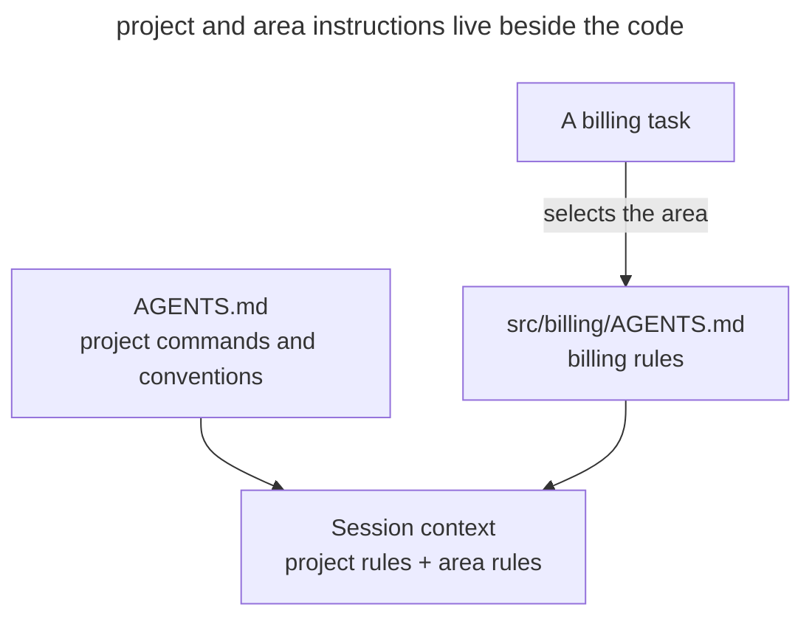

# Project Memory

## Intent

Keep a persistent file in the repository with the project's commands, conventions, and constraints, which the agent reads at the start of every session. You write a rule down once, and the following sessions get it from the file.

## Also known as

AGENTS.md, memory file, project rules, custom instructions.

## Problem

A new session may not know how the team builds the project and runs the tests. You explain the rules in the conversation, but the next session needs the same clarifications. This is most noticeable with a non-standard verification command.

For example, the agent runs the usual test script, although the project requires `make test` with fixture setup. You correct the command in the chat. If the rule is kept only in the conversation, a colleague in a new session will run into the same failure.

Project rules are needed across different tasks. It is more convenient to keep them separate from the specification of a particular feature.

## Solution

Create a file in the repository that the agent loads at startup. Write down in it the commands and non-obvious conventions that would otherwise have to be explained in every session. Specify module boundaries if the agent cannot reliably reconstruct them from the code.

Add to the file when you see a recurring need for context.

- the agent made the same mistake a second time;
- a review caught something the agent was obliged to know about this codebase;
- you are typing a clarification you already typed in the previous session;
- a new colleague would need the same context to be productive.

Keep the file under version control. Then the team can discuss edits in review, and new sessions get an agreed version of the rules.

The memory file guides the agent's behavior but does not guarantee the rules are followed. Enforce critical prohibitions, such as not writing to a protected branch, with permissions and hooks.

## Structure

The diagram combines project-wide instructions with rules for the chosen area. State in the root file when to read nested instructions: automatic discovery depends on the agent.



The root file stores shared commands; the nested file refines the rules for its directory. The agent needs both sources. Check which files it actually loaded before relying on a rule.

## Participants / Components

- **Root AGENTS.md** keeps team rules in git and goes through review.
- **Nested AGENTS.md** refines instructions for one area of the project.
- **Developer and team** add rules based on observed failures and review the file regularly.
- **Agent** reads applicable instructions and appends new rules on request.

## When to use

- The agent works in the repository regularly.
- The project's conventions diverge from the tools' default settings.
- Several developers and agents need shared working rules.

## Consequences and trade-offs

- ➕ New sessions get the saved rules without repeated explanations.
- ➕ The team keeps a shared version of the rules in git and discusses changes in review.
- ➕ Refining a rule takes only a small Markdown edit.
- ➖ Every line takes up space in the context of every session that reads the file (see [context engineering](context-engineering.md)).
- ➖ Without review, duplicates and contradictions accumulate in the file.
- ➖ Text instructions do not guarantee that critical prohibitions are respected.

## Implementation

### What does not depend on the agent

Create _AGENTS.md_ in the repository root. Record verified commands and conventions that are hard to infer from code. For example, "run `make test` before committing" specifies an observable action.

Keep the file short and add rules based on observed failures. Move area-specific rules to nested _AGENTS.md_ files; state in the root file which tasks require reading them. Keep team instructions in git and personal settings in the agent's user configuration.

The [AGENTS.md](https://agents.md/) convention provides a shared filename, but discovery depends on the tool. Verify that the required file loaded before relying on a rule. Check changed instructions on real tasks.

### Claude Code

Checked against Claude Code 2.1.316 on 2026-10-31.

#### Loading AGENTS.md

Claude Code supports native _AGENTS.md_ loading. In a new session, `/context` lets you inspect loaded instructions; `/config` opens the Project instructions choice. Project and organization settings affect loading. Root and nested files need no symlinks. See the [AGENTS.md documentation](https://code.claude.com/docs/en/memory#agentsmd).

##### Example

```text
/context
```

### Codex

Checked against Codex CLI 0.166.0 on 2026-10-31.

#### Loading AGENTS.md

Codex collects instructions from the project root toward the working directory. Nested _AGENTS.md_ files refine area rules. Check that required instructions fit within `project_doc_max_bytes`; a file on disk does not prove it loaded. See the [AGENTS.md guide](https://learn.chatgpt.com/docs/agent-configuration/agents-md).

##### Example

> Which AGENTS.md files apply in the current directory?

## Example

Below is a fragment of a small service's memory with commands and conventions that are hard to infer from the code.

```markdown
# Project: billing-service

## Commands
- Build and tests: `make test` (not `npm test` — containers are required)
- Local run: `make up`, sandbox on :8080

## Conventions
- Package manager — pnpm; the lock file is committed
- Commits — Conventional Commits, in English
- Migrations are never edited retroactively — only a new migration

## Boundaries
- Domains talk only through events; direct imports across
  `src/domains/*` are forbidden
- No sleep in tests — explicit waits only
```

The agent gets a task to add a failed-charge notification to billing. The memory says that domains interact through events, so the agent uses an event to trigger the notification. You do not have to repeat this rule in the task.

A week later, review finds that the agent ran `npm install` in a pnpm project. You extend the memory.

> Add a rule to AGENTS.md that dependencies are installed only through pnpm. State that package-lock.json must not appear in the repository.

The next session will get this rule when it reads the project memory.

## Anti-patterns and common mistakes

- **Bloated memory.** Duplicates and contradictions make it harder to find the applicable rules. This mistake is covered in a separate chapter, [Bloated Memory](bloated-agents-md.md).
- **A dump of derivables.** A retelling of the directory structure and dependencies takes up context, although the agent can get this information from the project files.
- **Expecting enforcement.** A text prohibition on pushing to main does not block the command. Enforce the boundary with permissions.
- **Personal content in the team file.** Keep personal sandbox URLs and the developer's preferences at the user or local level.
- **Write and forget.** Outdated instructions can steer the agent toward the wrong decision. Review them together with changes to the project.

## Known uses

- **Claude Code** supports native _AGENTS.md_ loading. Personal Auto memory notes are stored separately from team instructions.
- **AGENTS.md** sets a common instructions format for several agent tools.
- **Editor rules** implement the same idea through _.cursor/rules_ in Cursor and custom instructions in GitHub Copilot.
- **SDD toolkits** keep shared principles in the GitHub Spec Kit constitution, Kiro's steering files, and OpenSpec's context documents.

## Related patterns

- [Context Engineering](context-engineering.md) helps select information for the persistent memory file.
- [Domain Vocabulary](domain-context-file.md) supplements working instructions with definitions of the project's terms.
- [Spec-Driven Development](spec-driven-development.md) uses the project's conventions when preparing the specification and plan.
- [Bloated Memory](bloated-agents-md.md) describes a memory file that, without review, has accumulated duplicates, contradictions, and a retelling of the code.
- [Scheduled Maintenance](scheduled-maintenance.md) checks the memory file against practice once a month and removes what no longer helps.
