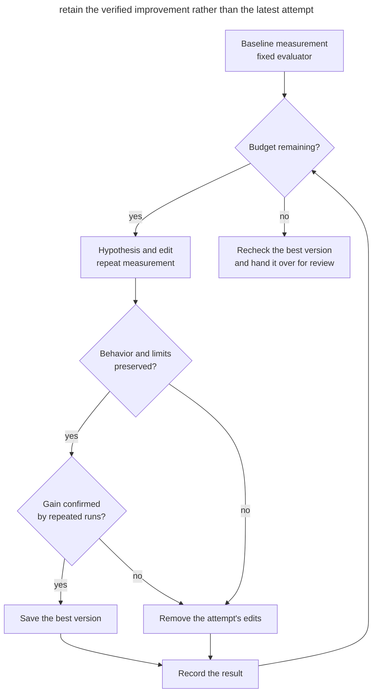

# Measured Optimization

## Intent

Give the agent a bounded series of performance experiments and retain improvements confirmed by repeated measurements and behavior checks.

## Also known as

Benchmark-guided optimization, experiment loop, autoresearch loop.

## Problem

You ask the agent to speed up search. It adds a result cache, shows an impressive number, and proposes accepting the change. The measurement repeats one query, so the answer is always cached. On real queries, the gain disappears while the memory cost and complexity remain.

Even a suitable benchmark can mislead. Another process loads the machine, one run happens to be lucky, and the agent mistakes noise for an improvement. After ten attempts, it is hard to tell which version was best and what was compared. If the agent can change the evaluator alongside the code, it can improve the score by reducing the workload or skipping work.

## Solution

Before experimenting, fix the workload, measurement method, and expected behavior. Choose a primary metric, such as processing time, and constraints the improvement must preserve: correctness, memory, compatibility. Reject an improvement that violates a constraint.

Establish the baseline over several runs. The agent proposes a hypothesis, changes code within the allowed area, repeats the same checks, and records the result. A confirmed gain becomes the new reference; a failed attempt stays in the log while its edits are removed. Keep the evaluator and data unchanged throughout the series.

Bound both each run and the entire series. When the budget is exhausted, the agent returns the best verified version and the remaining questions. If there is no improvement, the original implementation remains the result. Exhausting the budget ends the search but does not establish that the goal was achieved. You accept the change after repeating the checks and assessing its complexity.

## Structure

The diagram shows how each experiment updates the best saved version.



The log retains rejected experiments too. The best version is pinned to a separate commit. When the series ends, the agent separates any unfinished attempt's edits from that version and reports which checks it completed.

## Participants / Components

- **You** choose the workload, constraints, and budget, and accept the final change.
- **The agent** proposes hypotheses, conducts experiments, and records results.
- **The evaluation setup** measures the same work and checks correctness.
- **The baseline and best versions** let you repeat the comparison and restore verified code.
- **The experiment log** connects the hypothesis, code version, conditions, measurements, and decision.

## When to use

- There is a recurring expensive operation and a reproducible workload for it.
- Several implementations are possible, and choosing among them requires measurement.
- Performance matters to the task, and correctness can be checked separately.

If the cause of the delay is unknown, apply the approach from [Hypothesis-Driven Debugging](hypothesis-driven-debugging.md) first: reproduce the slowdown and test possible causes. A series of optimizations is useful once you know which work is worth speeding up and why.

## Consequences and trade-offs

- ➕ Decisions rest on comparable measurements and saved results.
- ➕ Failed attempts provide information for the next hypothesis.
- ➕ A total budget limits the cost of the search.
- ➖ An unrepresentative workload steers the search toward useless improvements.
- ➖ Repeated runs and correctness checks take time and resources.
- ➖ A local gain may not justify complexity or affect user-visible latency.

## Implementation

### What doesn't depend on the agent

#### Preparing the measurement

This is a plain task for the agent. Start with the project's existing profiler, load test, or benchmark. Choose scenarios from real use: input sizes, query distribution, cold starts, and warmed-up operation where both matter. A separate check must confirm the operation's result, including ordering, errors, and side effects where they are part of the contract.

Agree on a consistent environment and several repetitions. Alternate runs of the candidate and current best version within the same measurement batch so that changes in machine load do not become apparent gains. For execution time, you can compare medians while retaining individual measurements and their spread. Choose the threshold for a useful gain before experimenting, accounting for noise in the baseline runs; reassess the spread for each new best version too. Version the evaluator and data in the repository. If you discover a measurement error, fix it separately and establish a new baseline for comparison.

##### Example

```text
Prepare a measurement of search response construction time
```

#### Running the experiments

Record the allowed edit area and budget in the task. For example, allow changes to the search module and allocate eight attempts or 45 minutes, whichever comes first. That time includes baseline measurements and final verification; reserve time for the latter in advance. A hanging run needs its own timeout. Start an attempt only if its timeout will expire before the reserve begins. If final verification cannot finish within the total budget, the agent marks it incomplete. This limit is your choice for the task, not a model property.

After you approve the plan, the agent works on a separate branch or in a [worktree](isolated-parallel-work.md). Each attempt has a testable hypothesis and a saved code version. Pin the best result to a commit. Keep the log and raw measurements outside the area the agent restores when rejecting an attempt. The log includes crashes, memory overruns, and attempts with no gain. When rejecting an attempt, the agent removes only its edits and continues from the best version. The limit includes repairs to failed experiments: a crash does not reset the counter.

##### Example

The conditions for the series are already recorded in the ticket:

```text
PERF-42
```

#### Accepting the best version

At the end, repeat the comparison of the baseline and chosen versions under the same conditions, then run the relevant tests and required project checks. Verify that the final diff does not change the fixed evaluator, data, or correctness tests. An additional workload that was not used during tuning helps expose overfitting to the working benchmark. You assess whether the gain justifies the added complexity and preserves compatibility. If the repeated check does not confirm the gain, retain the baseline version and the log of findings.

The result includes the diff, code versions, run conditions, measurements, and rejected hypotheses. If the goal concerns production traffic, continue with [verification after deployment](give-agent-a-way-to-verify.md#verification-after-deployment). A successful microbenchmark establishes only the gain it measured.

##### Example

```text
Recheck the best PERF-42 version against the acceptance scenarios
```

## Example

In this teaching example, search sorts every matching document even though the response contains only the first 20. You fix several query sets, a check of the exact result, and a 64 MB memory limit. Baseline runs have a median of 42.1 ms with roughly 2% variation; you consider gains of at least 5% useful. Below is a log summary with illustrative version labels; individual measurements are saved alongside it. The numbers illustrate the mechanism; they are not results from running code in the book repository.

```console
trial  rev   runs  median_ms  min_ms  max_ms  peak_mb  correct  decision
0      base  7     42.1       41.4    42.8    18       pass     baseline
1      try1  7     41.8       41.0    42.6    18       pass     discard: small gain
2      try2  7     28.4       27.9    29.0    19       pass     keep: top-k selection
3      try3  7     23.1       22.7    23.6    19       fail     discard: tie order
4      try4  7     24.0       23.5    24.5    96       pass     discard: memory
```

The second attempt preserves the exact order of tied scores and selects the required documents without a full sort. The third is faster but changes that order; the fourth exceeds the memory limit. After the fourth attempt, the time reserved for final verification begins. The rejected attempts' edits have already been removed, so the working version matches the second attempt. The agent repeats its checks on additional queries. You receive a change with verified applicability limits and a log explaining why faster variants were rejected.

## Anti-patterns and common mistakes

- **One lucky run.** Repeat the comparison and inspect the spread before attributing the difference to code.
- **Changing the yardstick.** Reducing the data or weakening a check makes the result incomparable. After a necessary evaluator fix, measure the baseline version again.
- **Speed alone.** A broken contract, excessive memory use, or incompatibility cancels the gain.
- **Tuning for the example.** One repeated query rewards a cache that does not help real traffic.
- **Endless search.** A per-attempt timeout does not bound the cost of the entire series. Set a total limit and preserve the result when it ends.
- **The latest version instead of the best.** A failed experiment must not displace a verified improvement.
- **Speed at any cost.** A small saving may not justify a complex new code path.

## Known uses

- **Google's [ADK optimization case study](https://developers.googleblog.com/optimizing-a-200000-line-python-codebase-overnight-with-gemini-4-argon/)** describes six agent proposals, of which two were accepted. An independent benchmark found no end-to-end gain from one rewrite; reviewers rejected fragile solutions. Internal tests required a compatibility fix to the import optimization before acceptance. This is one project's experience.
- **Andrej Karpathy's autoresearch** specifies a [fixed evaluation, editable file, and experiment log](https://github.com/karpathy/autoresearch/blob/228791fb499afffb54b46200aca536f79142f117/program.md). The original experiment concerns model training and continues until manually stopped. Here, the mechanism is adapted to program optimization with an explicit total budget.

## Related patterns

- [Feedback Loop](give-agent-a-way-to-verify.md) checks task completion; here, several correct variants are compared by measured improvement.
- [Agent Workflow Evals](agent-workflow-evals.md) evaluate the agent's instructions and behavior. Here, the subject is the program the agent changes.
- [Hypothesis-Driven Debugging](hypothesis-driven-debugging.md) establishes the cause of a failure before selecting a fix; the same approach applies to an unexplained slowdown.
- [Isolated Parallel Work](isolated-parallel-work.md) separates experiments from other tasks. Parallel measurements on a shared machine can interfere with one another.
