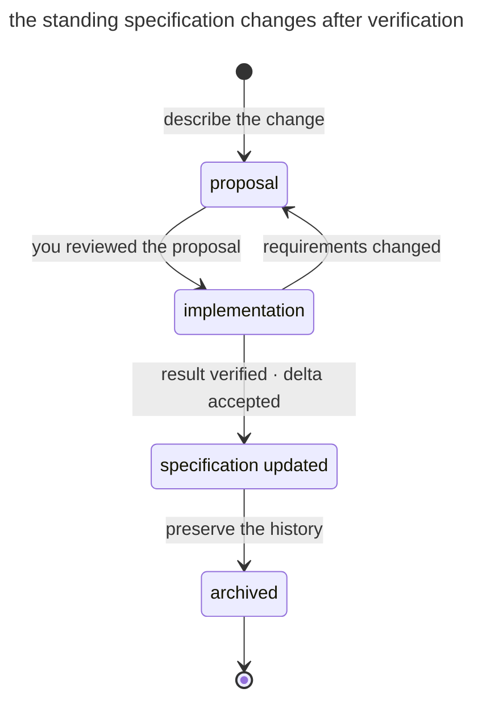

# OpenSpec

_Commands and capabilities of OpenSpec 2.1.1 checked on November 21, 2026._

[OpenSpec](https://github.com/Fission-AI/OpenSpec) by Fission-AI organizes [SDD](spec-driven-development.md) around a **change** with propose, review, apply and archive stages. Standing specifications describe the system, and deltas record proposed changes to the requirements.

OpenSpec supports various coding agents and assistants, including Claude Code, Codex, Cursor and GitHub Copilot.

## Workflow

OpenSpec keeps requirements across tasks. You discuss a specific change, review the proposal, then move to implementation. Setup is covered in the [official guide](https://openspec.dev/docs/installation).

The `/openspec-explore` skill helps investigate the code and compare approaches. Once the task is clear, `/openspec-propose` prepares a package: the reason for the change, requirement deltas, the technical approach and tasks. You check that it describes the intended behavior, including errors and boundary cases.

After approval, `/openspec-apply-change` carries out the tasks. If requirements change during the work, update the proposal and related artifacts first. At completion, `/openspec-archive-change` offers to merge the deltas into the standing specifications and preserves the package in the archive. See the [OpenSpec documentation](https://openspec.dev/docs/quickstart) for the procedures.

The diagram shows how a proposal becomes the new state of the specification.



Until the delta is accepted, the standing specification describes the previous behavior. The archive keeps the reasons for the change; the team decides whether archiving happens before or after the merge.

For example, you want to change the webhook cutoff policy:

```text
/openspec-propose disable a webhook after ten consecutive failures
```

The agent prepares the proposal, you review the new threshold and scenarios, then move to implementation. In Codex, skills use `$`, such as `$openspec-propose`; select the available skill in your agent's menu.

## Artifacts

The _openspec/_ directory separates standing specifications from change packages.

| Path | What lives there |
| ------ | ----------- |
| _openspec/specs/_ | Standing specifications — the current model of what is _already built_ |
| _openspec/changes/\<change\>/proposal.md_ | Why we are changing this |
| _openspec/changes/\<change\>/specs/_ | Requirement deltas with concrete scenarios |
| _openspec/changes/\<change\>/design.md_ | Technical approach |
| _openspec/changes/\<change\>/tasks.md_ | Implementation checklist |
| _openspec/changes/archive/_ | Completed changes |

## Example of a requirement change

In an event delivery service, a webhook is disabled after five consecutive failures. The standing specification in _openspec/specs/webhooks/spec.md_ contains this rule.

```markdown
### Requirement: Delivery failure cutoff
The system SHALL disable a webhook after five consecutive failed attempts.

#### Scenario: Failed deliveries reach cutoff
- **WHEN** the fifth consecutive delivery attempt fails
- **THEN** the webhook is disabled
```

The team agreed on a different threshold for temporarily unavailable recipients. In the change package, the agent creates a delta in _openspec/changes/raise-cutoff/specs/webhooks/spec.md_. For the modified requirement it keeps the heading and gives the new requirement with its scenario in full.

```markdown
## MODIFIED Requirements

### Requirement: Delivery failure cutoff
The system SHALL disable a webhook after ten consecutive failed attempts.

#### Scenario: Failed deliveries reach cutoff
- **WHEN** the tenth consecutive delivery attempt fails
- **THEN** the webhook is disabled
```

In this example `MODIFIED Requirements` marks the replacement of an existing requirement. After implementation and verification, the team confirms the sync during `/openspec-archive-change`. In the standing _spec.md_, the `Delivery failure cutoff` requirement now holds the threshold of ten and the matching scenario; the `MODIFIED Requirements` marker remains part of the archived delta. If the proposal is rejected, the standing rule with the threshold of five does not change. The format of sections and scenarios is described in the [OpenSpec documentation](https://github.com/Fission-AI/OpenSpec/blob/main/docs/concepts.md).

## What makes it different

- Standing specifications describe the system's current required behavior.
- A delta records the difference between the current and the proposed requirements.
- The process is designed for successive changes to an existing codebase.
- Shared specifications help the team agree on requirements and the history of their changes.

## When to choose it

OpenSpec fits an existing system whose requirements need to be maintained alongside the code. For a skill-based process with mandatory checkpoints, consider [Superpowers](superpowers.md), and for working through an issue tracker, compare [Matt Pocock's pack](matt-pocock-skills.md).
