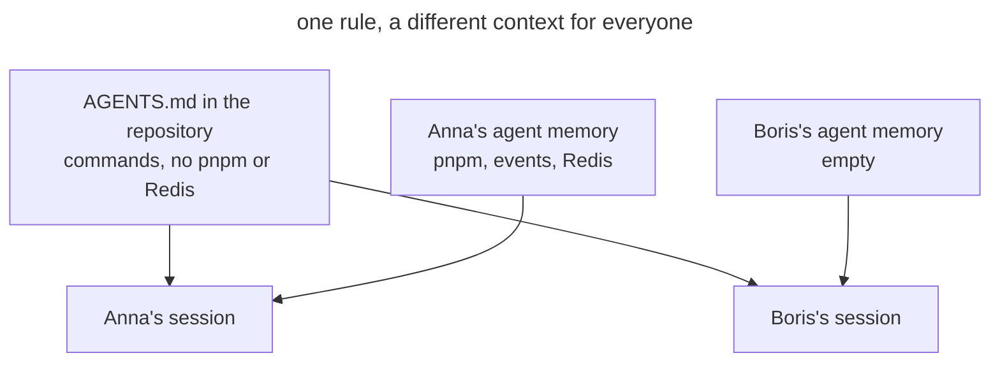

# Private Memory

## Also known as

Private agent memory, auto memory, Memories, personal agent memory.

## Context

The agent can keep its own notes about the project and load them in later sessions. You correct it in the chat or say "remember", and it writes the conclusion into its memory. That memory lives outside the repository: in your home directory or in your account on the vendor's side. In Claude Code this memory is on by default.

## Problem

Project knowledge settles in the agent's private memory instead of the repository. A rule the agent drew from your corrections works only on your machine. Your teammate, CI, and another agent don't have it. Each team member gradually gets their own context, and the same request makes the agent behave differently for different people.

## Why people do it

- Memory is on by default, and people only learn it exists from a "Saved 2 memories" message.
- Saying "remember" is faster than opening _AGENTS.md_ and phrasing a rule for everyone.
- The correction helps right away: on your machine the agent stops making the mistake, so the problem stays invisible.
- Memory feels like a personal setting, like an editor theme, even though it accumulates facts about the project's code and commands.

## Consequences

- ➖ The agent behaves differently for different people, and a "my agent doesn't do that" bug can't be reproduced.
- ➖ Rules skip review: nobody sees what the agent concluded from the corrections or whether it got it wrong.
- ➖ Entries go stale unnoticed. The project moved to another package manager, but memory still suggests the old one.
- ➖ Knowledge leaves with the person or the machine: a new laptop or a new teammate starts from zero.
- ➖ Memory and _AGENTS.md_ drift apart, and the agent gets conflicting instructions from two sources.

## Signs

- The agent's interface shows messages about saved or recalled memories.
- A teammate complains about an agent mistake you "fixed" long ago.
- _AGENTS.md_ lacks a rule your agent follows without a reminder.
- You tell the agent "remember" rather than "add to AGENTS.md".
- The agent's memory directory holds build commands, conventions, and module boundaries.

## A better way

Turn agent memory off in a team project so that the setting lives in the repository and applies to everyone. You can keep memory on globally for personal projects: turning it off in the project overrides that. Write everything the agent needs to know about the project into [project memory](agents-md-memory.md), the [domain vocabulary](domain-context-file.md), and other files that go through review. Your own preferences, such as the response language or commit style, you write yourself into the agent's user instruction file. Then every rule has an author and a change history, and sessions of different people start from the same context.

### What doesn't depend on the agent

#### Moving accumulated memory

This is a plain prompt you run once before turning memory off. The agent reads its memory about the project and sorts the entries: commands and conventions into _AGENTS.md_, terms into the glossary, your personal preferences into the user instruction file. It doesn't carry over stale or wrong entries. You check the diff in review, after which the agent deletes the original entries.

##### Example

```text
Move your memory about this project into the repository
```

#### A rule instead of "remember"

When a correction concerns the project, ask the agent to add a rule to _AGENTS.md_ rather than remember it. A "remember" request is addressed to the agent, and wherever memory is on, the entry settles with it. An _AGENTS.md_ edit lands in a commit, and the team sees it in review.

##### Example

```text
Add to AGENTS.md: install dependencies with pnpm only
```

### Claude Code

Checked against Claude Code 2.1.316 and the [memory documentation](https://code.claude.com/docs/en/memory) on 2026-10-31.

#### Auto memory

Auto memory is a built-in feature, and in local sessions it is on by default. Claude decides on its own what to save and writes notes to _~/.claude/projects/&lt;project&gt;/memory/_; the index of these notes loads into every session. The memory is tied to the repository and the machine and isn't shared with teammates, other machines, or cloud environments. When you say "remember", Claude writes to auto memory, and to the project instructions only if you ask for that explicitly.

Ask Claude to turn auto memory off in the project. It writes this into the project settings, which are committed with the code, so auto memory turns off for the whole team while staying on in your other projects. The toggle in `/memory` turns it off only for you, and in all projects at once.

##### Example

```text
Turn off auto memory in this project for the whole team
```

### Codex

Checked against Codex CLI 0.166.0 and the [Memories documentation](https://learn.chatgpt.com/docs/customization/memories) on 2026-10-31.

#### Memories

Memories is a built-in feature that is off by default. If you turned it on, Codex generates entries from past sessions and keeps them in _~/.codex/memories/_ as one store for the whole machine. The documentation itself advises keeping required team rules in _AGENTS.md_ and calls Memories a helpful recall layer.

If Memories is on globally for you, ask Codex to turn it off in the team project. It writes this into the project config; commit it so the setting applies to your teammates. Codex reads project config only in trusted projects, and there it overrides the user config. We checked this in practice on Codex CLI 0.166.0.

##### Example

```text
Turn off Memories in this project, keep it on globally
```

## Example

**Before**

> Over two weeks of work, Anna's auto memory has collected three entries: "the package manager is pnpm", "domains talk through events", "API tests need a local Redis". For Anna the agent does everything right. Boris picks up a task in the same repository, and his agent runs `npm install`, calls the notification service directly, and fails the tests without Redis.



In the diagram both sessions read the same _AGENTS.md_, but Anna's session also gets three rules from her private memory. Boris's session doesn't see them, and the same request leads to a different result.

**After**

> Anna asks the agent to move its memory into the repository. The three rules land in _AGENTS.md_ and go through review, where Boris adds the command that starts Redis. In the same PR the agent turns auto memory off in the project settings. Boris's next session installs dependencies with pnpm and triggers notifications through an event.

## Related patterns and anti-patterns

- [Project Memory](agents-md-memory.md) is where rules from the agent's private memory move to.
- [Domain Vocabulary](domain-context-file.md) takes the terms the agent would otherwise remember on its own.
- [Bloated Memory](bloated-agents-md.md) describes the opposite trouble: the shared file has the rules, but too many of them.
- [Scheduled Maintenance](scheduled-maintenance.md) includes a pass over agent memory for those who haven't turned it off yet.
