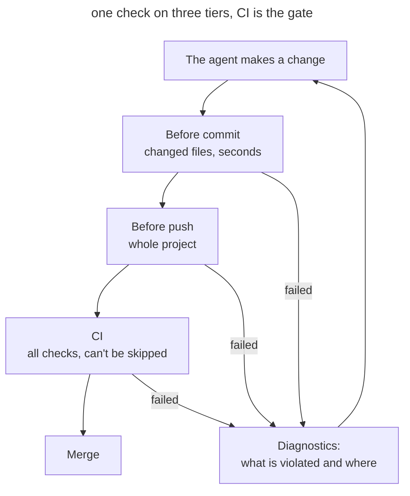

# Quality Gates

## Intent

Enforce the project's code standards with deterministic checks that run on every change and fail the build on a violation. The agent gets the signal immediately and fixes the problem itself, and the rule applies equally to every author, agent and machine.

## Also known as

Quality gates, enforcement as code, required checks, lint gates.

## Problem

The agent writes a lot of code, fast. It follows standards from _AGENTS.md_ such as "domains talk only through events" or "don't leave unused dependencies" probabilistically: in a long session the rule gets lost among the rest of the context. Review doesn't keep up either. The diff is large, attention goes to style, and a module-boundary violation slips through. Every such review comment is one a machine could have made in a second.

Projects often have linters already, but they don't work as a gate. Some print warnings and exit successfully, some run only in the editor, some sit in a hook that is easy to skip. The agent doesn't see such a signal or doesn't treat it as mandatory. People on the team use different agents and settings, and the only thing everyone sees is the repository and CI.

## Solution

Turn every unambiguously checkable rule into a tool that exits non-zero on a violation. One `check` command runs all checks, and CI calls the same command, so a local run and CI cannot drift apart.

The checks sit on three tiers. Before a commit, changed files are checked in seconds: formatting, linters, secrets, commit message format. Before a push, the whole project is checked: types, the full lint, dependencies. CI runs everything, including checks that need the network or a database. A hook is a convenience; only CI is a gate, because it can't be skipped.

_AGENTS.md_ records the command and the rule: a change is not done until `check` passes. The agent runs it on its own, reads the diagnostics and fixes the code. Rules are never turned off to get a green build: an exception is narrow, one path and one rule, with a reason and a human decision. On old code a new check fails, so introduce it with a baseline: new violations fail the build, old ones are listed and worked through gradually. Every check is seen failing once; otherwise nobody knows it works.

An instruction without a check is advice. If a rule can be checked, add the check and remove the line from _AGENTS.md_.

## Structure

In the diagram one change passes three tiers of checks. All tiers run the same command with a different scope.



The agent gets the error at the earliest tier that catches it and fixes it before review. If the hook was skipped or a teammate never installed it, CI stops the same violation.

## Participants / Components

- **A check tool** — linter, type checker, architecture rules, secret scanner — exits non-zero on a violation.
- **The `check` command** runs all checks the same way on a developer's machine and in CI.
- **Hooks** run the fast part of the checks before commit and push.
- **CI** runs everything and protects the target branch.
- **A baseline** records existing violations so that only new ones fail.
- **The agent** runs `check`, reads the diagnostics and fixes the code.
- **The developer** chooses the rules, approves exceptions and turns recurring review comments into checks.

## When to use

- The agent regularly writes code in the repository.
- The same review comments keep coming back.
- Several people or several agents work on the project.
- The standard can be stated unambiguously: a module boundary, a banned call, formatting, unused code.

## Consequences and trade-offs

- ➕ The agent fixes violations itself, before review and without your involvement.
- ➕ Review is freed up for what the change means: architecture, requirements, risks.
- ➕ A rule applies the same way for every author, in every agent and on every machine.
- ➕ Rules that became checks leave _AGENTS.md_, and project memory gets shorter.
- ➖ Adoption on old code needs a baseline and gradual cleanup.
- ➖ Slow checks slow the agent's loop down, so they move to the push tier and CI.
- ➖ The agent may "fix" the check instead of the code: turn off a rule or widen an ignore list. Exceptions need to be looked at in review.
- ➖ A check covers only what can be formalized. Whatever needs judgment stays with review.

## Implementation

### What doesn't depend on the agent

#### Adopting the gates

This is a plain prompt in plan mode. The agent studies the project: languages, package managers, existing linters, hooks and CI. Based on the stack it chooses tools, combines them into one `check` command, wires it into hooks and CI, sets up a baseline for old code and adds the rule to _AGENTS.md_. The plan shows what it will add, what it will keep as is, and why. After implementing, the agent shows that each new check can fail.

A curated list helps with choosing tools. [Dev Quality Gates](https://github.com/mokevnin/dev-quality-gates) recommends one tool per job, with its limits, and includes adoption instructions for the agent ([instructions](https://github.com/mokevnin/dev-quality-gates/blob/main/docs/adopt.md)). The list is maintained by the author of this book. Run the adoption once per project, and again when the stack changes.

##### Example

```text
Apply https://github.com/mokevnin/dev-quality-gates to this repository
```

#### A check from a review comment

This is a plain prompt. When the same comment shows up in review a second time, ask the agent to turn it into a check. The agent picks a suitable tool or writes a rule for one that is already wired in, tests it against the current code and adds it to `check`. Write the error message so that it says how to fix the violation: the agent reads it.

##### Example

```text
Turn this comment into a check so CI catches it on its own
```

### Claude Code

Checked against Claude Code 2.1.316 and the [hooks documentation](https://code.claude.com/docs/en/hooks) on 2026-10-31.

#### A check before the reply ends

A Stop hook is a built-in Claude Code feature. The hook runs a command when Claude is about to finish its reply. If the check fails, Claude gets its output and keeps working instead of reporting that it's done. Hooks from the project settings are committed with the code and apply to the whole team. Put the fast part of the checks into such a hook and leave the full set to CI.

##### Example

```text
Add a hook for the whole team: run the fast checks before finishing a reply and keep working until they pass
```

### Codex

Checked against Codex CLI 0.166.0 and the [hooks documentation](https://learn.chatgpt.com/docs/hooks) on 2026-10-31.

#### A check before the reply ends

A Stop hook is a built-in Codex feature. If the check fails, the hook sends Codex back to work, and the reason becomes a new prompt. Project hooks live in the repository but load only in a trusted project, and each teammate reviews and trusts a new or changed hook once in `/hooks`. So after such a change, give your teammates a heads-up.

##### Example

```text
Add a hook for the whole team: run the fast checks before finishing a reply and keep working until they pass
```

## Example

A billing service lives with a rule in _AGENTS.md_: domains talk only through events. The agent adds a notification about a failed charge and imports the notification client directly from the neighboring domain. Along the way it installs a date-formatting package and then stops using it. A reviewer finds both violations a day later, and the agent redoes the work.

You run the gate adoption. The agent wires in a rule for boundaries between domains and a search for unused dependencies, combines them into `check` together with the existing linter and type checker, puts the fast part into the pre-commit hook and everything into CI. For two old boundary violations it sets up a baseline. The line about events in _AGENTS.md_ is replaced by the rule "a change is not done until `mise run check` passes".

The next similar task runs into the check before the commit:

```text
src/billing/notify.ts → src/notifications/client.ts
  violated: domains talk only through events
  fix: publish PaymentFailed, subscriber in src/notifications
```

The agent publishes the event, removes the unused package and reruns `check`. The diff that reaches review has neither problem, and the reviewer looks at the notification logic itself.

## Anti-patterns and common mistakes

- **A check only in a hook.** A hook can be skipped or never installed. Without CI the rule isn't mandatory.
- **Warnings instead of errors.** A tool that exits successfully on a violation isn't a signal the agent acts on.
- **A green build at any cost.** The agent turns off a rule or widens an ignore list. Exceptions must be narrow and go through review.
- **A new check without a baseline.** Thousands of old errors push the agent either to fix everything in sight or to turn the rule off.
- **A check nobody has seen failing.** A wrong path or config gives a gate that is always green.
- **Everything at once.** Tools for categories the project doesn't have only slow the loop down.

## Known uses

- **Dev Quality Gates** collects one tool per job, describes the run tiers, baselines and exceptions, and gives the agent adoption instructions.
- **This book's repository** runs jactionlint, betterleaks, typos, rumdl, agnix and oxlint with one `mise run check` command through hk, and CI calls the same command.
- **Boris Cherny** says he turns recurring review comments into lint rules by tagging `@claude` right in the PR ([podcast](https://youtu.be/julbw1JuAz0?t=2715)).
- **Birgitta Böckeler** describes dependency rules and linters with repair advice as maintainability sensors for the agent ([article](https://martinfowler.com/articles/sensors-for-coding-agents.html)).

## Related patterns

- [Feedback Loop](give-agent-a-way-to-verify.md) sets up a check for one task, while quality gates enforce the whole project's standards on every change.
- [Executable Guardrails](executable-guardrails.md) limit the agent's actions in the environment, while quality gates check the code it leaves behind.
- [Project Memory](agents-md-memory.md) holds the `check` command and the rule to run it.
- [Bloated Memory](bloated-agents-md.md) shrinks when checkable rules move into checks.
- [Writer and Reviewer](writer-reviewer.md) remains for what needs judgment.
