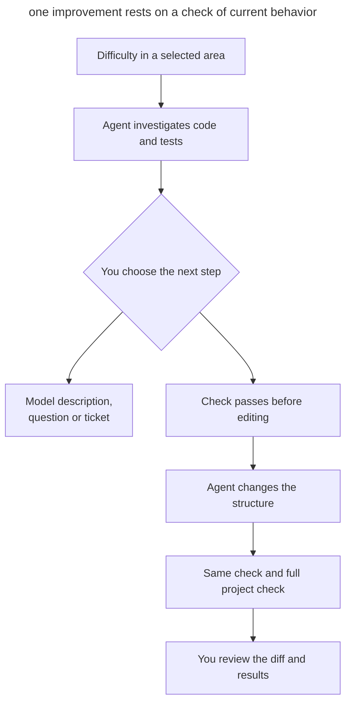
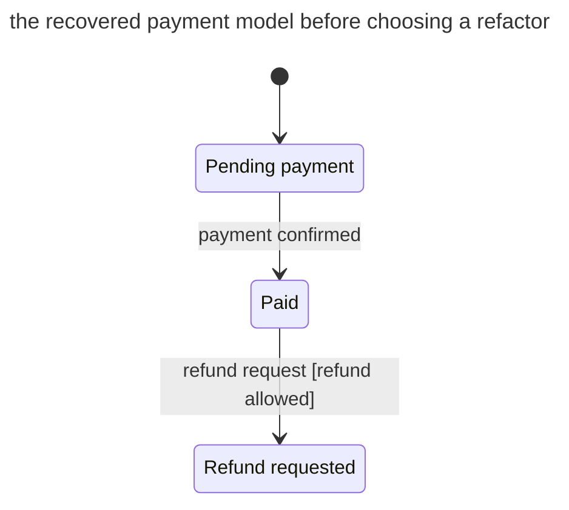
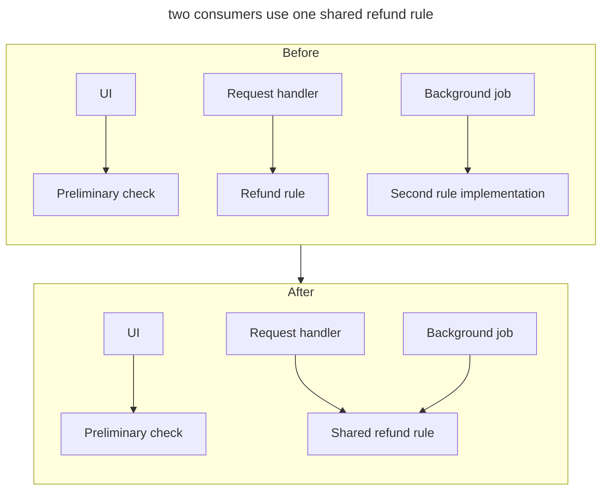

# Refactoring

## Intent

Work with an agent to simplify existing code through small, verifiable changes while preserving observable behavior. You choose the difficulty worth removing, validate the model the agent recovers, and accept the change based on the checks.

## Also known as

Agent-assisted refactoring, structural simplification.

## Problem

Adding one refund condition requires changing a request handler, a background job, and a UI check. An agent readily finds similar expressions and suggests a shared helper. Yet one expression may determine whether to show a button, while another determines final refund eligibility. Merging them based on code similarity changes the rule without you noticing.

“Improve the architecture” leaves the agent too much freedom. It may add layers, rename dozens of entities, and upgrade dependencies in one diff. Even passing tests say little about behavior preservation if the agent also rewrote their expectations to match the new implementation.

## Solution

Start with a concrete difficulty: one rule needs edits in several places, a state transition is hard to trace, or checking a calculation requires external services. In planning mode, the agent investigates the selected area, links its findings to code and tests, and proposes a change. You assess whether it actually makes the next task easier.

Separate recovering a model from changing it. A description of states may be a sufficient investigation result. An unclear field combination becomes a domain question; a discovered bug becomes a separate task. Refactoring changes structure while preserving [observable behavior](https://refactoring.com/).

Before editing, identify how the current contract is checked. If a needed scenario has no test, capture it through the existing public interface first. After plan approval, the agent performs the selected transformation and repeats the check. Handle independent improvements separately so each has a clear reason and a verifiable result.

## Structure

The check connects the original behavior to the result of the change. Investigation can end with a model description, a question, or a ticket without code edits.



If the check fails after editing, the agent investigates the difference against the original contract. Replacing the expected result needs separate justification: it may conceal a behavior change.

## Participants / Components

- **You** choose the area, validate the meaning of rules, and approve the change plan.
- **Agent** investigates code, proposes a transformation, edits, and reports check results.
- **Contract** defines behavior to preserve: results, errors, external calls, and their order.
- **Checks** observe that contract before and after the change.

## When to use

- Small tasks repeatedly require coordinated edits in several places.
- You have to reconstruct the meaning of states or business rules from conditions each time.
- Unnecessary layers make calls and module responsibilities hard to follow.
- You need to simplify an area before adding a feature there.

## Consequences and trade-offs

- ➕ You assess value against a concrete next task and can see the reason for each change.
- ➕ Checks through a public boundary remain useful as internal code is reorganized.
- ➕ Investigation exposes unclear rules before they become a new abstraction.
- ➖ Weak coverage means recovering the contract and adding checks first.
- ➖ The agent may mistake accidental similarity for a shared rule; you confirm its meaning.
- ➖ Broad changes to a shared interface require a coordinated consumer migration.

## Implementation

### Approach that does not depend on the agent

#### Choosing a change and checking behavior

Start where a change is already difficult. The agent shows which places you have to read or edit together and explains how the transformation will reduce that work. Fewer lines alone do not mean clearer code. A useful improvement may remove a layer, consolidate a confirmed rule, or make a calculation independently testable.

An agent aiming for the smallest diff may repeat a flaw in the surrounding code. Allow it to propose a broader improvement and explain the benefit; you choose its scope with the cause of the difficulty and current requirements in mind.

The plan should expose the existing contract and a check that observes it. For a calculation, that may mean results and rounding; for a refund, also repeated requests, the order of writes and messages, and error handling. If checks already fail, establish why first: you need an understood baseline. After editing, the agent runs the relevant checks and the project's full `check`.

Keep the change focused on the task, including every necessary caller and test update. If the team controls all consumers of an internal interface, you can update them in one coordinated change. For an external API, account for its compatibility contract. Split a broad replacement into expand–contract: add the new form, migrate consumers, then remove the old one; [Tracer-Bullet Tickets](tracer-bullet-tickets.md) describes this order.

A small improvement fits before the feature that needs it, as a separately verifiable step. [Continuous refactoring](https://martinfowler.com/bliki/OpportunisticRefactoring.html) is complemented by recurring candidate discovery in [Scheduled Maintenance](scheduled-maintenance.md).

##### Example

```text
Simplify the refund eligibility check in payments
```

#### Implicit state machines

This plain prompt finds lifecycles hidden in statuses, flags, nullable fields, dates and conditionals. The agent proposes state names, events, transition conditions and actions, linking them to code and tests. The description draws on [states and transitions](https://www.w3.org/TR/scxml/#Core); a diagram exposes a transition that would otherwise need to be reconstructed from several handlers.

Separate behavior confirmed by code from inferred rules. A combination such as "payment pending, settlement date populated" might be a bug, a valid intermediate state or residue from an old migration. Describe independent payment and notification-delivery states separately: [parallel states](https://stately.ai/docs/parallel-states) need not become a single enum. First validate the model, then decide whether to refactor and which representation fits.

Start with one domain area where flags and branches keep appearing. Work through questions about allowed transitions together with the agent.

##### Example

```text
Find implicit state machines in payments and propose their descriptions
```

#### Scattered business rules

This is a plain prompt. The agent looks for one rule repeated across handlers, policies and background jobs, showing differences with code references. For example, refund eligibility might be computed differently in the UI and a payment-processing job. You determine whether the discrepancy is accidental or the conditions express different rules. This pass complements [terminology checks](domain-context-file.md): the same name does not guarantee the same behavior.

Run it after a series of changes in one area or when one change repeatedly requires edits in several places. Consolidate implementations after confirming the shared rule.

##### Example

```text
Find payment business rules implemented in multiple places
```

#### Unnecessary abstractions

This plain prompt finds layers that make you read more files while hiding little complexity. The agent shows calling code before and after removing the layer and explains where its responsibility would go. In Fowler's catalog, [Inline Class](https://refactoring.com/catalog/inlineClass.html) is the inverse of extracting a class: removing an abstraction can be an improvement.

Check extension points built for future requirements too. If the project exports one format, a universal plugin system may complicate its only scenario. Before simplifying it, the agent checks actual callers and extension commitments: removing a layer must preserve the whole current scenario, including error handling.

Run it on an area where even a small task requires jumping between many files. Use the skill in the Architecture section below to work through the selected change.

##### Example

```text
Find abstractions in app/services that could be removed
```

#### Concepts hidden in primitives

This plain prompt finds domain values represented as strings and numbers with repeated validation, conversions and comparisons around them. The agent proposes a concept name and its invariants. Money, for example, may need an amount and currency stored together; a duration may need an explicit unit. [Replace Primitive with Object](https://refactoring.com/catalog/replacePrimitiveWithObject.html) illustrates this direction; its value comes from the shared rule it expresses.

Run it on an area where the same values are validated in several places or units get confused. Agree on the glossary term, then choose a representation.

##### Example

```text
Find domain concepts in payments hidden in strings and numbers
```

#### Calculations and effects

This is a plain prompt. The agent shows where a price calculation or refund decision is entangled with database writes, network requests or messages. It then proposes a boundary where the decision can be checked independently. Fowler's [Separate Query from Modifier](https://refactoring.com/catalog/separateQueryFromModifier.html) separates calculating an amount from sending a bill.

Run it where checking a business rule requires starting external services. When refactoring, also verify effect ordering, error handling and transaction boundaries: the same final result alone does not prove behavior stayed stable.

##### Example

```text
Find places in payments where calculations are mixed with side effects
```

#### Dead code and workarounds

This plain prompt looks for unused branches, completed feature flags and compatibility that is no longer needed. Start with the project's [unused-code checks](quality-gates.md), then have the agent investigate remaining candidates. Deletion needs evidence about callers, entry points and supported versions. A missing static reference does not rule out calls through configuration, reflection or an external consumer.

Run it after completing a migration or removing an old feature. If the support period is unknown, the result is a question for the compatibility owner, rather than a deleted branch.

##### Example

```text
Find dead code and obsolete workarounds in payments
```

#### Architecture

This is the `improve-codebase-architecture` skill from [Matt Pocock's pack](matt-pocock-skills.md) ([source](https://github.com/mattpocock/skills/tree/4ae2317ddb22b046e26455e4f9c9b3aaaf62212d/skills/engineering/improve-codebase-architecture)). It loads `codebase-design` and `grilling` itself. The plan becomes tickets with the `to-tickets` skill ([source](https://github.com/mattpocock/skills/tree/4ae2317ddb22b046e26455e4f9c9b3aaaf62212d/skills/engineering/to-tickets)).

The skill takes its vocabulary from `codebase-design`: module, interface, depth, seam, adapter. Then it reads _GLOSSARY.md_ and the ADRs of the chosen area, and a sub-agent walks the code looking for friction: understanding one concept means bouncing between many small modules; an interface is nearly as complex as its implementation; modules leak into each other across seams. Suspicious modules get the deletion test: if you deleted the module, would the complexity concentrate in one place or just move? The skill presents candidates as an HTML report in a temp folder. For the chosen candidate it runs `grilling` and, if you want, compares interface options with [Design It Twice](design-it-twice.md). `to-tickets` turns the agreed plan into verifiable tickets with blocking edges and publishes them to the tracker.

Use the skill with the agent when several connected modules make changes difficult. Compare interface options after selecting a concrete difficulty; plan broad mechanical replacements through expand–contract.

##### Example

```text
/improve-codebase-architecture app/services
```

After working through the chosen place, run `/to-tickets`.

### Claude Code

Simplification details were checked against Claude Code 2.1.319 and the [command reference](https://code.claude.com/docs/en/commands) on 2026-11-07.

#### Simplification: `/simplify`

`/simplify` is a bundled skill. Four sub-agents check reuse, simplification, efficiency, and abstraction level in parallel, then the findings are fixed. You can pass a path or PR reference. The skill does not look for correctness bugs ([documentation](https://code.claude.com/docs/en/commands)).

Run it to simplify a selected area after understanding its behavior. Before invoking it, make sure the current contract check passes. Repeat that check after editing: a readability review does not prove that results, errors, and effects stayed the same.

##### Example

```text
/simplify app/services
```

### Codex

This block was checked against Codex CLI 0.167.0 and the [refactoring guide](https://learn.chatgpt.com/use-cases/refactor-your-codebase) on 2026-11-07.

[OpenAI's refactoring guide](https://learn.chatgpt.com/use-cases/refactor-your-codebase) describes small passes with behavior checks. The general requests above work in Codex too.

#### A repeatable pass as a skill

Once several real passes have shown which inputs and results help your team, use the built-in `$skill-creator` skill ([documentation](https://learn.chatgpt.com/docs/build-skills)). In the current session it already has the context of the completed pass. Test the new skill on another area before putting it on a schedule.

##### Example

```text
$skill-creator
```

## Example

In this illustrative example, you are adding a refund condition and notice that you have to read three similar checks: in the UI, the request handler, and a background job. In planning mode, you start with the payment model:

> Find implicit state machines in payments and propose their descriptions

The agent connects `status`, `settled_at` and `refund_pending` to states and transition handlers. A simplified diagram shows the recovered lifecycle:



Each transition has references to its handler and test. The agent flags `status=pending` with `settled_at` populated as a question: is this an intermediate state between writes or a violation? Notification delivery is described separately, since retries do not change payment state.

You confirm known transitions and open a separate ticket for the disputed field combination. Now investigate the repeated rule:

> Find payment business rules implemented in multiple places

The agent compares all three checks. The UI only gives a preliminary indication of refund availability, while the handler and background job make the final decision. The conditions in both final checks match; the preliminary check has a different contract. You keep it separate.

For refactoring, you choose to consolidate the two final-decision implementations. Before editing, tests through the public entry points capture an allowed refund, a denial, and a repeated request; where coverage is missing, the agent adds a check first. After plan approval, it moves the shared rule and updates both callers, preserving conditions and effect ordering. The same tests and the full `check` pass after the change.

The diff shows one transformation: the shared rule can now be changed in one place. You do not infer a need for a state-machine library from this investigation; the model description remains useful on its own.

You add the new refund condition in the next, separate change, now in one place.

The diagram shows how the calls change: the final rule has one implementation, while the preliminary check stays with the UI.



## Anti-patterns and common mistakes

- **Architecture without a difficulty.** The agent adds layers for general principles and makes the next task harder. Require an explanation of the benefit in the selected area.
- **Merging by similarity.** Similar conditions turn out to represent different rules. Confirm a shared meaning before extracting a helper.
- **Jumping straight to a state library.** Discovered flags become a dependency before the model and independent states are validated.
- **Behavior change disguised as cleanup.** A new refund condition or effect order requires a separate decision and check.
- **Green tests through new expectations.** The agent adjusts the test to the edit, losing evidence that the contract was preserved.
- **Deletion without evidence.** Missing static references do not rule out dynamic calls and external consumers.
- **Incidental rework.** Renames and dependency upgrades hide the main transformation in a large diff.

## Known uses

- [OpenAI's refactoring guide](https://learn.chatgpt.com/use-cases/refactor-your-codebase) describes working on an existing codebase through small, verifiable passes.
- [Claude Code's bundled `/simplify` skill](https://code.claude.com/docs/en/commands) reviews selected code for simplification opportunities.
- [Matt Pocock's `improve-codebase-architecture` skill](https://github.com/mattpocock/skills/blob/4ae2317ddb22b046e26455e4f9c9b3aaaf62212d/skills/engineering/improve-codebase-architecture/SKILL.md) connects codebase investigation to choosing an improvement with you.

## Related patterns

- [Scheduled Maintenance](scheduled-maintenance.md) organizes recurring candidate discovery and result review.
- [Feedback Loop](give-agent-a-way-to-verify.md) helps choose a behavior check.
- [Design It Twice](design-it-twice.md) helps compare alternatives for a selected interface.
- [Domain Vocabulary](domain-context-file.md) establishes concept meanings before rules are consolidated.
- [Tracer-Bullet Tickets](tracer-bullet-tickets.md) orders the steps of a broad interface migration.
- [AGENTS.md Phrases](agents-md-phrases.md) set lasting preferences for implementation choices and change scope.
