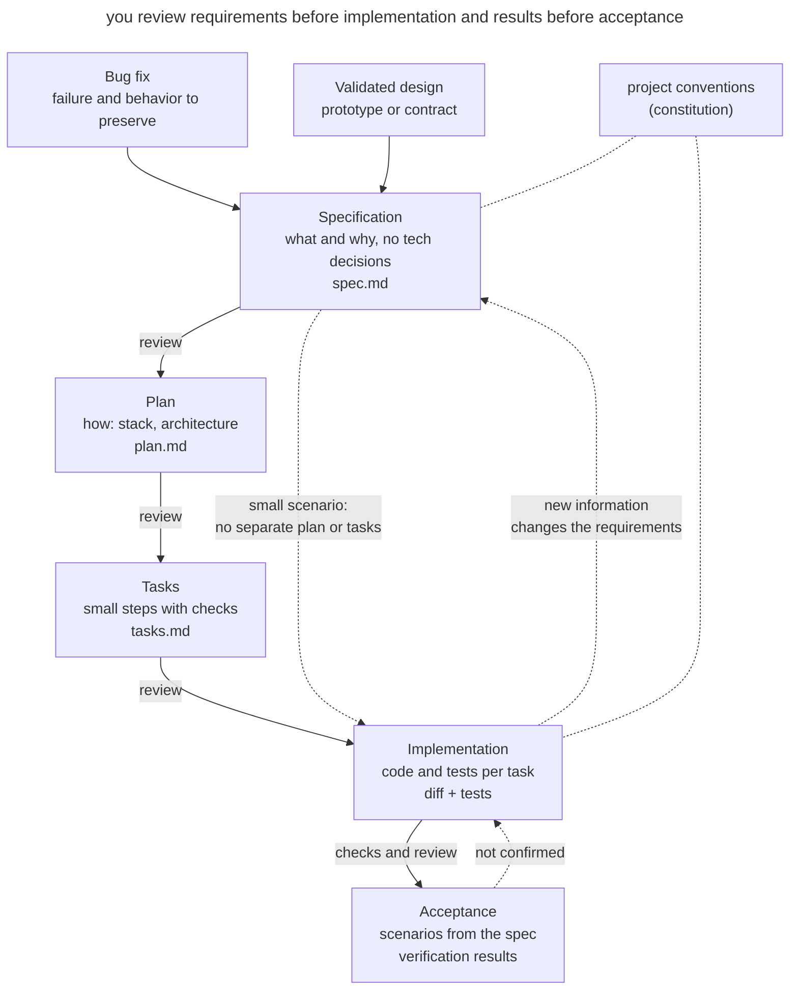

# Spec-Driven Development

## Intent

Keep the goal and requirements in an agreed specification that guides implementation and verification. The documents let the work continue in another session and make it possible to judge whether the result matches the original intent.

## Also known as

Spec-Driven Development (SDD), spec-first, "the spec as the source of truth".

## Problem

With a large feature, requirements can end up buried among the messages of a long conversation. A new session sees the code but does not know everything that was agreed.

For example, the chat settled on sending large reports as a link. The implementation still sends attachments, and a new agent cannot tell whether that was a deliberate limitation or an unfinished piece of work. Without a written record, requirements have to be reconstructed from the author's memory. Subsequent edits can pull the behavior even further from the goal, because there is nothing to compare it against.

Accepting generated code without such a comparison is described in the [vibe coding](vibe-coding.md) anti-pattern.

## Solution

Before implementation, agree on the expected behavior, constraints and acceptance criteria in a specification. Use it when choosing an approach, implementing and verifying the result. One common workflow has four stages.

1. **The specification** describes scenarios, requirements, constraints and acceptance criteria.
2. **The plan** chooses a technical approach once the requirements are agreed.
3. **The tasks** split the plan into small steps with a verifiable result.
4. **Implementation and acceptance.** The agent works through the tasks, checking against the specification and the plan, and you accept the result based on checks of the agreed scenarios.

At each transition you review the resulting document. This lets you fix a requirement before it is implemented. If new information changes the task, agree on the specification first and then bring the code in line with it.

Acceptance checks the result against the agreed scenarios. A separate plan and task list help with large changes; a small scenario can be implemented directly from the specification. The documents and the entry point depend on the task.

## Structure

The diagram shows a workflow with a separate plan and tasks, ending in acceptance.

Standing project conventions constrain the choices in every phase. For a bug fix, the starting inputs are a reproduction and behavior to preserve; for a validated design, they are its constraints. The dotted path lets a small scenario bypass a separate plan and tasks. Acceptance matches scenarios to checks; failed or unverified cases return the work to implementation and verification. The arrow to the specification means revising requirements when new information changes the task; violations of current requirements are fixed in the implementation.

## Participants / Components

- **Developer** sets the goal and reviews the documents and the result.
- **Agent** prepares the documents and implements the agreed tasks.
- **Specification** holds the requirements and acceptance criteria.
- **Plan and tasks** set the technical approach and the order of implementation.
- **Project conventions** preserve shared standards and constraints.

## When to use

- The work spans several sessions.
- Several participants need shared requirements.
- The system's correctness has to be checked against explicitly defined scenarios.
- The team is still refining the behavior of a new system.

For a small edit, [four phases](explore-plan-code-commit.md) or a direct request is enough.

## Consequences and trade-offs

- ➕ Requirements are available to the next session and to other participants.
- ➕ Divergence between the implementation and the intent can be checked against the document.
- ➕ Mistakes in requirements and approach can surface before any code is written.
- ➕ An up-to-date specification explains the expected behavior after development is finished.
- ➖ Preparing documents raises the cost of short tasks.
- ➖ The documents have to be updated when requirements change.
- ➖ Too much implementation detail in the specification leads to [premature specification](premature-specification.md).

## Implementation

### What does not depend on the agent

#### Requirements review

Before choosing an implementation, check that you and the agent understand the scenarios in the same way. Words such as "delete", "deliver" or "in local time" allow different outcomes. Also check that requirements are compatible: keeping a file for a day so it can be downloaded again contradicts deleting it immediately after sending. Agree on the behavior before the technical plan; an [interview](let-claude-interview-you.md) helps gather missing requirements.

For scenarios involving data access, record who may perform the action and what should happen when access is denied. For example, forwarding a report link must not grant another user access. These requirements affect the design; tests and review then check their implementation. Kiro describes this pass as [hardening specifications with security requirements](https://kiro.dev/blog/spec-it-safe/). Requirements review complements code checks and [quality gates](quality-gates.md).

#### Entry points

For a new feature, start with the required behavior, then choose an approach and split the work into [tracer-bullet tickets](tracer-bullet-tickets.md) if needed. If a prototype has already validated the technical approach or a mandatory contract dictates it, use that as a starting constraint and agree on the system's behavior within those bounds. This differs from [choosing an implementation prematurely](premature-specification.md), before the goal is clear.

For a bug fix, record the reproducing scenario, expected result and neighboring behavior that must remain unchanged. When fixing a schedule's time zone, its execution time changes while cancellation and retry rules stay the same.

Entry-point variants are described by [Kiro](https://kiro.dev/blog/specs-bugfix-and-design-first/): separate workflows for bug fixes and starting from a technical design. In [Simon Martinelli's approach](https://tessl.io/blog/spec-driven-development-works-when-specs-are-system-use-cases), use cases and a domain model guide implementation without a separate plan-and-task stage.

#### Implementation and acceptance

The agent implements the agreed scope and runs checks for the acceptance criteria. At completion, match each significant scenario to a test, an end-to-end run or another observable result. The [environment's records](give-agent-a-way-to-verify.md) should show what was checked, what failed and what has not been run. A completed task list and a successful build do not by themselves confirm every requirement.

If the code violates current requirements, fix the implementation. If the requirements themselves change, agree on the specification and update checks together with the code. An [independent reviewer](writer-reviewer.md) compares the result with the intent and looks for missed cases. Evidence that criteria were met helps this review, but does not make implementation review unnecessary.

#### Ready-made workflows

You can assemble the workflow by hand or use a ready-made toolkit. [OpenSpec](openspec.md) keeps standing specifications and change deltas. [Superpowers](superpowers.md) links the phases through skills and mandatory checkpoints. [Matt Pocock's skills](matt-pocock-skills.md) keep specifications and tracer-bullet tickets in the issue tracker. Other tools are collected in [Useful Links](resources.md) and in the [spec-compare](https://cameronsjo.github.io/spec-compare/) comparison.

## Example

You are adding scheduled report export.

> Add scheduled report export

The agent prepares a **specification** for your review.

> The user picks a report, a schedule and recipients. The system sends the report no later than five minutes after the scheduled time. If the build fails, it notifies the recipients of the failure. Deleting a report disables its schedules.

During review you notice that the schedule's time zone is undefined and clarify it before implementation. You also add a requirement: recipients must have access to the report at the time of sending. Revoked access prevents sending.

In the **plan**, the agent proposes a cron worker and `report_schedules`. You point to the scheduler the project already uses, and the agent refines the approach.

The **tasks** add verifiable scenarios one after another: creating a schedule, sending a report, denying delivery without access, handling a failure and disabling schedules after a report is deleted.

During **implementation** it turns out the mail gateway limits attachments to 10 MB. You record the boundary in the specification: reports up to and including 10 MB are sent as attachments; larger reports are sent as links. For the new delivery method, you add a requirement and tasks to check current access to the report on every download. Revoked access or forwarding the link to a user without permission must result in denial. The access requirement before sending applies to both delivery methods.

At **acceptance**, you match scenarios to verification results: meeting the delivery deadline in the chosen time zone to a scheduler run, the size threshold to tests with 10 and 11 MB reports, revoked access to denied sending and downloads, a link forwarded to an unauthorized user to a denied download, and failure notifications to a report-generation failure test. The log shows successful checks for these cases and for disabling schedules after a report is deleted. Delivery through the real mail gateway has not yet been checked: the agent marks this scenario as unverified, and you complete an end-to-end run before accepting the export feature.

## Anti-patterns and common mistakes

- **Documents without review.** Unchecked requirements can carry a mistake into the implementation.
- **Only the happy path.** Delivering a report to an authorized recipient does not check denial of access to an unauthorized user. Include significant prohibitions in requirements and checks.
- **Tasks complete means requirements met.** Match agreed scenarios to verification results; explicitly retain the status of unverified cases.
- **Stale specification.** When behavior changes, update the agreed requirements together with the code.
- **Pseudocode specification.** A detailed call sequence written before the task has been explored creates a [premature specification](premature-specification.md).
- **Excessive process.** For a small, reversible edit, a full set of documents can cost more than the work itself.
- **A spec instead of a prototype.** Days of exhaustive documents before the first working version are covered in the [Big Spec Up Front](big-spec-up-front.md) anti-pattern.

## Known uses

- [OpenSpec](openspec.md), [Superpowers](superpowers.md) and [Matt Pocock's skills](matt-pocock-skills.md) are covered in this section. The general approach is also described in the [Spec Kit announcement](https://github.blog/ai-and-ml/generative-ai/spec-driven-development-with-ai-get-started-with-a-new-open-source-toolkit/).
- [Microsoft](https://developer.microsoft.com/blog/spec-driven-development-ai-native-engineering/) includes requirements clarification and final validation in the SDD lifecycle and recommends starting with a lightweight process, expanding it as needed.
- A comparison of other tools is available in [spec-compare](https://cameronsjo.github.io/spec-compare/) and the [collection of links](resources.md).

## Related patterns

- [Four Phases](explore-plan-code-commit.md) organizes agreement and implementation at the scale of a single task.
- [Premature Specification](premature-specification.md) describes the risk of choosing an implementation before the requirements are clarified.
- [Feedback Loop](give-agent-a-way-to-verify.md) connects acceptance criteria to checks and evidence from the environment.
- [Writer and Reviewer](writer-reviewer.md) checks the implementation against agreed requirements in a separate context.
