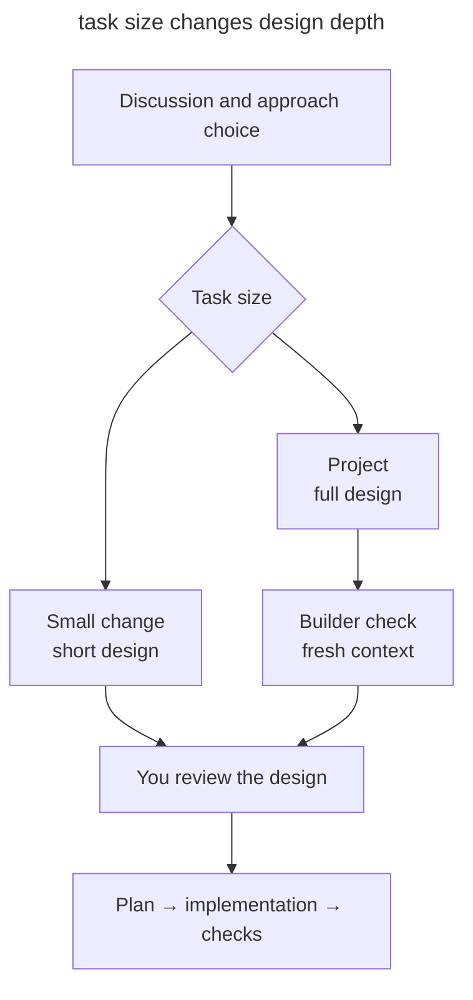

# Superpowers

_Commands and capabilities of Superpowers 7.0.1 checked on October 31, 2026._

[Superpowers](https://github.com/obra/superpowers) by Jesse Vincent (obra) implements [SDD](spec-driven-development.md) as a set of [skills](skills-as-packaged-workflows.md). Between design and implementation, the instructions set mandatory checkpoints called HARD-GATE.

## Installation

The main way to install it uses the Claude Code marketplace.

```text
/plugin install superpowers@claude-plugins-official
```

The pack also includes instructions and manifests for Codex, Cursor, Antigravity, GitHub Copilot CLI and OpenCode.

## Workflow

At session start, a hook loads `using-superpowers`, which requires checking whether skills apply before answering. The agent discusses a new feature through `brainstorming` and investigates a bug through `systematic-debugging`.

In `brainstorming`, you clarify the goal and choose an approach. A small change gets a short written design; a project gets a full one. Both record the alternatives and reasons for the choice. You review the document before implementation.



For a project, the builder check finds questions that would prevent a builder from planning. A fresh subagent normally performs it; without that tool the agent checks it itself. A small change goes straight to your review. A clear trivial request can be handled directly; an agreed throwaway spike and an explicit opt-out from interviewing also have separate exceptions. See [brainstorming](https://github.com/obra/superpowers/blob/main/skills/brainstorming/SKILL.md).

After design approval, `writing-plans` prepares tasks with actions and checks. Isolation through `using-git-worktrees` belongs to execution preparation. `subagent-driven-development` or `executing-plans` executes the plan; `test-driven-development` sets the TDD cycle. `requesting-code-review` and `receiving-code-review` support review, and `finishing-a-development-branch` completes a verified branch through your choice of merge or PR. `verification-before-completion` requires checks before declaring success.

## Artifacts

| Artifact | Where it lives |
| ---------- | ----------- |
| Design document | _docs/superpowers/specs/YYYY-MM-DD-\<topic\>-design.md_ |
| Implementation plan | _docs/superpowers/plans/YYYY-MM-DD-\<feature\>.md_ |

Short and full designs are Markdown documents. For a project, the builder check precedes your review. The plan follows design approval; its location can be overridden. A throwaway spike ends with an answer; keeping its code requires a new decision.

## What makes it different

- A small change gets a short written design; a project gets a full design with an additional check.
- A hook helps the agent pick the right procedure automatically.
- Separate contexts for the executor and the reviewer keep implementation apart from evaluation.
- The plan includes red–green–refactor steps.

## When to choose it

Superpowers fits a team that needs a single process with mandatory checkpoints. For quick changes this process can be excessive. If you prefer to keep the outcome of discussions in an issue tracker, compare [Matt Pocock's skills](matt-pocock-skills.md).
