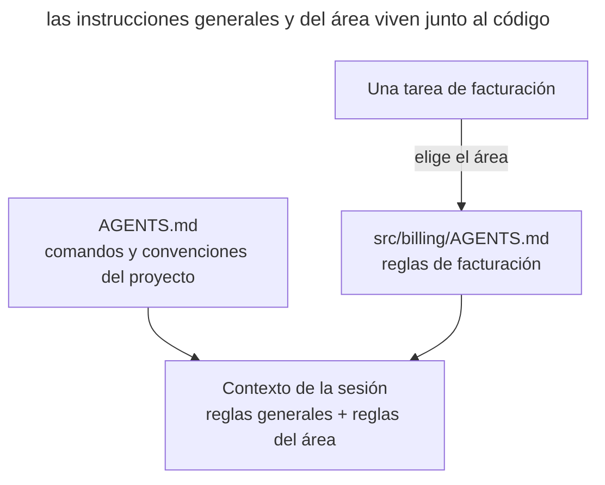

# Memoria del proyecto

## Propósito

Mantener en el repositorio un archivo permanente con los comandos, las convenciones y las restricciones del proyecto, que el agente lee al inicio de cada sesión. Escribes una regla una vez y las sesiones siguientes la obtienen del archivo.

## También conocido como

AGENTS.md, memory file, archivo de memoria, project rules, custom instructions.

## Problema

Una sesión nueva puede no saber cómo el equipo compila el proyecto y ejecuta los tests. Explicas las reglas en la conversación, pero la sesión siguiente necesita las mismas aclaraciones. Esto se nota sobre todo con un comando de verificación no estándar.

Por ejemplo, el agente ejecuta el script de tests habitual, aunque el proyecto exige `make test` con preparación de fixtures. Corriges el comando en el chat. Si la regla se guarda solo en la conversación, un compañero en una sesión nueva se topará con el mismo fallo.

Las reglas del proyecto hacen falta en tareas distintas. Es más cómodo guardarlas aparte de la especificación de una funcionalidad concreta.

## Solución

Crea en el repositorio un archivo que el agente cargue al arrancar. Anota en él los comandos y las convenciones no evidentes que de otro modo habría que explicar en cada sesión. Indica los límites de los módulos si el agente no puede reconstruirlos de forma fiable a partir del código.

Amplía el archivo cuando veas una necesidad recurrente de contexto.

- el agente cometió el mismo error por segunda vez;
- la revisión detectó algo que el agente debía saber sobre esta base de código;
- estás escribiendo una aclaración que ya escribiste en la sesión anterior;
- un compañero nuevo necesitaría el mismo contexto para ser productivo.

Guarda el archivo en el control de versiones. Así el equipo podrá discutir los cambios en la revisión y las sesiones nuevas obtendrán una versión consensuada de las reglas.

El archivo de memoria orienta el comportamiento del agente, pero no garantiza que se cumplan las reglas. Refuerza las prohibiciones críticas, como la de escribir en una rama protegida, con permisos y hooks.

## Estructura

El diagrama combina las instrucciones generales con las reglas del área elegida. Indica en el archivo raíz cuándo leer las instrucciones anidadas: su carga automática depende del agente.



El archivo raíz guarda los comandos comunes; el anidado precisa las reglas de su directorio. El agente necesita ambas fuentes. Comprueba qué archivos ha cargado antes de confiar en una regla.

## Participantes / Componentes

- **AGENTS.md raíz** guarda las reglas del equipo en git y pasa por revisión.
- **AGENTS.md anidado** precisa las instrucciones de un área del proyecto.
- **Desarrollador y equipo** añaden reglas a partir de fallos observados y revisan el archivo con regularidad.
- **Agente** lee las instrucciones aplicables y añade reglas cuando se le pide.

## Cuándo aplicarlo

- El agente trabaja con regularidad en el repositorio.
- Las convenciones del proyecto difieren de los ajustes por defecto de las herramientas.
- Varios desarrolladores y agentes necesitan reglas de trabajo comunes.

## Consecuencias y compromisos

- ➕ Las sesiones nuevas obtienen las reglas guardadas sin explicaciones repetidas.
- ➕ El equipo guarda una versión común de las reglas en git y discute los cambios en la revisión.
- ➕ Para precisar una regla basta un pequeño cambio en Markdown.
- ➖ Cada línea ocupa espacio en el contexto de cada sesión que lee el archivo (véase [ingeniería de contexto](context-engineering.md)).
- ➖ Sin revisión, en el archivo se acumulan duplicados y contradicciones.
- ➖ Las instrucciones de texto no garantizan que se respeten las prohibiciones críticas.

## Implementación

### Lo que no depende del agente

Crea _AGENTS.md_ en la raíz del repositorio. Anota comandos comprobados y convenciones difíciles de deducir del código. Por ejemplo, «ejecuta `make test` antes del commit» especifica una acción observable.

Mantén el archivo corto y añade reglas a partir de fallos observados. Lleva las reglas de cada área a archivos _AGENTS.md_ anidados; indica en el archivo raíz qué tareas requieren leerlos. Guarda las instrucciones del equipo en git y los ajustes personales en la configuración de usuario del agente.

La convención [AGENTS.md](https://agents.md/) da un nombre común, pero el descubrimiento depende de la herramienta. Comprueba que el archivo se cargó antes de confiar en una regla. Verifica los cambios de instrucciones con tareas reales.

### Claude Code

Comprobado con Claude Code 2.1.316 el 2026-10-31.

#### Carga de AGENTS.md

Claude Code admite la carga nativa de _AGENTS.md_. En una sesión nueva, `/context` permite inspeccionar las instrucciones cargadas; `/config` abre la selección Project instructions. Los ajustes del proyecto y de la organización influyen en la carga. Los archivos raíz y anidados no necesitan enlaces simbólicos. Consulta la [documentación de AGENTS.md](https://code.claude.com/docs/en/memory#agentsmd).

##### Ejemplo

```text
/context
```

### Codex

Comprobado con Codex CLI 0.166.0 el 2026-10-31.

#### Carga de AGENTS.md

Codex reúne instrucciones desde la raíz hasta el directorio de trabajo. Los _AGENTS.md_ anidados precisan las reglas del área. Comprueba que las instrucciones necesarias caben en el límite de tamaño, 32 KiB por defecto; que un archivo exista no demuestra que se cargó. Consulta la [guía de AGENTS.md](https://learn.chatgpt.com/docs/agent-configuration/agents-md).

##### Ejemplo

> ¿Qué archivos AGENTS.md se aplican al directorio actual?

## Ejemplo

A continuación se muestra un fragmento de la memoria de un servicio pequeño con comandos y convenciones difíciles de deducir del código.

```markdown
# Proyecto: billing-service

## Comandos
- Compilación y tests: `make test` (no `npm test` — hacen falta contenedores)
- Ejecución local: `make up`, entorno en :8080

## Convenciones
- Gestor de paquetes — pnpm; el lock file se commitea
- Commits — Conventional Commits, en inglés
- Las migraciones no se editan retroactivamente — solo una migración nueva

## Límites
- Los dominios se comunican solo mediante eventos; los imports directos
  entre `src/domains/*` están prohibidos
- En los tests está prohibido el sleep — solo esperas explícitas
```

El agente recibe la tarea de añadir a facturación una notificación de cobro fallido. En la memoria consta que los dominios interactúan mediante eventos, así que el agente usa un evento para disparar la notificación. No tienes que repetir esta regla en la tarea.

Una semana después, la revisión descubre que el agente ejecutó `npm install` en un proyecto con pnpm. Amplías la memoria.

> Añade a AGENTS.md la regla de instalar las dependencias solo con pnpm. Indica que package-lock.json no debe aparecer en el repositorio.

La sesión siguiente obtendrá esta regla al leer la memoria del proyecto.

## Antipatrones y errores comunes

- **Memoria hinchada.** Los duplicados y las contradicciones dificultan encontrar las reglas aplicables. Este error se analiza en un capítulo aparte, [«Memoria hinchada»](bloated-agents-md.md).
- **Vertedero de lo deducible.** El resumen de la estructura de directorios y de las dependencias ocupa contexto, aunque el agente puede obtener esa información de los archivos del proyecto.
- **Esperar imposición.** Una prohibición de texto de hacer push a main no bloquea el comando. Refuerza el límite con permisos.
- **Conocimiento en la memoria privada del agente.** Una regla que el agente recordó por su cuenta no llega a sus compañeros. Este antipatrón se analiza en [«Memoria privada»](private-agent-memory.md).
- **Lo personal en el archivo del equipo.** Guarda las URLs de entornos personales y las preferencias del desarrollador en el nivel del usuario o en el local.
- **Escribir y olvidar.** Las instrucciones obsoletas pueden llevar al agente a una decisión equivocada. Revísalas junto con los cambios del proyecto.

## Usos conocidos

- **Claude Code** admite la carga nativa de _AGENTS.md_. Las notas personales de Auto memory se guardan aparte de las instrucciones del equipo.
- **AGENTS.md** fija un formato común de instrucciones para varias herramientas de agentes.
- **Reglas de los editores** aplican la misma idea mediante _.cursor/rules_ en Cursor y custom instructions en GitHub Copilot.
- **Toolkits de SDD** guardan los principios comunes en la constitución de GitHub Spec Kit, los archivos de steering de Kiro y los documentos de contexto de OpenSpec.

## Patrones relacionados

- [Ingeniería de contexto](context-engineering.md) ayuda a seleccionar la información para el archivo de memoria permanente.
- [Vocabulario del dominio](domain-context-file.md) complementa las instrucciones de trabajo con definiciones de los términos del proyecto.
- [Desarrollo orientado a especificaciones](spec-driven-development.md) usa las convenciones del proyecto al preparar la especificación y el plan.
- [Memoria hinchada](bloated-agents-md.md) describe un archivo de memoria en el que, sin revisión, se han acumulado duplicados, contradicciones y un resumen del código.
- [Mantenimiento programado](scheduled-maintenance.md) contrasta una vez al mes el archivo de memoria con la práctica y quita lo que sobra.
