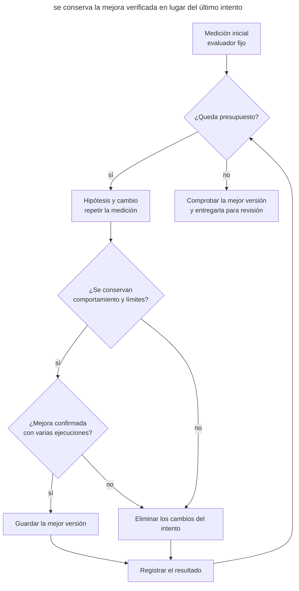

# Optimización medida

## Propósito

Encargar al agente una serie limitada de experimentos de rendimiento y conservar las mejoras confirmadas por mediciones repetidas y comprobaciones del comportamiento.

## También conocido como

Benchmark-guided optimization, measured optimization, ciclo de experimentos, autoresearch loop.

## Problema

Pides al agente que acelere la búsqueda. Añade una caché de resultados, muestra una cifra impresionante y propone aceptar el cambio. La medición repite una sola consulta, así que la respuesta siempre está en la caché. Con consultas reales, la mejora desaparece, pero el coste de memoria y la complejidad permanecen.

Incluso un benchmark adecuado puede engañar. Otro proceso carga la máquina, una ejecución sale bien por casualidad y el agente confunde el ruido con una mejora. Tras diez intentos, cuesta saber qué versión era la mejor y qué se estaba comparando. Si el agente puede cambiar el evaluador junto con el código, puede mejorar la puntuación reduciendo la carga o saltándose trabajo.

## Solución

Antes de experimentar, fija la carga de trabajo, el método de medición y el comportamiento esperado. Elige una métrica principal, como el tiempo de procesamiento, y las restricciones que la mejora debe respetar: corrección, memoria, compatibilidad. Rechaza una mejora que incumpla una restricción.

Obtén la referencia inicial con varias ejecuciones. El agente propone una hipótesis, cambia el código dentro del área permitida, repite las mismas comprobaciones y registra el resultado. Una mejora confirmada se convierte en la nueva referencia; un intento fallido permanece en el registro mientras se eliminan sus cambios. Conserva el evaluador y los datos sin cambios durante toda la serie.

Limita tanto cada ejecución como la serie completa. Al agotar el presupuesto, el agente devuelve la mejor versión verificada y las preguntas pendientes. Si no hay mejora, la implementación original sigue siendo el resultado. Agotar el presupuesto termina la búsqueda, pero no demuestra que se haya logrado el objetivo. Aceptas el cambio después de repetir las comprobaciones y evaluar su complejidad.

## Estructura

El diagrama muestra cómo cada experimento actualiza la mejor versión guardada.



El registro conserva también los experimentos rechazados. La mejor versión queda fijada en un commit aparte. Al terminar la serie, el agente separa de ella los cambios de cualquier intento incompleto e indica qué comprobaciones pudo completar.

## Participantes / Componentes

- **Tú** eliges la carga, las restricciones y el presupuesto, y aceptas el cambio final.
- **El agente** propone hipótesis, realiza experimentos y registra los resultados.
- **El entorno de evaluación** mide el mismo trabajo y comprueba la corrección.
- **Las versiones inicial y mejor** permiten repetir la comparación y restaurar código verificado.
- **El registro de experimentos** conecta la hipótesis, la versión del código, las condiciones, las mediciones y la decisión.

## Cuándo aplicarlo

- Hay una operación costosa y recurrente con una carga de trabajo reproducible.
- Son posibles varias implementaciones y elegir entre ellas requiere medir.
- El rendimiento importa para la tarea y la corrección se puede comprobar por separado.

Si desconoces la causa de la demora, aplica primero el enfoque del [Diagnóstico mediante hipótesis](hypothesis-driven-debugging.md): reproduce la ralentización y comprueba sus posibles causas. Una serie de optimizaciones resulta útil cuando ya sabes qué trabajo merece acelerarse y por qué.

## Consecuencias y compromisos

- ➕ Las decisiones se apoyan en mediciones comparables y resultados guardados.
- ➕ Los intentos fallidos aportan información para la siguiente hipótesis.
- ➕ Un presupuesto total limita el coste de la búsqueda.
- ➖ Una carga poco representativa orienta la búsqueda hacia mejoras inútiles.
- ➖ Las ejecuciones repetidas y las comprobaciones de corrección consumen tiempo y recursos.
- ➖ Una mejora local puede no compensar la complejidad ni reducir la latencia que percibe el usuario.

## Implementación

### Lo que no depende del agente

#### Preparar la medición

Es una tarea normal para el agente. Empieza con el perfilador, la prueba de carga o el benchmark que ya tenga el proyecto. Elige escenarios del uso real: tamaños de entrada, distribución de consultas, arranque en frío y funcionamiento precalentado cuando ambos importen. Una comprobación aparte debe confirmar el resultado de la operación, incluidos el orden, los errores y los efectos secundarios cuando formen parte del contrato.

Acuerda un entorno constante y varias repeticiones. Alterna ejecuciones del candidato y de la mejor versión actual dentro de la misma serie de mediciones para que un cambio de carga en la máquina no se convierta en una mejora aparente. Para el tiempo de ejecución, puedes comparar medianas conservando las mediciones individuales y su dispersión. Elige el umbral de mejora útil antes de experimentar, teniendo en cuenta el ruido de las ejecuciones iniciales; vuelve a evaluar la dispersión también para cada nueva mejor versión. Guarda el evaluador y los datos bajo control de versiones en el repositorio. Si descubres un error de medición, corrígelo por separado y obtén una nueva referencia inicial para comparar.

##### Ejemplo

```text
Prepara una medición del tiempo de construcción de la respuesta de búsqueda
```

#### Serie de experimentos

Anota el área modificable y el presupuesto en la tarea. Por ejemplo, permites cambios en el módulo de búsqueda y asignas ocho intentos o 45 minutos, lo que termine antes. Ese tiempo incluye las mediciones iniciales y la verificación final; reserva tiempo para esta última. Una ejecución bloqueada necesita su propio timeout. Empieza un intento solo si su timeout termina antes de que empiece la reserva. Si la verificación final no termina dentro del presupuesto total, el agente la marca como incompleta. Este límite es una elección tuya para la tarea, no una propiedad del modelo.

Tras aprobar el plan, el agente trabaja en una rama aparte o en un [worktree](isolated-parallel-work.md). Cada intento tiene una hipótesis comprobable y una versión guardada del código. Fija el mejor resultado en un commit. Guarda el registro y las mediciones originales fuera del área que el agente restaura al rechazar un intento. El registro incluye fallos, excesos de memoria e intentos sin mejora. Al rechazar un intento, el agente elimina solo sus cambios y continúa desde la mejor versión. El límite incluye las correcciones de experimentos fallidos: un fallo no reinicia el contador.

##### Ejemplo

Las condiciones de la serie ya están anotadas en el ticket:

```text
PERF-42
```

#### Aceptar la mejor versión

Al terminar, repite la comparación de las versiones inicial y elegida en las mismas condiciones y ejecuta los tests pertinentes y las comprobaciones obligatorias del proyecto. Comprueba que el diff final no modifica el evaluador, los datos ni los tests de corrección fijados. Una carga adicional que no se haya usado durante el ajuste ayuda a detectar la adaptación excesiva al benchmark de trabajo. Tú evalúas si la mejora compensa la complejidad añadida y mantiene la compatibilidad. Si la comprobación repetida no confirma la mejora, conserva la versión inicial y el registro de conclusiones.

El resultado incluye el diff, las versiones del código, las condiciones de ejecución, las mediciones y las hipótesis rechazadas. Si el objetivo afecta al tráfico de producción, continúa con la [verificación después del despliegue](give-agent-a-way-to-verify.md#verificación-después-del-despliegue). Un microbenchmark satisfactorio solo demuestra la mejora que ha medido.

##### Ejemplo

```text
Vuelve a comprobar la mejor versión de PERF-42 con los escenarios de aceptación
```

## Ejemplo

En esta tarea didáctica, la búsqueda ordena todos los documentos encontrados aunque la respuesta solo contiene los primeros 20. Fijas varios conjuntos de consultas, una comprobación del resultado exacto y un límite de memoria de 64 MB. Las ejecuciones iniciales dan una mediana de 42,1 ms con variaciones de aproximadamente el 2 %; consideras útiles las mejoras de al menos el 5 %. A continuación se resume el registro con etiquetas de versión ilustrativas; las mediciones individuales se guardan junto a él. Las cifras ilustran el mecanismo; no proceden de ejecutar código en el repositorio del libro.

```console
trial  rev   runs  median_ms  min_ms  max_ms  peak_mb  correct  decision
0      base  7     42.1       41.4    42.8    18       pass     baseline
1      try1  7     41.8       41.0    42.6    18       pass     discard: small gain
2      try2  7     28.4       27.9    29.0    19       pass     keep: top-k selection
3      try3  7     23.1       22.7    23.6    19       fail     discard: tie order
4      try4  7     24.0       23.5    24.5    96       pass     discard: memory
```

El segundo intento conserva el orden exacto entre puntuaciones iguales y selecciona los documentos necesarios sin ordenarlos todos. El tercero es más rápido, pero cambia ese orden; el cuarto supera el límite de memoria. Tras el cuarto intento empieza el tiempo reservado para la verificación final. Los cambios de los intentos rechazados ya se han eliminado, así que la versión de trabajo coincide con el segundo intento. El agente repite sus comprobaciones con consultas adicionales. Recibes un cambio con límites de aplicación verificados y un registro que explica por qué se rechazaron variantes más rápidas.

## Antipatrones y errores comunes

- **Una ejecución afortunada.** Repite la comparación y observa la dispersión antes de atribuir la diferencia al código.
- **Cambiar la regla de medir.** Reducir los datos o debilitar una comprobación hace que el resultado deje de ser comparable. Tras una corrección necesaria del evaluador, vuelve a medir la versión inicial.
- **Solo velocidad.** Incumplir el contrato, exceder la memoria o romper la compatibilidad anula la mejora.
- **Ajustar al ejemplo.** Una sola consulta repetida premia una caché que no ayuda con tráfico real.
- **Búsqueda interminable.** Un timeout por intento no limita el coste de la serie completa. Fija un límite total y conserva el resultado al terminar.
- **La última versión en lugar de la mejor.** Un experimento fallido no debe desplazar una mejora verificada.
- **Velocidad a cualquier precio.** Un ahorro pequeño puede no justificar una nueva ruta de código compleja.

## Usos conocidos

- **Google**, en su [caso de optimización de ADK](https://developers.googleblog.com/optimizing-a-200000-line-python-codebase-overnight-with-gemini-4-argon/), describe seis propuestas del agente, de las que se aceptaron dos. Un benchmark independiente no encontró mejora de extremo a extremo en una reescritura; los revisores rechazaron soluciones frágiles. Los tests internos exigieron corregir la compatibilidad de la optimización de imports antes de aceptarla. Es la experiencia de un proyecto.
- **autoresearch de Andrej Karpathy** define una [evaluación fija, un archivo modificable y un registro de experimentos](https://github.com/karpathy/autoresearch/blob/228791fb499afffb54b46200aca536f79142f117/program.md). El experimento original trata del entrenamiento de modelos y continúa hasta que alguien lo detiene. Aquí se adapta el mecanismo a la optimización de programas con un presupuesto total explícito.

## Patrones relacionados

- [Bucle de retroalimentación](give-agent-a-way-to-verify.md) comprueba que la tarea está hecha; aquí se comparan varias variantes correctas por su mejora medida.
- [Evaluaciones del flujo del agente](agent-workflow-evals.md) evalúan las instrucciones y el comportamiento del agente. Aquí se mide el programa que modifica.
- [Diagnóstico mediante hipótesis](hypothesis-driven-debugging.md) establece la causa de un fallo antes de elegir una corrección; el mismo enfoque se aplica a una ralentización de causa desconocida.
- [Trabajo paralelo aislado](isolated-parallel-work.md) separa los experimentos de otras tareas. Las mediciones en paralelo en una máquina compartida pueden interferir entre sí.
