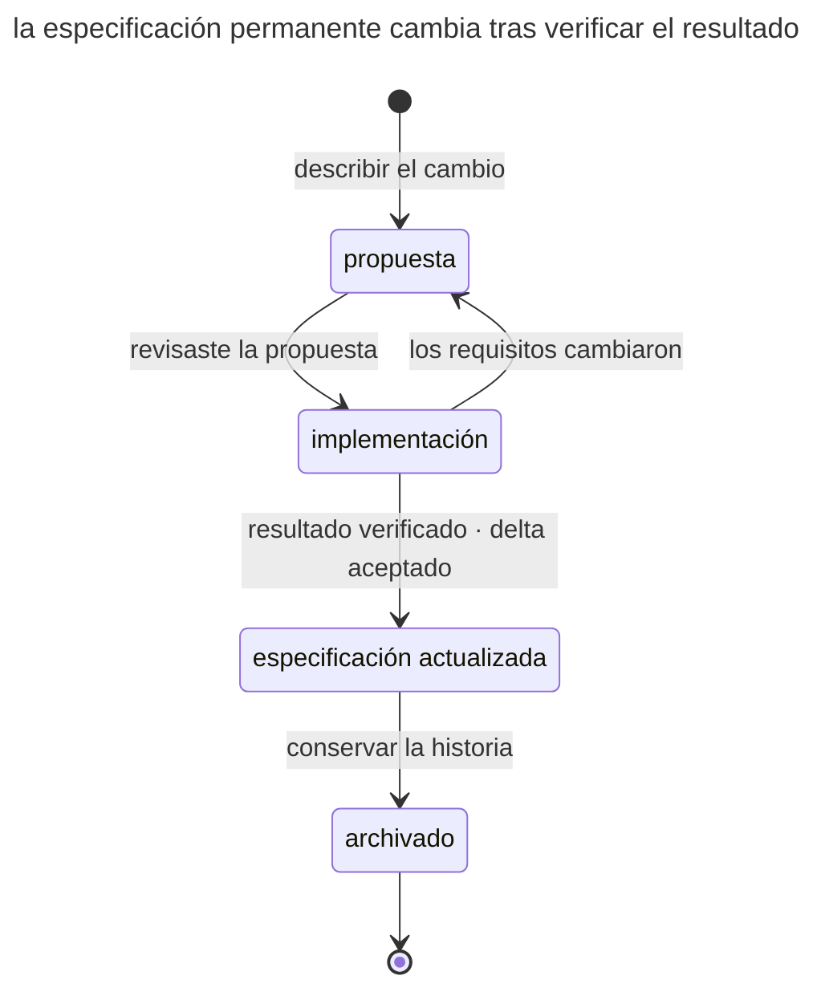

# OpenSpec

_Comandos y capacidades de OpenSpec 2.1.1 comprobados el 21 de noviembre de 2026._

[OpenSpec](https://github.com/Fission-AI/OpenSpec), de Fission-AI, organiza el [SDD](spec-driven-development.md) alrededor de un **cambio** con las etapas propose, review, apply y archive. Las especificaciones permanentes describen el sistema, y los deltas registran los cambios propuestos a los requisitos.

OpenSpec soporta distintos agentes y asistentes de código, incluidos Claude Code, Codex, Cursor y GitHub Copilot.

## Flujo de trabajo

OpenSpec conserva los requisitos entre tareas. Discutes un cambio concreto, revisas la propuesta y después pasas a la implementación. La preparación está descrita en la [guía oficial](https://openspec.dev/docs/installation).

El skill `/openspec-explore` ayuda a investigar el código y comparar enfoques. Cuando la tarea está clara, `/openspec-propose` prepara un paquete: el motivo del cambio, los deltas de requisitos, el enfoque técnico y las tareas. Compruebas que describe el comportamiento esperado, incluidos los errores y los casos límite.

Tras la aprobación, `/openspec-apply-change` ejecuta las tareas. Si cambian los requisitos durante el trabajo, actualiza primero la propuesta y los artefactos relacionados. Al terminar, `/openspec-archive-change` propone incorporar los deltas a las especificaciones permanentes y conserva el paquete en el archivo. Los procedimientos están en la [documentación de OpenSpec](https://openspec.dev/docs/quickstart).

El diagrama muestra cómo una propuesta se convierte en el nuevo estado de la especificación.



Hasta que se acepta el delta, la especificación permanente describe el comportamiento anterior. El archivo conserva los motivos del cambio; el equipo decide si archivar antes o después del merge.

Por ejemplo, quieres cambiar la política de desactivación de webhooks:

```text
/openspec-propose desactivar el webhook tras diez fallos seguidos
```

El agente prepara la propuesta, revisas el nuevo umbral y los escenarios, y después pasas a la implementación. En Codex, los skills se invocan con `$`, como `$openspec-propose`; elige el skill disponible en el menú de tu agente.

## Artefactos

El directorio _openspec/_ separa las especificaciones permanentes de los paquetes de cambio.

| Ruta | Qué contiene |
| ------ | ----------- |
| _openspec/specs/_ | Especificaciones permanentes — el modelo actual de lo que _ya está construido_ |
| _openspec/changes/\<cambio\>/proposal.md_ | Por qué cambiamos esto |
| _openspec/changes/\<cambio\>/specs/_ | Deltas de requisitos con escenarios concretos |
| _openspec/changes/\<cambio\>/design.md_ | Enfoque técnico |
| _openspec/changes/\<cambio\>/tasks.md_ | Checklist de implementación |
| _openspec/changes/archive/_ | Cambios completados |

## Ejemplo de cambio de un requisito

En un servicio de entrega de eventos, un webhook se desactiva tras cinco fallos seguidos. La especificación permanente en _openspec/specs/webhooks/spec.md_ contiene esta regla.

```markdown
### Requirement: Delivery failure cutoff
El sistema SHALL desactivar el webhook tras cinco intentos fallidos seguidos.

#### Scenario: Failed deliveries reach cutoff
- **WHEN** el quinto intento de entrega seguido falla
- **THEN** el webhook se desactiva
```

El equipo acordó otro umbral para destinatarios temporalmente no disponibles. En el paquete de cambio, el agente crea un delta en _openspec/changes/raise-cutoff/specs/webhooks/spec.md_. Para el requisito modificado conserva el encabezado y da el nuevo requisito con su escenario completo.

```markdown
## MODIFIED Requirements

### Requirement: Delivery failure cutoff
El sistema SHALL desactivar el webhook tras diez intentos fallidos seguidos.

#### Scenario: Failed deliveries reach cutoff
- **WHEN** el décimo intento de entrega seguido falla
- **THEN** el webhook se desactiva
```

En este ejemplo, `MODIFIED Requirements` indica la sustitución de un requisito existente. Tras la implementación y la verificación, el equipo confirma la sincronización en `/openspec-archive-change`. En el _spec.md_ permanente, el requisito `Delivery failure cutoff` contiene ahora el umbral de diez y el escenario correspondiente; el marcador `MODIFIED Requirements` sigue formando parte del delta archivado. Si la propuesta se rechaza, la regla permanente con el umbral de cinco no cambia. El formato de secciones y escenarios se describe en la [documentación de OpenSpec](https://github.com/Fission-AI/OpenSpec/blob/main/docs/concepts.md).

## En qué se diferencia

- Las especificaciones permanentes describen el comportamiento requerido actual del sistema.
- Un delta registra la diferencia entre los requisitos actuales y los propuestos.
- El proceso está pensado para cambios sucesivos en una base de código existente.
- Las especificaciones compartidas ayudan al equipo a acordar los requisitos y la historia de sus cambios.

## Cuándo elegirlo

OpenSpec encaja en un sistema existente cuyos requisitos hay que mantener junto con el código. Para un proceso basado en skills con puntos de control obligatorios, considera [Superpowers](superpowers.md), y para trabajar a través del tracker, compara [el pack de Matt Pocock](matt-pocock-skills.md).
