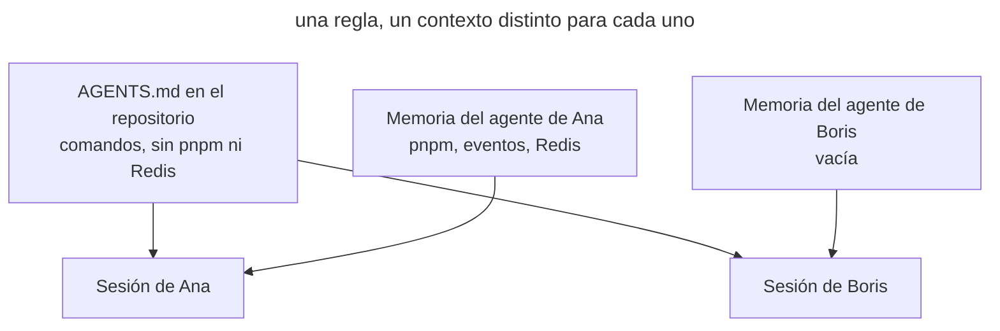

# Memoria privada

## También conocido como

Private agent memory, auto memory, Memories, memoria personal del agente.

## Contexto

El agente puede llevar sus propias notas sobre el proyecto y cargarlas en sesiones posteriores. Lo corriges en el chat o le dices «recuerda», y el agente escribe la conclusión en su memoria. Esa memoria vive fuera del repositorio: en tu directorio personal o en tu cuenta del proveedor. En Claude Code esta memoria está activada por defecto.

## Problema

El conocimiento del proyecto se queda en la memoria privada del agente y no en el repositorio. Una regla que el agente dedujo de tus correcciones funciona solo en tu máquina. Tu compañero, la CI y otro agente no la tienen. Cada miembro del equipo acaba con su propio contexto, y la misma petición hace que el agente se comporte de forma distinta con cada persona.

## Por qué se hace

- La memoria está activada por defecto, y la gente descubre que existe solo por un mensaje «Saved 2 memories».
- Decir «recuerda» es más rápido que abrir _AGENTS.md_ y formular una regla para todos.
- La corrección ayuda enseguida: en tu máquina el agente deja de equivocarse, así que el problema no se ve.
- La memoria parece un ajuste personal, como el tema del editor, aunque en ella se acumulan hechos sobre el código y los comandos del proyecto.

## Consecuencias

- ➖ El agente se comporta distinto con cada persona, y el fallo «a mí el agente no me hace eso» no se puede reproducir.
- ➖ Las reglas no pasan revisión: nadie ve qué dedujo el agente de las correcciones ni si se equivocó.
- ➖ Las entradas caducan sin que nadie lo note. El proyecto cambió de gestor de paquetes, pero la memoria sigue sugiriendo el antiguo.
- ➖ El conocimiento se va con la persona o con la máquina: un portátil nuevo o un compañero nuevo empiezan de cero.
- ➖ La memoria y _AGENTS.md_ divergen, y el agente recibe instrucciones contradictorias de dos fuentes.

## Señales

- La interfaz del agente muestra mensajes sobre recuerdos guardados o leídos.
- Un compañero se queja de un error del agente que tú «corregiste» hace tiempo.
- En _AGENTS.md_ falta una regla que tu agente cumple sin recordatorio.
- Le dices al agente «recuerda» en lugar de «añade a AGENTS.md».
- En el directorio de memoria del agente hay comandos de compilación, convenciones y límites de módulos.

## Cómo hacerlo mejor

Desactiva la memoria del agente en un proyecto de equipo de modo que el ajuste viva en el repositorio y se aplique a todos. Globalmente puedes dejar la memoria activada para proyectos personales: desactivarla en el proyecto tiene prioridad. Escribe todo lo que el agente debe saber del proyecto en la [memoria del proyecto](agents-md-memory.md), el [vocabulario del dominio](domain-context-file.md) y otros archivos que pasan revisión. Tus propias preferencias, como el idioma de las respuestas o el estilo de los commits, las escribes tú mismo en el archivo de instrucciones de usuario del agente. Así cada regla tiene autor e historial de cambios, y las sesiones de distintas personas parten del mismo contexto.

### Lo que no depende del agente

#### Trasladar la memoria acumulada

Es un prompt normal que ejecutas una vez antes de desactivar la memoria. El agente lee su memoria sobre el proyecto y reparte las entradas: comandos y convenciones a _AGENTS.md_, términos al glosario, tus preferencias personales al archivo de instrucciones de usuario. No traslada las entradas obsoletas o erróneas. Revisas el diff, y después el agente borra las entradas originales.

##### Ejemplo

```text
Traslada tu memoria sobre este proyecto al repositorio
```

#### Una regla en lugar de «recuerda»

Cuando una corrección afecta al proyecto, pide al agente que añada una regla a _AGENTS.md_ en lugar de recordarla. La petición «recuerda» va dirigida al agente, y donde la memoria está activada, la entrada se queda con él. Un cambio en _AGENTS.md_ llega a un commit, y el equipo lo ve en la revisión.

##### Ejemplo

```text
Añade a AGENTS.md: las dependencias se instalan solo con pnpm
```

### Claude Code

Comprobado con Claude Code 2.1.316 y la [documentación de memoria](https://code.claude.com/docs/en/memory) el 2026-10-31.

#### Auto memory

Auto memory es una función integrada, y en las sesiones locales está activada por defecto. Claude decide por su cuenta qué guardar y escribe notas en _~/.claude/projects/&lt;proyecto&gt;/memory/_; el índice de esas notas se carga en cada sesión. La memoria está ligada al repositorio y a la máquina y no se comparte con compañeros, otras máquinas ni entornos en la nube. Cuando dices «recuerda», Claude escribe en auto memory, y en las instrucciones del proyecto solo si se lo pides explícitamente.

Pide a Claude que desactive auto memory en el proyecto. Lo escribe en los ajustes del proyecto, que se suben con el código, así que auto memory se desactiva para todo el equipo y sigue activa en tus otros proyectos. El interruptor de `/memory` la desactiva solo para ti y en todos los proyectos a la vez.

##### Ejemplo

```text
Desactiva auto memory en este proyecto para todo el equipo
```

### Codex

Comprobado con Codex CLI 0.166.0 y la [documentación de Memories](https://learn.chatgpt.com/docs/customization/memories) el 2026-10-31.

#### Memories

Memories es una función integrada, desactivada por defecto. Si la activaste, Codex genera entradas a partir de sesiones anteriores y las guarda en _~/.codex/memories/_ como un único almacén para toda la máquina. La propia documentación aconseja mantener las reglas obligatorias del equipo en _AGENTS.md_ y llama a Memories una capa auxiliar de recuerdo.

Si tienes Memories activada globalmente, pide a Codex que la desactive en el proyecto de equipo. Lo escribe en la configuración del proyecto; súbela al repositorio para que el ajuste se aplique a tus compañeros. Codex lee la configuración del proyecto solo en proyectos de confianza, y ahí tiene prioridad sobre la de usuario. Lo comprobamos en la práctica con Codex CLI 0.166.0.

##### Ejemplo

```text
Desactiva Memories en este proyecto, déjala activada globalmente
```

## Ejemplo

**Antes**

> En dos semanas de trabajo, la auto memory de Ana ha reunido tres entradas: «el gestor de paquetes es pnpm», «los dominios se comunican mediante eventos», «los tests de la API necesitan un Redis local». Con Ana el agente lo hace todo bien. Boris toma una tarea en el mismo repositorio, y su agente ejecuta `npm install`, llama directamente al servicio de notificaciones y falla en los tests sin Redis.



En el diagrama ambas sesiones leen el mismo _AGENTS.md_, pero la sesión de Ana recibe además tres reglas de su memoria privada. La sesión de Boris no las ve, y la misma petición da otro resultado.

**Después**

> Ana pide al agente que traslade su memoria al repositorio. Las tres reglas llegan a _AGENTS.md_ y pasan revisión, donde Boris añade el comando que arranca Redis. En el mismo PR el agente desactiva auto memory en los ajustes del proyecto. La siguiente sesión de Boris instala las dependencias con pnpm y lanza las notificaciones mediante un evento.

## Patrones y antipatrones relacionados

- [Memoria del proyecto](agents-md-memory.md) es adonde se mudan las reglas de la memoria privada del agente.
- [Vocabulario del dominio](domain-context-file.md) recoge los términos que el agente, si no, recordaría por su cuenta.
- [Memoria hinchada](bloated-agents-md.md) describe el problema opuesto: el archivo compartido tiene las reglas, pero demasiadas.
- [Mantenimiento programado](scheduled-maintenance.md) incluye una pasada por la memoria del agente para quien aún no la ha desactivado.
