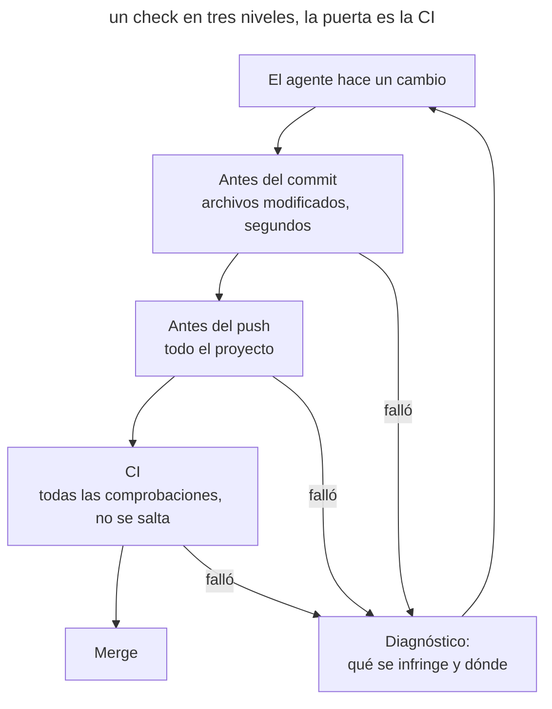

# Puertas de calidad

## Propósito

Imponer los estándares de código del proyecto con comprobaciones deterministas que se ejecutan en cada cambio y rompen la compilación ante una infracción. El agente recibe la señal de inmediato y corrige el problema por sí mismo, y la regla se aplica igual a cada autor, agente y máquina.

## También conocido como

Quality gates, enforcement as code, comprobaciones obligatorias, puertas de lint.

## Problema

El agente escribe mucho código y rápido. Sigue los estándares de _AGENTS.md_, como «los dominios se comunican solo mediante eventos» o «no dejes dependencias sin usar», de forma probabilística: en una sesión larga la regla se pierde entre el resto del contexto. La revisión tampoco da abasto. El diff es grande, la atención se va al estilo y una infracción de los límites de un módulo pasa inadvertida. Cada uno de esos comentarios de revisión lo habría hecho una máquina en un segundo.

Los proyectos suelen tener ya linters, pero no funcionan como puerta. Unos muestran advertencias y terminan con éxito, otros solo se ejecutan en el editor, otros están en un hook fácil de saltar. El agente no ve esa señal o no la considera obligatoria. Cada persona del equipo usa agentes y ajustes distintos, y lo único que todos ven es el repositorio y la CI.

## Solución

Convierte cada regla comprobable sin ambigüedad en una herramienta que termina con un código distinto de cero ante una infracción. Un único comando `check` ejecuta todas las comprobaciones, y la CI llama al mismo comando, así que la ejecución local y la CI no pueden divergir.

Las comprobaciones se reparten en tres niveles. Antes del commit se revisan en segundos los archivos modificados: formato, linters, secretos, formato del mensaje. Antes del push se revisa todo el proyecto: tipos, el lint completo, dependencias. La CI lo ejecuta todo, incluidas las comprobaciones que necesitan red o base de datos. Un hook es una comodidad; solo la CI es una puerta, porque no se puede saltar.

_AGENTS.md_ recoge el comando y la regla: un cambio no está listo hasta que `check` pasa. El agente lo ejecuta por su cuenta, lee el diagnóstico y corrige el código. Las reglas nunca se desactivan para conseguir una compilación verde: una excepción es estrecha, una ruta y una regla, con un motivo y una decisión humana. En código antiguo una comprobación nueva falla, así que introdúcela con un baseline: las infracciones nuevas rompen la compilación y las antiguas quedan listadas y se resuelven poco a poco. Cada comprobación se ve fallar una vez; si no, nadie sabe si funciona.

Una instrucción sin comprobación es un consejo. Si una regla se puede comprobar, añade la comprobación y quita la línea de _AGENTS.md_.

## Estructura

En el diagrama un cambio pasa por tres niveles de comprobaciones. Todos los niveles ejecutan el mismo comando con distinto alcance.



El agente recibe el error en el primer nivel que lo detecta y lo corrige antes de la revisión. Si alguien saltó el hook o un compañero nunca lo instaló, la CI detiene la misma infracción.

## Participantes / Componentes

- **Una herramienta de comprobación** — linter, comprobador de tipos, reglas de arquitectura, escáner de secretos — termina con código distinto de cero ante una infracción.
- **El comando `check`** ejecuta todas las comprobaciones igual en la máquina del desarrollador y en la CI.
- **Los hooks** ejecutan la parte rápida de las comprobaciones antes del commit y del push.
- **La CI** lo ejecuta todo y protege la rama de destino.
- **Un baseline** registra las infracciones existentes para que solo fallen las nuevas.
- **El agente** ejecuta `check`, lee el diagnóstico y corrige el código.
- **El desarrollador** elige las reglas, aprueba las excepciones y convierte los comentarios de revisión recurrentes en comprobaciones.

## Cuándo aplicarlo

- El agente escribe código en el repositorio con regularidad.
- En la revisión se repiten los mismos comentarios.
- En el proyecto trabajan varias personas o varios agentes.
- El estándar se puede formular sin ambigüedad: un límite de módulo, una llamada prohibida, el formato, código sin usar.

## Consecuencias y compromisos

- ➕ El agente corrige las infracciones por sí mismo, antes de la revisión y sin tu intervención.
- ➕ La revisión queda libre para el sentido del cambio: arquitectura, requisitos, riesgos.
- ➕ Una regla se aplica igual para cada autor, en cada agente y en cada máquina.
- ➕ Las reglas que se convirtieron en comprobaciones salen de _AGENTS.md_, y la memoria del proyecto se acorta.
- ➖ Adoptarlas en código antiguo requiere un baseline y una limpieza gradual.
- ➖ Las comprobaciones lentas frenan el ciclo del agente, así que pasan al nivel del push y a la CI.
- ➖ El agente puede «arreglar» la comprobación en lugar del código: desactivar una regla o ampliar una lista de exclusiones. Las excepciones hay que mirarlas en la revisión.
- ➖ Una comprobación cubre solo lo formalizable. Lo que requiere criterio sigue en la revisión.

## Implementación

### Lo que no depende del agente

#### Adoptar las puertas

Es un prompt normal en modo de planificación. El agente estudia el proyecto: lenguajes, gestores de paquetes, linters, hooks y CI existentes. Según el stack elige herramientas, las reúne en un único comando `check`, lo conecta a los hooks y a la CI, prepara un baseline para el código antiguo y añade la regla a _AGENTS.md_. El plan muestra qué añadirá, qué dejará como está y por qué. Tras implementarlo, el agente demuestra que cada comprobación nueva puede fallar.

Una lista curada ayuda a elegir herramientas. [Dev Quality Gates](https://github.com/mokevnin/dev-quality-gates) recomienda una herramienta por tarea, con sus límites, e incluye instrucciones de adopción para el agente ([instrucciones](https://github.com/mokevnin/dev-quality-gates/blob/main/docs/adopt.md)). La lista la mantiene el autor de este libro. Ejecuta la adopción una vez por proyecto, y otra vez cuando cambie el stack.

##### Ejemplo

```text
Aplica https://github.com/mokevnin/dev-quality-gates a este repositorio
```

#### Una comprobación a partir de un comentario de revisión

Es un prompt normal. Cuando el mismo comentario aparece por segunda vez en la revisión, pide al agente que lo convierta en una comprobación. El agente elige una herramienta adecuada o escribe una regla para una ya conectada, la prueba con el código actual y la añade a `check`. Redacta el mensaje de error de modo que diga cómo corregir la infracción: lo lee el agente.

##### Ejemplo

```text
Convierte este comentario en una comprobación para que la CI lo detecte sola
```

### Claude Code

Comprobado con Claude Code 2.1.316 y la [documentación de hooks](https://code.claude.com/docs/en/hooks) el 2026-10-31.

#### Una comprobación antes de terminar la respuesta

Un Stop hook es una función integrada de Claude Code. El hook ejecuta un comando cuando Claude está a punto de terminar su respuesta. Si la comprobación falla, Claude recibe su salida y sigue trabajando en lugar de dar el trabajo por terminado. Los hooks de los ajustes del proyecto se suben con el código y se aplican a todo el equipo. Pon en ese hook la parte rápida de las comprobaciones y deja el conjunto completo a la CI.

##### Ejemplo

```text
Crea un hook para todo el equipo: antes de terminar la respuesta ejecuta las comprobaciones rápidas y sigue trabajando hasta que pasen
```

### Codex

Comprobado con Codex CLI 0.166.0 y la [documentación de hooks](https://learn.chatgpt.com/docs/hooks) el 2026-10-31.

#### Una comprobación antes de terminar la respuesta

Un Stop hook es una función integrada de Codex. Si la comprobación falla, el hook devuelve a Codex al trabajo, y el motivo se convierte en un nuevo prompt. Los hooks del proyecto viven en el repositorio, pero solo se cargan en un proyecto de confianza, y cada compañero revisa y aprueba una vez un hook nuevo o modificado en `/hooks`. Así que, tras un cambio así, avisa a tus compañeros.

##### Ejemplo

```text
Crea un hook para todo el equipo: antes de terminar la respuesta ejecuta las comprobaciones rápidas y sigue trabajando hasta que pasen
```

## Ejemplo

Un servicio de facturación vive con una regla en _AGENTS.md_: los dominios se comunican solo mediante eventos. El agente añade una notificación de cobro fallido e importa el cliente de notificaciones directamente desde el dominio vecino. De paso instala un paquete para formatear fechas y luego deja de usarlo. Un revisor encuentra ambas infracciones al día siguiente, y el agente rehace el trabajo.

Lanzas la adopción de las puertas. El agente conecta una regla de límites entre dominios y una búsqueda de dependencias sin usar, las reúne en `check` junto con el linter y el comprobador de tipos existentes, pone la parte rápida en el hook previo al commit y todo en la CI. Para dos infracciones antiguas de límites prepara un baseline. La línea sobre eventos en _AGENTS.md_ se sustituye por la regla «un cambio no está listo hasta que `mise run check` pasa».

La siguiente tarea parecida choca con la comprobación antes del commit:

```text
src/billing/notify.ts → src/notifications/client.ts
  infringido: los dominios se comunican solo mediante eventos
  corrección: publica PaymentFailed, suscriptor en src/notifications
```

El agente publica el evento, elimina el paquete sobrante y vuelve a ejecutar `check`. El diff que llega a la revisión ya no tiene ninguno de los dos problemas, y el revisor mira la propia lógica de las notificaciones.

## Antipatrones y errores comunes

- **Una comprobación solo en un hook.** Un hook se puede saltar o no instalar. Sin la CI la regla no es obligatoria.
- **Advertencias en lugar de errores.** Una herramienta que termina con éxito ante una infracción no es una señal que el agente atienda.
- **Compilación verde a cualquier precio.** El agente desactiva una regla o amplía una lista de exclusiones. Las excepciones deben ser estrechas y pasar revisión.
- **Una comprobación nueva sin baseline.** Miles de errores antiguos empujan al agente a corregirlo todo a la vez o a desactivar la regla.
- **Una comprobación que nadie ha visto fallar.** Una ruta o una configuración erróneas dan una puerta siempre verde.
- **Todo de golpe.** Herramientas para categorías que el proyecto no tiene solo frenan el ciclo.

## Usos conocidos

- **Dev Quality Gates** reúne una herramienta por tarea, describe los niveles de ejecución, los baselines y las excepciones, y da al agente instrucciones de adopción.
- **El repositorio de este libro** ejecuta jactionlint, betterleaks, typos, rumdl, agnix y oxlint con un único comando `mise run check` mediante hk, y la CI llama al mismo comando.
- **Boris Cherny** cuenta que convierte los comentarios de revisión recurrentes en reglas de lint mencionando a `@claude` directamente en el PR ([podcast](https://youtu.be/julbw1JuAz0?t=2715)).
- **Birgitta Böckeler** describe las reglas de dependencias y los linters con consejos de corrección como sensores de mantenibilidad para el agente ([artículo](https://martinfowler.com/articles/sensors-for-coding-agents.html)).

## Patrones relacionados

- [Bucle de retroalimentación](give-agent-a-way-to-verify.md) define una comprobación para una tarea, mientras que las puertas de calidad imponen los estándares de todo el proyecto en cada cambio.
- [Límites ejecutables](executable-guardrails.md) limitan las acciones del agente en el entorno, mientras que las puertas de calidad comprueban el código que deja.
- [Memoria del proyecto](agents-md-memory.md) guarda el comando `check` y la regla para ejecutarlo.
- [Memoria hinchada](bloated-agents-md.md) se reduce cuando las reglas comprobables pasan a ser comprobaciones.
- [Escritor y revisor](writer-reviewer.md) sigue para lo que requiere criterio.
