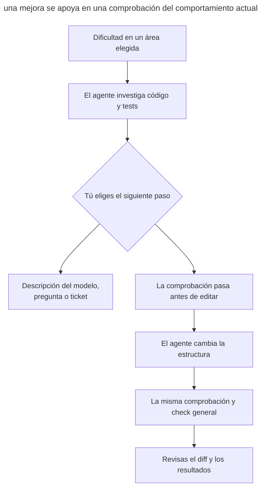
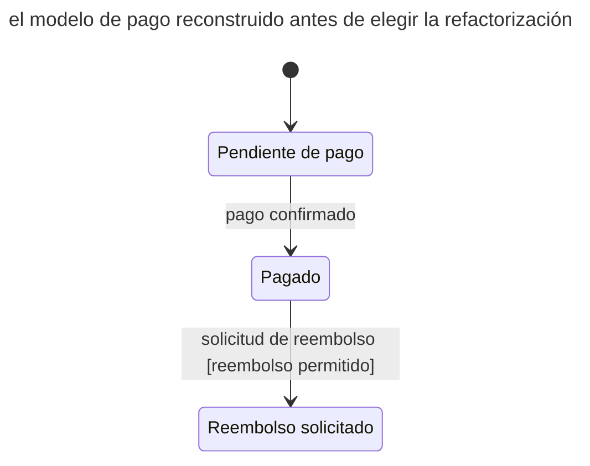
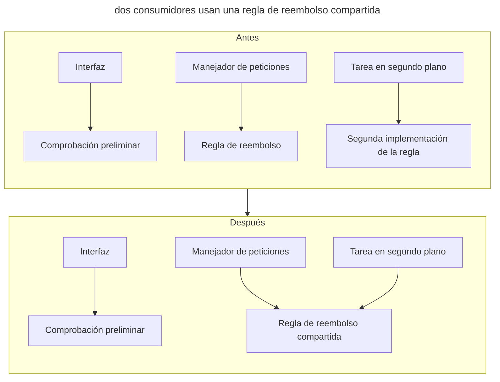

# Refactorización

## Propósito

Simplificar con un agente la estructura del código existente mediante cambios pequeños y verificables, conservando su comportamiento observable. Tú eliges la dificultad que merece la pena eliminar, validas el modelo que recupera el agente y aceptas el cambio según las comprobaciones.

## También conocido como

Agent-assisted refactoring, refactorización con un agente, simplificación estructural.

## Problema

Para añadir una condición de reembolso tienes que cambiar un manejador de peticiones, una tarea en segundo plano y una comprobación de la interfaz. El agente encuentra expresiones parecidas y propone un helper compartido. Pero una expresión puede decidir si se muestra un botón y otra determinar el derecho definitivo al reembolso. Unificarlas por su parecido cambia la regla sin que te des cuenta.

«Mejora la arquitectura» deja demasiada libertad al agente. Puede añadir capas, renombrar decenas de entidades y actualizar dependencias en un solo diff. Incluso los tests que pasan dicen poco sobre la conservación del comportamiento si el agente también ha reescrito sus expectativas para ajustarlas a la nueva implementación.

## Solución

Empieza por una dificultad concreta: una regla exige cambios en varios lugares, una transición de estado resulta difícil de seguir o comprobar un cálculo requiere servicios externos. En modo de planificación, el agente investiga el área elegida, vincula sus hallazgos al código y los tests y propone un cambio. Tú evalúas si realmente facilita la siguiente tarea.

Separa la recuperación del modelo de su modificación. Una descripción de estados puede ser un resultado suficiente de la investigación. Una combinación de campos poco clara se convierte en una pregunta sobre el dominio; un error descubierto, en una tarea aparte. La refactorización cambia la estructura conservando el [comportamiento observable](https://refactoring.com/).

Antes de editar, identifica cómo se comprueba el contrato actual. Si falta un escenario en los tests, fíjalo primero a través de la interfaz pública existente. Tras aprobar el plan, el agente realiza la transformación elegida y repite la comprobación. Aborda por separado las mejoras independientes para que cada una tenga un motivo claro y un resultado verificable.

## Estructura

La comprobación conecta el comportamiento original con el resultado del cambio. La investigación puede terminar con una descripción del modelo, una pregunta o un ticket sin editar código.



Si la comprobación falla tras editar, el agente investiga la diferencia respecto al contrato original. Cambiar el resultado esperado necesita una justificación aparte: puede ocultar un cambio de comportamiento.

## Participantes / Componentes

- **Tú** eliges el área, validas el significado de las reglas y apruebas el plan de cambio.
- **El agente** investiga el código, propone la transformación, edita e informa de las comprobaciones.
- **El contrato** define el comportamiento que se conserva: resultados, errores, llamadas externas y su orden.
- **Las comprobaciones** observan ese contrato antes y después del cambio.

## Cuándo aplicarlo

- Las tareas pequeñas exigen repetidamente cambios coordinados en varios lugares.
- Tienes que reconstruir el significado de estados o reglas de negocio a partir de condiciones cada vez.
- Las capas innecesarias dificultan seguir una llamada y entender la responsabilidad de un módulo.
- Necesitas simplificar un área antes de añadir una funcionalidad allí.

## Consecuencias y compromisos

- ➕ Evalúas la utilidad respecto a una siguiente tarea concreta y ves el motivo de cada cambio.
- ➕ Las comprobaciones a través de una frontera pública siguen siendo útiles al reorganizar el código interno.
- ➕ La investigación descubre reglas poco claras antes de convertirlas en una nueva abstracción.
- ➖ Una cobertura escasa exige recuperar primero el contrato y añadir comprobaciones.
- ➖ El agente puede confundir un parecido accidental con una regla compartida; tú confirmas su significado.
- ➖ Un cambio amplio de una interfaz compartida requiere coordinar la migración de sus consumidores.

## Implementación

### Enfoque que no depende del agente

#### Elegir el cambio y comprobar el comportamiento

Empieza donde cambiar algo ya resulta difícil. El agente muestra qué lugares tienes que leer o editar juntos y explica cómo la transformación reducirá ese trabajo. Menos líneas no significa por sí solo un código más claro. Una mejora útil puede eliminar una capa, unificar una regla confirmada o permitir comprobar un cálculo de forma independiente.

Un agente que busca el diff mínimo puede repetir un defecto del código vecino. Permítele proponer una mejora más amplia y explicar el beneficio; tú eliges su alcance considerando la causa de la dificultad y los requisitos actuales.

El plan debe mostrar el contrato existente y una comprobación que lo observe. En un cálculo pueden ser los resultados y el redondeo; en un reembolso, también las peticiones repetidas, el orden de escrituras y mensajes y el tratamiento de errores. Si las comprobaciones ya fallan, averigua primero por qué: necesitas un estado inicial que entiendas. Tras editar, el agente ejecuta las comprobaciones pertinentes y el `check` general del proyecto.

Mantén el cambio centrado en la tarea, incluyendo todas las actualizaciones necesarias de llamadas y tests. Si el equipo controla a todos los consumidores de una interfaz interna, puedes actualizarlos en un único cambio coordinado. Para una API externa, considera el contrato de compatibilidad. Divide una sustitución amplia en expand–contract: añade la nueva forma, migra a los consumidores y después elimina la antigua; los [tickets trazadores](tracer-bullet-tickets.md) describen este orden.

Una mejora pequeña encaja antes de la funcionalidad que la necesita, como paso verificable por separado. La [refactorización continua](https://martinfowler.com/bliki/OpportunisticRefactoring.html) se complementa con la búsqueda periódica de candidatos del [mantenimiento programado](scheduled-maintenance.md).

##### Ejemplo

```text
Simplifica la comprobación del derecho a reembolso en pagos
```

#### Máquinas de estados implícitas

Este prompt normal busca ciclos de vida ocultos en estados, flags, campos que admiten null, fechas y condiciones. El agente propone nombres de estados, eventos, condiciones y acciones de transición, y los vincula con código y tests. La descripción se apoya en los conceptos de [estados y transiciones](https://www.w3.org/TR/scxml/#Core); un diagrama permite ver una transición que de otro modo tendrías que reconstruir a partir de varios manejadores.

Separa el comportamiento confirmado por el código de las reglas inferidas. La combinación «pago pendiente, fecha de liquidación rellenada» puede ser un fallo, un estado intermedio válido o un resto de una migración antigua. Describe por separado los estados independientes del pago y del envío de notificaciones: los [estados paralelos](https://stately.ai/docs/parallel-states) no tienen por qué convertirse en una sola enumeración. Primero valida el modelo; después decide si hace falta refactorizar y qué representación conviene.

Empieza por un área del dominio donde se añaden flags y bifurcaciones con frecuencia. Resuelve con el agente las dudas sobre transiciones permitidas.

##### Ejemplo

```text
Encuentra las máquinas de estados implícitas en pagos y propón sus descripciones
```

#### Reglas de negocio dispersas

Es un prompt normal. El agente busca una misma regla repetida en manejadores, políticas y tareas en segundo plano, y muestra las diferencias con referencias al código. Por ejemplo, el derecho a un reembolso puede calcularse de forma distinta en la interfaz y en una tarea de procesamiento de pagos. Tú determinas si la diferencia es accidental o si las condiciones expresan reglas diferentes. Esta pasada complementa la [comprobación de términos](domain-context-file.md): un mismo nombre no garantiza un mismo comportamiento.

Lánzalo después de una serie de cambios en un área o cuando una modificación exige tocar varios sitios de forma recurrente. Unifica las implementaciones después de confirmar la regla compartida.

##### Ejemplo

```text
Encuentra reglas de negocio de pagos implementadas en varios sitios
```

#### Abstracciones innecesarias

Este prompt normal busca capas que obligan a leer más archivos sin ocultar apenas complejidad. El agente muestra el código que las llama antes y después de quitarlas y explica dónde quedaría su responsabilidad. En el catálogo de Fowler, [Inline Class](https://refactoring.com/catalog/inlineClass.html) es la operación inversa de extraer una clase: eliminar una abstracción puede ser una mejora.

Comprueba también los puntos de extensión previstos para requisitos futuros. Si el proyecto exporta un solo formato, un sistema universal de plugins puede complicar su único escenario. Antes de simplificarlo, el agente comprueba las llamadas reales y los compromisos de extensión: eliminar una capa debe conservar todo el escenario actual, incluido el manejo de errores.

Lánzalo sobre un área donde incluso una tarea pequeña obliga a saltar entre muchos archivos. Usa el skill de la sección «Arquitectura» de abajo para trabajar el cambio elegido.

##### Ejemplo

```text
Encuentra abstracciones en app/services que se puedan eliminar
```

#### Conceptos ocultos en primitivos

Este prompt normal busca valores del dominio representados con cadenas y números alrededor de los cuales se repiten validaciones, conversiones y comparaciones. El agente propone un nombre para el concepto y sus invariantes. Por ejemplo, el dinero puede necesitar un importe y una moneda juntos; una duración, una unidad explícita. [Replace Primitive with Object](https://refactoring.com/catalog/replacePrimitiveWithObject.html) ilustra esta dirección; su valor depende de la regla compartida que permite expresar.

Lánzalo sobre un área donde se validan los mismos valores en varios sitios o se confunden unidades. Acuerda el término con el glosario y después elige la representación.

##### Ejemplo

```text
Encuentra conceptos del dominio de pagos ocultos en cadenas y números
```

#### Cálculos y efectos

Es un prompt normal. El agente muestra dónde el cálculo de un precio o la decisión de reembolso se mezcla con escrituras en la base de datos, peticiones de red o mensajes. Después propone un límite donde comprobar la decisión por separado. [Separate Query from Modifier](https://refactoring.com/catalog/separateQueryFromModifier.html), de Fowler, separa el cálculo de un importe del envío de una factura.

Lánzalo donde comprobar una regla de negocio requiere arrancar servicios externos. Al refactorizar, verifica también el orden de los efectos, la gestión de errores y los límites de las transacciones: un mismo resultado final no basta para demostrar que se conserva el comportamiento.

##### Ejemplo

```text
Encuentra sitios de pagos donde los cálculos se mezclan con efectos secundarios
```

#### Código muerto y soluciones temporales

Este prompt normal busca ramas sin uso, flags de funcionalidades ya completadas y compatibilidad que ha dejado de ser necesaria. Empieza con las [comprobaciones de código sin uso](quality-gates.md) del proyecto; después el agente investiga los candidatos restantes. Para borrar hacen falta pruebas sobre quienes lo llaman, los puntos de entrada y las versiones admitidas. La ausencia de una referencia estática no descarta llamadas mediante configuración, reflexión o consumidores externos.

Lánzalo al completar una migración o eliminar una función antigua. Si no se conoce el periodo de soporte, el resultado será una pregunta a quien mantiene la compatibilidad, en lugar de una rama borrada.

##### Ejemplo

```text
Encuentra código muerto y soluciones temporales obsoletas en pagos
```

#### Arquitectura

Es el skill `improve-codebase-architecture` del [paquete de Matt Pocock](matt-pocock-skills.md) ([código fuente](https://github.com/mattpocock/skills/tree/4ae2317ddb22b046e26455e4f9c9b3aaaf62212d/skills/engineering/improve-codebase-architecture)). Carga por sí mismo `codebase-design` y `grilling`. El plan se convierte en tickets con el skill `to-tickets` ([código fuente](https://github.com/mattpocock/skills/tree/4ae2317ddb22b046e26455e4f9c9b3aaaf62212d/skills/engineering/to-tickets)).

El skill toma su vocabulario de `codebase-design`: módulo, interfaz, profundidad, costura, adaptador. Luego lee _GLOSSARY.md_ y los ADR del área elegida, y un subagente recorre el código buscando fricción: para entender un concepto hay que saltar entre muchos módulos pequeños; una interfaz es casi tan compleja como su implementación; los módulos se filtran unos en otros a través de las costuras. A los módulos sospechosos se les aplica la prueba de borrado: si borraras el módulo, ¿la complejidad se concentraría en un sitio o solo se movería? El skill presenta los candidatos en un informe HTML en una carpeta temporal. Para el candidato elegido hace un `grilling` y, si quieres, compara variantes de interfaz con [Diseña dos veces](design-it-twice.md). `to-tickets` convierte el plan acordado en tickets verificables con dependencias de bloqueo y los publica en el tracker.

Usa el skill con el agente cuando varios módulos conectados dificulten los cambios. Compara interfaces tras elegir una dificultad concreta; planifica las sustituciones mecánicas amplias mediante expand–contract.

##### Ejemplo

```text
/improve-codebase-architecture app/services
```

Después de trabajar el sitio elegido, lanza `/to-tickets`.

### Claude Code

Los datos de simplificación se comprobaron con Claude Code 2.1.319 y la [referencia de comandos](https://code.claude.com/docs/en/commands) el 2026-11-07.

#### Simplificación: `/simplify`

`/simplify` es un skill integrado. Cuatro subagentes comprueban en paralelo reutilización, simplificación, eficiencia y nivel de abstracción; después se aplican las correcciones. Puedes pasar una ruta o una referencia a un PR. El skill no busca errores de corrección funcional ([documentación](https://code.claude.com/docs/en/commands)).

Ejecútalo para simplificar un área elegida tras entender su comportamiento. Antes de invocarlo, asegúrate de que pasa la comprobación del contrato actual. Repítela después de editar: una revisión de legibilidad no demuestra que resultados, errores y efectos sigan siendo los mismos.

##### Ejemplo

```text
/simplify app/services
```

### Codex

Este bloque se comprobó con Codex CLI 0.167.0 y la [guía de refactorización](https://learn.chatgpt.com/use-cases/refactor-your-codebase) el 2026-11-07.

La [guía de refactorización de OpenAI](https://learn.chatgpt.com/use-cases/refactor-your-codebase) describe pasadas pequeñas con comprobaciones de comportamiento. Las peticiones generales anteriores también sirven en Codex.

#### Una pasada repetible como skill

Cuando varias pasadas reales hayan mostrado qué entradas y resultados ayudan a tu equipo, usa el skill integrado `$skill-creator` ([documentación](https://learn.chatgpt.com/docs/build-skills)). En la sesión actual ya dispone del contexto de la pasada completada. Prueba el nuevo skill en otra área antes de programarlo.

##### Ejemplo

```text
$skill-creator
```

## Ejemplo

En este ejemplo didáctico, añades una condición de reembolso y ves que tienes que leer tres comprobaciones parecidas: en la interfaz, el manejador de peticiones y una tarea en segundo plano. En modo de planificación, empiezas por el modelo de pago:

> Encuentra las máquinas de estados implícitas en pagos y propón sus descripciones

El agente relaciona `status`, `settled_at` y `refund_pending` con estados y manejadores de transición. Un diagrama simplificado muestra el ciclo de vida reconstruido:



Cada transición incluye referencias al manejador y al test. El agente señala `status=pending` con `settled_at` rellenado como una duda: ¿es un estado intermedio entre escrituras o una infracción? El envío de notificaciones se describe por separado, ya que los reintentos no cambian el estado del pago.

Confirmas las transiciones conocidas y abres un ticket aparte para la combinación de campos dudosa. Ahora investigas la regla repetida:

> Encuentra reglas de negocio de pagos implementadas en varios sitios

El agente compara las tres comprobaciones. La interfaz solo indica de forma preliminar la disponibilidad del reembolso, mientras que el manejador y la tarea en segundo plano toman la decisión definitiva. Las condiciones de ambas comprobaciones definitivas coinciden; la comprobación preliminar tiene otro contrato. La mantienes separada.

Para refactorizar eliges unificar las dos implementaciones de la decisión definitiva. Antes de editar, los tests a través de los puntos de entrada públicos fijan un reembolso permitido, un rechazo y una petición repetida; donde falta cobertura, el agente añade primero una comprobación. Tras aprobar el plan, traslada la regla compartida y actualiza ambas llamadas, conservando las condiciones y el orden de los efectos. Los mismos tests y el `check` general pasan después del cambio.

El diff muestra una transformación: ahora la regla compartida se cambia en un solo lugar. De esta investigación no deduces la necesidad de una biblioteca de máquinas de estados; la descripción del modelo conserva su utilidad por sí sola.

Añades la nueva condición de reembolso en el siguiente cambio, por separado, ahora en un solo lugar.

El diagrama muestra cómo cambian las llamadas: la regla definitiva tiene una sola implementación, mientras la comprobación preliminar sigue en la interfaz.



## Antipatrones y errores comunes

- **Arquitectura sin dificultad.** El agente añade capas por principios generales y complica la siguiente tarea. Pide una explicación del beneficio en el área elegida.
- **Unificar por parecido.** Condiciones similares representan reglas distintas. Confirma un significado compartido antes de extraer un helper.
- **Ir directamente a una biblioteca de estados.** Los flags descubiertos se convierten en una dependencia antes de validar el modelo y la independencia de los estados.
- **Cambiar comportamiento como limpieza.** Una nueva condición de reembolso o un nuevo orden de efectos exige una decisión y comprobación aparte.
- **Tests verdes gracias a expectativas nuevas.** El agente ajusta el test al cambio y pierde la evidencia de conservación del contrato.
- **Eliminar sin evidencia.** La ausencia de referencias estáticas no excluye llamadas dinámicas ni consumidores externos.
- **Reformas de paso.** Renombrados y actualizaciones de dependencias ocultan la transformación principal en un diff grande.

## Usos conocidos

- La [guía de refactorización de OpenAI](https://learn.chatgpt.com/use-cases/refactor-your-codebase) describe el trabajo con código existente mediante pasadas pequeñas y verificables.
- El [skill integrado `/simplify` de Claude Code](https://code.claude.com/docs/en/commands) revisa oportunidades de simplificación en el código elegido.
- El [skill `improve-codebase-architecture` de Matt Pocock](https://github.com/mattpocock/skills/blob/4ae2317ddb22b046e26455e4f9c9b3aaaf62212d/skills/engineering/improve-codebase-architecture/SKILL.md) conecta la investigación del código con la elección de una mejora contigo.

## Patrones relacionados

- [Mantenimiento programado](scheduled-maintenance.md) organiza la búsqueda periódica de candidatos y la revisión de resultados.
- [Bucle de retroalimentación](give-agent-a-way-to-verify.md) ayuda a elegir una comprobación de comportamiento.
- [Diseña dos veces](design-it-twice.md) ayuda a comparar alternativas para una interfaz elegida.
- [Vocabulario del dominio](domain-context-file.md) fija el significado de los conceptos antes de unificar reglas.
- [Tickets trazadores](tracer-bullet-tickets.md) ordena los pasos de una migración amplia de interfaz.
- [Frases para AGENTS.md](agents-md-phrases.md) establece preferencias duraderas al elegir implementaciones y límites del cambio.
