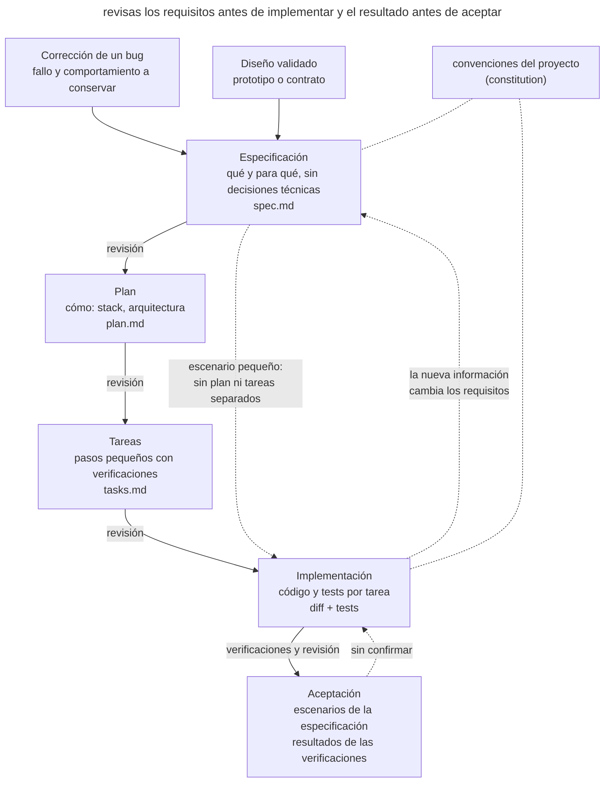

# Desarrollo orientado a especificaciones

## Propósito

Conservar el objetivo y los requisitos en una especificación acordada que guíe la implementación y la verificación del resultado. Los documentos permiten continuar el trabajo en otra sesión y valorar si el resultado corresponde a la intención original.

## También conocido como

Spec-Driven Development (SDD), spec-first, «la especificación como fuente de verdad».

## Problema

En una funcionalidad grande, los requisitos pueden quedar perdidos entre los mensajes de una conversación larga. Una sesión nueva ve el código, pero no conoce todo lo acordado.

Por ejemplo, en el chat se decidió enviar los informes grandes como enlace. En la implementación se quedó el envío de adjuntos, y un agente nuevo no puede saber si fue una limitación deliberada o algo sin terminar. Sin un registro escrito, los requisitos hay que reconstruirlos de memoria del autor. Las correcciones posteriores pueden alejar aún más el comportamiento del objetivo, porque no hay con qué compararlo.

Aceptar código generado sin esa comparación se describe en el antipatrón del [vibe coding](vibe-coding.md).

## Solución

Antes de implementar, acuerda el comportamiento esperado, las restricciones y los criterios de aceptación en una especificación. Úsala al elegir el enfoque, implementar y verificar el resultado. Uno de los flujos de trabajo habituales consta de cuatro etapas.

1. **La especificación** describe escenarios, requisitos, restricciones y criterios de aceptación.
2. **El plan** elige un enfoque técnico una vez acordados los requisitos.
3. **Las tareas** dividen el plan en pasos pequeños con un resultado verificable.
4. **Implementación y aceptación.** El agente ejecuta las tareas contrastándolas con la especificación y el plan, y tú aceptas el resultado a partir de las verificaciones de los escenarios acordados.

En cada transición revisas el documento obtenido. Así puedes corregir un requisito antes de implementarlo. Si la nueva información cambia la tarea, acuerda primero la especificación y después adapta el código a ella.

La aceptación contrasta el resultado con los escenarios acordados. Un plan y una lista de tareas separados ayudan en trabajos grandes; un escenario pequeño se puede implementar directamente a partir de la especificación. Los documentos y el punto de entrada dependen de la tarea.

## Estructura

El diagrama muestra una variante con plan y tareas separados que termina con la aceptación.

Las convenciones permanentes del proyecto limitan las decisiones en cada fase. Para corregir un bug, el punto de partida es su reproducción y el comportamiento que debe conservarse; para un diseño validado, son sus restricciones. El camino de puntos permite que un escenario pequeño omita un plan y tareas separados. La aceptación vincula los escenarios con las verificaciones; los casos fallidos o no verificados devuelven el trabajo a la implementación y la verificación. La flecha a la especificación significa revisar los requisitos cuando la nueva información cambia la tarea; los incumplimientos de los requisitos vigentes se corrigen en la implementación.

## Participantes / Componentes

- **Desarrollador** fija el objetivo y revisa los documentos y el resultado.
- **Agente** prepara los documentos e implementa las tareas acordadas.
- **Especificación** guarda los requisitos y los criterios de aceptación.
- **Plan y tareas** fijan el enfoque técnico y el orden de implementación.
- **Convenciones del proyecto** conservan los estándares y restricciones comunes.

## Cuándo aplicarlo

- El trabajo ocupa varias sesiones.
- Varios participantes necesitan requisitos comunes.
- La corrección del sistema debe contrastarse con escenarios definidos explícitamente.
- El equipo todavía está precisando el comportamiento de un sistema nuevo.

Para un cambio pequeño bastan las [cuatro fases](explore-plan-code-commit.md) o una petición directa.

## Consecuencias y compromisos

- ➕ Los requisitos están disponibles para la siguiente sesión y para otros participantes.
- ➕ Las divergencias entre la implementación y la intención se pueden comprobar con el documento.
- ➕ Los errores en los requisitos y en el enfoque pueden aparecer antes de escribir código.
- ➕ Una especificación al día explica el comportamiento esperado una vez terminado el desarrollo.
- ➖ Preparar los documentos encarece las tareas cortas.
- ➖ Los documentos hay que actualizarlos cuando cambian los requisitos.
- ➖ Demasiado detalle de implementación en la especificación lleva a la [especificación prematura](premature-specification.md).

## Implementación

### Lo que no depende del agente

#### Revisión de requisitos

Antes de elegir la implementación, comprueba que tú y el agente entendéis los escenarios de la misma manera. Palabras como «eliminar», «entregar» o «en hora local» admiten resultados distintos. Comprueba también la compatibilidad de los requisitos: conservar un archivo un día para volver a descargarlo contradice eliminarlo inmediatamente después del envío. Acuerda el comportamiento antes del plan técnico; la [entrevista](let-claude-interview-you.md) ayuda a recoger los requisitos que faltan.

Para los escenarios con acceso a datos, registra quién puede realizar la acción y qué debe ocurrir cuando se deniega el acceso. Por ejemplo, reenviar el enlace de un informe no debe dar acceso a otro usuario. Estos requisitos influyen en el diseño; después, los tests y la revisión comprueban su implementación. Kiro describe esta pasada como [reforzar las especificaciones con requisitos de seguridad](https://kiro.dev/blog/spec-it-safe/). La revisión de requisitos complementa las verificaciones del código y las [puertas de calidad](quality-gates.md).

#### Puntos de entrada

Para una funcionalidad nueva, empieza por el comportamiento requerido, elige después el enfoque y, si hace falta, divide el trabajo en [tickets trazadores](tracer-bullet-tickets.md). Si un prototipo ya ha validado el enfoque técnico o un contrato obligatorio lo determina, úsalo como restricción de partida y acuerda el comportamiento del sistema dentro de esos límites. Esto se distingue de [elegir la implementación prematuramente](premature-specification.md), cuando aún no está claro el objetivo.

Para corregir un bug, registra el escenario que lo reproduce, el resultado esperado y el comportamiento cercano que debe conservarse. Al corregir la zona horaria de una programación, cambia la hora de ejecución y se mantienen las reglas de cancelación y reintentos.

Las variantes de entrada se describen en [Kiro](https://kiro.dev/blog/specs-bugfix-and-design-first/): flujos separados para corregir bugs y partir de un diseño técnico. En el [enfoque de Simon Martinelli](https://tessl.io/blog/spec-driven-development-works-when-specs-are-system-use-cases), los casos de uso y un modelo de dominio guían la implementación sin una etapa separada de plan y tareas.

#### Implementación y aceptación

El agente implementa el alcance acordado y ejecuta las verificaciones de los criterios de aceptación. Al terminar, vincula cada escenario importante con un test, una ejecución de extremo a extremo u otro resultado observable. Los [registros del entorno](give-agent-a-way-to-verify.md) deben mostrar qué se comprobó, qué falló y qué aún no se ha ejecutado. Una lista de tareas completada y una compilación correcta no confirman por sí solas todos los requisitos.

Si el código incumple los requisitos vigentes, corrige la implementación. Si cambian los propios requisitos, acuerda la especificación y actualiza las verificaciones junto con el código. Un [revisor independiente](writer-reviewer.md) contrasta el resultado con la intención y busca casos omitidos. Las evidencias de cumplimiento de los criterios ayudan a esta revisión, pero no hacen innecesaria la revisión de la implementación.

#### Flujos ya preparados

Puedes montar el flujo de trabajo a mano o usar un toolkit ya hecho. [OpenSpec](openspec.md) guarda especificaciones permanentes y deltas de cambios. [Superpowers](superpowers.md) enlaza las fases mediante skills y puntos de control obligatorios. [Los skills de Matt Pocock](matt-pocock-skills.md) guardan las especificaciones y los tickets trazadores en el tracker. Otras herramientas están reunidas en [Enlaces útiles](resources.md) y en la comparativa [spec-compare](https://cameronsjo.github.io/spec-compare/).

## Ejemplo

Añades la exportación programada de informes.

> Añade la exportación programada de informes

El agente prepara una **especificación** para que la revises.

> El usuario elige un informe, una programación y los destinatarios. El sistema envía el informe como máximo cinco minutos después de la hora programada. Si falla la generación, notifica el fallo a los destinatarios. Eliminar un informe desactiva sus programaciones.

En la revisión detectas que no está definida la zona horaria de la programación y la aclaras antes de implementar. También añades un requisito: el destinatario debe tener acceso al informe en el momento del envío. Revocar el acceso impide el envío.

En el **plan**, el agente propone un worker de cron y `report_schedules`. Tú indicas el planificador que el proyecto ya usa, y el agente ajusta el enfoque.

Las **tareas** añaden uno tras otro escenarios verificables: crear una programación, enviar un informe, denegar el envío sin acceso, gestionar un fallo y desactivar las programaciones al eliminar el informe.

Durante la **implementación** se descubre que la pasarela de correo limita los adjuntos a 10 MB. Registras el límite en la especificación: los informes de hasta 10 MB inclusive se envían como adjuntos y los más grandes, mediante un enlace. Para la nueva forma de entrega añades un requisito y tareas: comprobar el acceso vigente al informe en cada descarga. Revocar el acceso o reenviar el enlace a un usuario sin permiso debe provocar el rechazo de la descarga. El requisito de acceso antes del envío se mantiene en ambas formas de entrega.

En la **aceptación**, vinculas los escenarios con los resultados de las verificaciones: el cumplimiento del plazo de envío en la zona horaria elegida con una ejecución del planificador, el umbral de tamaño con tests de informes de 10 y 11 MB, la revocación de acceso con el rechazo del envío y de la descarga, el reenvío del enlace a un usuario sin permiso con el rechazo de la descarga, y la notificación de fallo con un test de error de generación. El registro muestra verificaciones correctas de estos casos y de la desactivación de las programaciones al eliminar el informe. La entrega mediante la pasarela de correo real todavía no se ha comprobado: el agente marca ese escenario como no verificado y realizas una ejecución de extremo a extremo antes de aceptar la exportación.

## Antipatrones y errores comunes

- **Documentos sin revisión.** Los requisitos sin comprobar pueden trasladar un error a la implementación.
- **Solo el caso de éxito.** Entregar un informe a un destinatario autorizado no comprueba que se deniegue el acceso a un usuario sin permiso. Incluye las prohibiciones importantes en los requisitos y las verificaciones.
- **Tareas cerradas equivale a requisitos cumplidos.** Vincula los escenarios acordados con los resultados de las verificaciones; conserva explícitamente el estado de los casos no verificados.
- **Especificación desactualizada.** Cuando cambie el comportamiento, actualiza los requisitos acordados junto con el código.
- **Especificación-pseudocódigo.** Un orden de llamadas detallado antes de explorar la tarea crea una [especificación prematura](premature-specification.md).
- **Proceso excesivo.** Para un cambio pequeño y reversible, el juego completo de documentos puede costar más que el propio trabajo.
- **Especificación en lugar de prototipo.** Los días de documentos exhaustivos antes de la primera versión funcional se analizan en el antipatrón [«Especificación por adelantado»](big-spec-up-front.md).

## Usos conocidos

- [OpenSpec](openspec.md), [Superpowers](superpowers.md) y [los skills de Matt Pocock](matt-pocock-skills.md) se analizan en esta sección. El enfoque general también se describe en el [anuncio de Spec Kit](https://github.blog/ai-and-ml/generative-ai/spec-driven-development-with-ai-get-started-with-a-new-open-source-toolkit/).
- [Microsoft](https://developer.microsoft.com/blog/spec-driven-development-ai-native-engineering/) incluye la aclaración de requisitos y la validación final en el ciclo de SDD y recomienda empezar con un proceso ligero, ampliándolo según haga falta.
- Hay una comparativa de otras herramientas en [spec-compare](https://cameronsjo.github.io/spec-compare/) y en la [recopilación de enlaces](resources.md).

## Patrones relacionados

- [Cuatro fases](explore-plan-code-commit.md) organiza el acuerdo y la implementación a la escala de una sola tarea.
- [Especificación prematura](premature-specification.md) describe el riesgo de elegir la implementación antes de precisar los requisitos.
- [Bucle de retroalimentación](give-agent-a-way-to-verify.md) vincula los criterios de aceptación con verificaciones y evidencias del entorno.
- [Escritor y revisor](writer-reviewer.md) comprueba la implementación frente a los requisitos acordados en un contexto separado.
