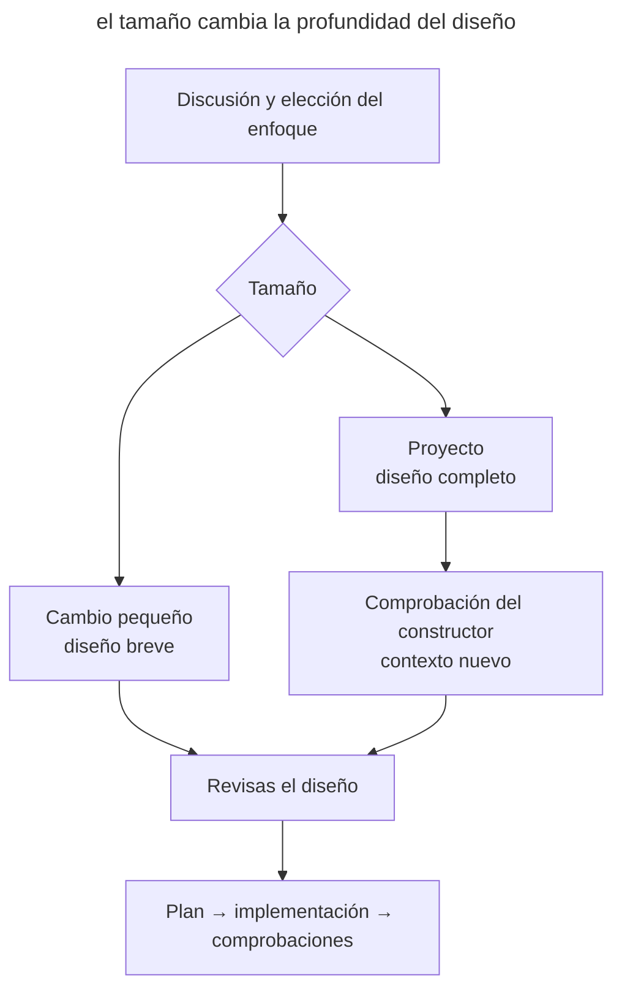

# Superpowers

_Comandos y capacidades de Superpowers 7.0.1 comprobados el 31 de octubre de 2026._

[Superpowers](https://github.com/obra/superpowers), de Jesse Vincent (obra), implementa el [SDD](spec-driven-development.md) como un conjunto de [skills](skills-as-packaged-workflows.md). Entre el diseño y la implementación, las instrucciones fijan puntos de control obligatorios llamados HARD-GATE.

## Instalación

La vía principal de instalación usa el marketplace de Claude Code.

```text
/plugin install superpowers@claude-plugins-official
```

El pack también incluye instrucciones y manifiestos para Codex, Cursor, Antigravity, GitHub Copilot CLI y OpenCode.

## Flujo de trabajo

Al iniciar la sesión, un hook carga `using-superpowers`, que exige comprobar si algún skill es aplicable antes de responder. El agente trata una funcionalidad nueva con `brainstorming` e investiga un bug con `systematic-debugging`.

En `brainstorming` aclaras el objetivo y eliges un enfoque. Un cambio pequeño recibe un diseño escrito breve; un proyecto recibe uno completo. Ambos guardan las alternativas y los motivos de la elección. Revisas el documento antes de implementar.



En un proyecto, el builder check detecta preguntas que impedirían planificar la construcción. Normalmente lo hace un subagente con contexto nuevo; sin esa herramienta, lo hace el propio agente. Un cambio pequeño pasa directamente a tu revisión. Una petición trivial y clara puede ejecutarse directamente; un spike desechable acordado y el rechazo explícito de la entrevista también tienen excepciones propias. Consulta [brainstorming](https://github.com/obra/superpowers/blob/main/skills/brainstorming/SKILL.md).

Tras aprobar el diseño, `writing-plans` prepara tareas con acciones y comprobaciones. El aislamiento mediante `using-git-worktrees` pertenece a la preparación de la ejecución. `subagent-driven-development` o `executing-plans` ejecuta el plan; `test-driven-development` fija el ciclo TDD. `requesting-code-review` y `receiving-code-review` ayudan a revisar, y `finishing-a-development-branch` termina la rama verificada mediante merge o PR, según elijas. `verification-before-completion` exige comprobar antes de declarar el éxito.

## Artefactos

| Artefacto | Dónde vive |
| ---------- | ----------- |
| Documento de diseño | _docs/superpowers/specs/AAAA-MM-DD-\<tema\>-design.md_ |
| Plan de implementación | _docs/superpowers/plans/AAAA-MM-DD-\<funcionalidad\>.md_ |

Los diseños breve y completo se guardan en Markdown. En un proyecto, el builder check precede a tu revisión. El plan aparece tras aprobar el diseño; su ubicación se puede cambiar. Un spike desechable termina con una respuesta; conservar su código requiere una decisión nueva.

## En qué se diferencia

- Un cambio pequeño recibe un diseño escrito breve; un proyecto, uno completo con una comprobación adicional.
- Un hook ayuda al agente a elegir automáticamente el procedimiento adecuado.
- Contextos separados para el ejecutor y el revisor mantienen la implementación aparte de la evaluación.
- El plan incluye pasos red–green–refactor.

## Cuándo elegirlo

Superpowers encaja con un equipo que necesita un orden único con puntos de control obligatorios. Para cambios rápidos este proceso puede resultar excesivo. Si prefieres guardar el resultado de las discusiones en el tracker, compara [los skills de Matt Pocock](matt-pocock-skills.md).
