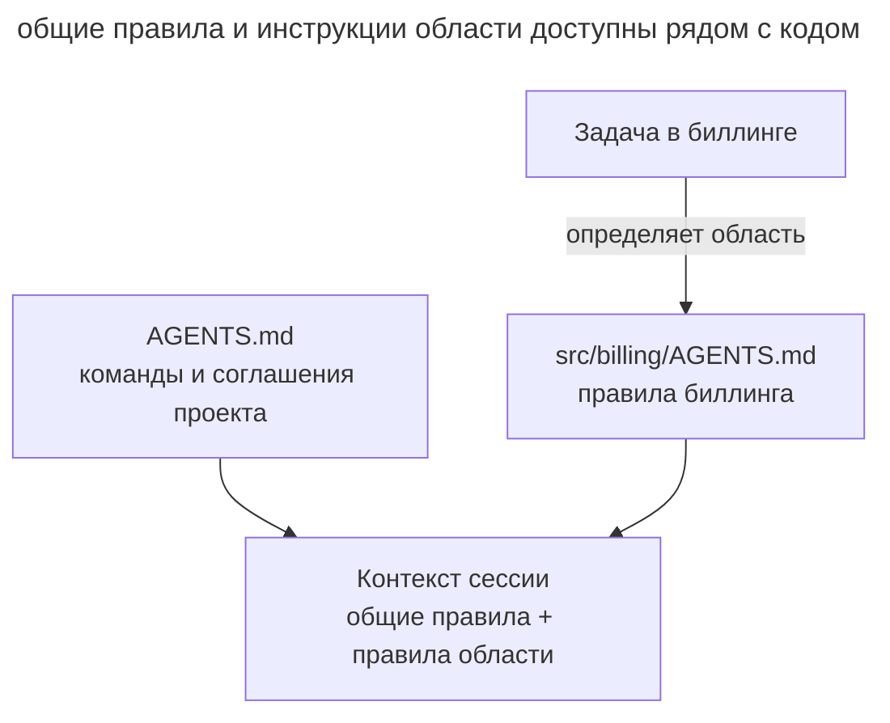

# Память проекта

## Назначение

Завести в репозитории постоянный файл с командами, соглашениями и ограничениями проекта, который агент читает в начале каждой сессии. Вы записываете правило один раз, и следующие сессии получают его из файла.

## Также известен как

AGENTS.md, memory file, файл памяти, project rules, custom instructions.

## Проблема

Новая сессия может не знать, как команда собирает проект и запускает тесты. Вы объясняете правила в переписке, но следующая сессия требует тех же уточнений. Особенно заметно это на нестандартной команде проверки.

Например, агент запускает обычный тестовый скрипт, хотя проект требует `make test` с подготовкой fixtures. Вы исправляете команду в чате. Если сохранить это правило только в переписке, коллега в новой сессии столкнётся с тем же сбоем.

Правила проекта нужны при выполнении разных задач. Их удобнее хранить отдельно от спецификации конкретной фичи.

## Решение

Создайте в репозитории файл, который агент загружает при старте. Запишите в нём команды и неочевидные соглашения, которые иначе пришлось бы объяснять в каждой сессии. Укажите границы модулей, если агент не может надёжно восстановить их по коду.

Пополняйте файл, когда видите повторяющуюся потребность в контексте.

- агент совершил одну и ту же ошибку второй раз;
- ревью поймало то, что агент обязан был знать об этой кодовой базе;
- вы печатаете уточнение, которое уже печатали в прошлой сессии;
- новому коллеге для продуктивной работы понадобился бы тот же контекст.

Храните файл в системе контроля версий. Тогда команда сможет обсуждать правки на ревью, а новые сессии получат согласованную версию правил.

Файл памяти направляет поведение агента, но не гарантирует соблюдения правил. Критические запреты, например запрет записи в защищённую ветку, закрепляйте правами доступа и хуками.

## Структура

На схеме общие инструкции проекта дополняются правилами выбранной области. Укажите в корневом файле, когда читать вложенные инструкции: автоматическая загрузка зависит от агента.



Корневой файл хранит общие команды, а вложенный уточняет правила своего каталога. Агенту нужны оба источника. Проверяйте, какие файлы он действительно загрузил, прежде чем рассчитывать на правило.

## Участники / Компоненты

- **AGENTS.md в корне** хранит командные правила в git и проходит ревью.
- **Вложенный AGENTS.md** уточняет инструкции для отдельной области проекта.
- **Разработчик и команда** добавляют правила по наблюдаемым сбоям и регулярно пересматривают файл.
- **Агент** читает применимые инструкции и по просьбе дописывает новые правила.

## Когда применять

- Агент регулярно работает в репозитории.
- Соглашения проекта расходятся со стандартными настройками инструментов.
- Нескольким разработчикам и агентам нужны общие правила работы.

## Последствия и компромиссы

- ➕ Новые сессии получают сохранённые правила без повторных объяснений.
- ➕ Команда хранит общую версию правил в git и обсуждает изменения на ревью.
- ➕ Для уточнения правила достаточно небольшой правки Markdown.
- ➖ Каждая строка занимает место в контексте каждой сессии, которая читает файл (см. [инженерию контекста](context-engineering.md)).
- ➖ Без пересмотра в файле накапливаются дубли и противоречия.
- ➖ Текстовые инструкции не гарантируют соблюдения критических запретов.

## Реализация

### Что не зависит от агента

Создайте _AGENTS.md_ в корне репозитория. Запишите проверенные команды и неочевидные соглашения, которые агенту трудно получить из кода. Например, «перед коммитом запусти `make test`» задаёт проверяемое действие.

Держите файл коротким и добавляйте правила по наблюдаемым сбоям. Правила отдельных областей вынесите во вложенные _AGENTS.md_; в корневом файле укажите, перед какими задачами их читать. Командные инструкции хранятся в git, личные настройки — в пользовательской конфигурации агента.

Конвенция [AGENTS.md](https://agents.md/) задаёт общее имя файла, но обнаружение инструкций зависит от инструмента. Убедитесь, что нужный файл загружен, прежде чем рассчитывать на правило. После изменения инструкций проверяйте их на реальных задачах.

### Claude Code

Сверено с Claude Code 2.1.316 на 2026-10-31.

#### Загрузка AGENTS.md

Claude Code поддерживает нативную загрузку _AGENTS.md_. В новой сессии `/context` позволяет проверить загруженные инструкции, а `/config` открывает выбор Project instructions. На загрузку влияют настройки проекта и организации. Корневые и вложенные файлы не требуют симлинков. См. [документацию AGENTS.md](https://code.claude.com/docs/en/memory#agentsmd).

##### Пример

```text
/context
```

### Codex

Сверено с Codex CLI 0.166.0 на 2026-10-31.

#### Загрузка AGENTS.md

Codex собирает инструкции по пути от корня проекта к рабочему каталогу. Во вложенном _AGENTS.md_ уточняют правила области. Проверьте, что необходимые инструкции помещаются в `project_doc_max_bytes`; файл на диске ещё не доказывает его загрузку. См. [руководство AGENTS.md](https://learn.chatgpt.com/docs/agent-configuration/agents-md).

##### Пример

> Какие AGENTS.md действуют в текущем каталоге?

## Пример

Ниже показан фрагмент памяти небольшого сервиса с командами и соглашениями, которые трудно вывести из кода.

```markdown
# Проект: billing-service

## Команды
- Сборка и тесты: `make test` (не `npm test` — нужны контейнеры)
- Локальный запуск: `make up`, стенд на :8080

## Соглашения
- Пакетный менеджер — pnpm; lock-файл коммитим
- Коммиты — Conventional Commits, на английском
- Миграции не редактируются задним числом — только новая миграция

## Границы
- Домены общаются только через события; прямые импорты между
  `src/domains/*` запрещены
- В тестах запрещён sleep — только явные ожидания
```

Агент получает задачу добавить в биллинг уведомление о неудачном списании. В памяти записано, что домены взаимодействуют через события, поэтому агент использует событие для вызова уведомления. Вам не приходится повторять это правило в задаче.

Через неделю ревью обнаруживает, что агент выполнил `npm install` в проекте с pnpm. Вы дополняете память.

> Добавь в AGENTS.md правило установки зависимостей только через pnpm. Укажи, что package-lock.json в репозитории появляться не должен.

Следующая сессия получит это правило при чтении памяти проекта.

## Антипаттерны и частые ошибки

- **Раздутая память.** Дубли и противоречия затрудняют поиск применимых правил. Эта ошибка разобрана в отдельной главе [«Раздутая память»](bloated-agents-md.md).
- **Свалка производного.** Пересказ структуры каталогов и зависимостей занимает контекст, хотя агент может получить эти сведения из файлов проекта.
- **Ожидание принуждения.** Текстовый запрет пушить в main не блокирует команду. Закрепите границу правами доступа.
- **Личное в командном файле.** Адреса личных стендов и предпочтения разработчика храните на пользовательском или локальном уровне.
- **Написал и забыл.** Устаревшие инструкции могут направлять агента к неверному решению. Пересматривайте их вместе с изменениями проекта.

## Известные применения

- **Claude Code** поддерживает нативную загрузку _AGENTS.md_. Личные заметки Auto memory хранятся отдельно от командных инструкций.
- **AGENTS.md** задаёт общий формат инструкций для нескольких агентских инструментов.
- **Правила редакторов** реализуют ту же идею через _.cursor/rules_ в Cursor и custom instructions в GitHub Copilot.
- **SDD-тулкиты** сохраняют общие принципы в конституции GitHub Spec Kit, steering-файлах Kiro и документах контекста OpenSpec.

## Связанные паттерны

- [Инженерия контекста](context-engineering.md) помогает отбирать сведения для постоянного файла памяти.
- [Словарь домена](domain-context-file.md) дополняет рабочие инструкции определениями терминов проекта.
- [Спеко-ориентированная разработка](spec-driven-development.md) использует соглашения проекта при подготовке спецификации и плана.
- [Раздутая память](bloated-agents-md.md) описывает файл памяти, в котором без пересмотра накопились дубли, противоречия и пересказ кода.
- [Плановое обслуживание](scheduled-maintenance.md) раз в месяц сверяет файл памяти с практикой и убирает лишнее.
