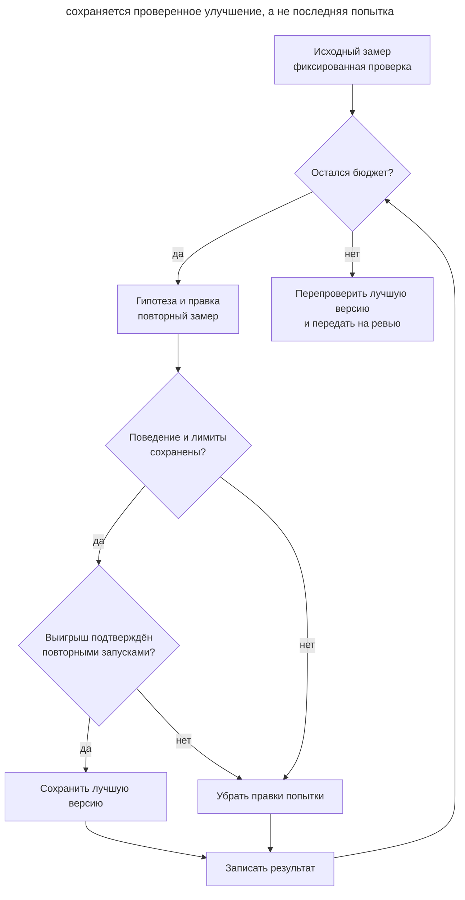

# Оптимизация по измерениям

## Назначение

Поручить агенту серию ограниченных экспериментов над производительностью программы и сохранить улучшения, подтверждённые повторными измерениями и проверкой поведения.

## Также известен как

Benchmark-guided optimization, measured optimization, цикл экспериментов, autoresearch loop.

## Проблема

Вы просите ускорить поиск. Агент добавляет кэш результатов, показывает красивую цифру и предлагает принять изменение. В замере повторяется один запрос, поэтому ответ всегда есть в кэше. На реальных запросах выигрыш исчезает, а память и сложность остаются.

Даже подходящий бенчмарк может обмануть. Соседний процесс нагрузил машину, один запуск оказался удачным, а агент принял шум за ускорение. После десяти попыток трудно понять, какая версия была лучшей и что именно сравнивали. Если разрешить менять проверку вместе с кодом, результат можно улучшить сокращением нагрузки или пропуском работы.

## Решение

Перед экспериментами зафиксируйте рабочую нагрузку, способ измерения и проверяемое поведение. Выберите основную метрику, например время обработки, и ограничения, которые улучшение обязано сохранить: корректность, память, совместимость. Ускорение, нарушившее ограничение, отклоняется.

Получите исходный результат несколькими запусками. Агент выдвигает гипотезу, меняет код в разрешённой области, повторяет ту же проверку и записывает результат. Подтверждённый выигрыш становится новой точкой сравнения; неудачная попытка остаётся в журнале, а её правки убираются. Проверяющий код и данные сохраняют прежними на протяжении серии.

Ограничьте и отдельный запуск, и всю серию. По исчерпании бюджета агент возвращает лучший проверенный вариант и оставшиеся вопросы. Если улучшения нет, исходная реализация остаётся результатом. Истечение бюджета завершает поиск, но не подтверждает достижение цели. Вы принимаете изменение после повторной проверки и оценки его сложности.

## Структура

Схема показывает, как результат отдельного эксперимента меняет лучшую сохранённую версию.



Журнал сохраняет и отклонённые эксперименты. Лучшая версия закреплена отдельным коммитом. При остановке серии агент отделяет от неё правки незавершённой попытки и сообщает, какие проверки успел выполнить.

## Участники / Компоненты

- **Вы** выбираете нагрузку, ограничения, бюджет и принимаете итоговое изменение.
- **Агент** предлагает гипотезы, проводит эксперименты и сохраняет результаты.
- **Проверяющий стенд** измеряет одну и ту же работу и проверяет корректность.
- **Исходная и лучшая версии** позволяют повторить сравнение и восстановить проверенный код.
- **Журнал экспериментов** связывает гипотезу, версию кода, условия, измерения и решение.

## Когда применять

- Есть повторяющаяся дорогая операция и воспроизводимая нагрузка для неё.
- Возможны несколько реализаций, а выбор между ними требует измерения.
- Производительность имеет значение для задачи, и корректность можно проверить отдельно.

Если причина задержки неизвестна, сначала примените подход из [диагностики через гипотезы](hypothesis-driven-debugging.md): воспроизведите замедление и проверьте возможные причины. Серия оптимизаций полезна, когда вы уже знаете, какую работу и почему стоит ускорять.

## Последствия и компромиссы

- ➕ Решение опирается на сравнимые замеры и сохранённые результаты.
- ➕ Неудачные попытки дают сведения для следующей гипотезы.
- ➕ Общий бюджет ограничивает стоимость поиска.
- ➖ Нерепрезентативная нагрузка направляет поиск к бесполезным улучшениям.
- ➖ Повторные запуски и проверка корректности требуют времени и ресурсов.
- ➖ Локальный выигрыш может не окупать сложность или не влиять на пользовательскую задержку.

## Реализация

### Что не зависит от агента

#### Подготовка измерения

Это обычная задача для агента. Начните с имеющегося профилировщика, нагрузочного теста или бенчмарка проекта. Выберите сценарии из реальной работы: размеры входа, распределение запросов, холодный старт и прогретое состояние там, где оба важны. Отдельная проверка должна подтверждать результат операции, включая порядок, ошибки и побочные эффекты, если они входят в контракт.

Согласуйте одинаковое окружение и несколько повторов. Чередуйте запуски кандидата и текущей лучшей версии в одной серии измерений, чтобы изменение нагрузки на машину не стало мнимым выигрышем. Для времени выполнения можно сравнивать медианы, сохраняя отдельные замеры и разброс. Порог полезного выигрыша выберите до экспериментов с учётом шума исходных запусков; разброс оценивайте заново и для каждой новой лучшей версии. Зафиксируйте стенд и данные в репозитории. Если обнаружилась ошибка измерения, исправьте её отдельно и получите новый исходный результат для сравнения.

##### Пример

```text
Подготовь измерение времени построения поискового ответа
```

#### Серия экспериментов

Запишите область изменений и бюджет в задаче. Например, вы разрешаете менять модуль поиска и выделяете восемь попыток или 45 минут, смотря что закончится раньше. В это время входят исходные замеры и итоговая проверка; заранее оставьте на неё часть времени. На зависший запуск нужен отдельный таймаут. Начинайте попытку, только если её таймаут истечёт до начала резерва. Если итоговая проверка не уложилась в общий бюджет, агент отмечает её незавершённой. Такой предел — ваш выбор для задачи, а не свойство модели.

После подтверждения плана агент работает в отдельной ветке или [worktree](isolated-parallel-work.md). Каждой попытке соответствует проверяемая гипотеза и сохранённая версия кода. Лучший результат закрепляется коммитом. Журнал и сырые замеры храните вне области, которую агент восстанавливает при отклонении попытки. В журнал попадают и сбои, и превышение памяти, и отсутствие выигрыша. При отклонении агент убирает только правки этой попытки и продолжает от лучшей версии. Лимит включает исправления неудачных экспериментов: авария не обнуляет счётчик.

##### Пример

Условия серии уже записаны в тикете:

```text
PERF-42
```

#### Приёмка лучшей версии

В конце повторите сравнение исходной и выбранной версий в тех же условиях, затем запустите нужные тесты и обязательные проверки проекта. Проверьте, что итоговый дифф не меняет зафиксированные стенд, данные и тесты корректности. Дополнительная нагрузка, которую не использовали для подбора, помогает заметить подгонку под рабочий бенчмарк. Вы проверяете, окупает ли выигрыш новую сложность и сохраняется ли совместимость. Если повторная проверка не подтверждает выигрыш, сохраняйте исходную версию и журнал выводов.

Результат включает дифф, версии кода, условия запуска, замеры и отклонённые гипотезы. Если цель касается производственной нагрузки, продолжите [проверку после деплоя](give-agent-a-way-to-verify.md#проверка-после-деплоя). Успех микробенчмарка устанавливает только тот выигрыш, который он измерял.

##### Пример

```text
Перепроверь лучший вариант PERF-42 на сценариях из приёмки
```

## Пример

В учебной задаче поиск сортирует все найденные документы, хотя ответ содержит только первые 20. Вы фиксируете несколько наборов запросов, проверку точного результата и лимит памяти 64 МБ. Исходные запуски дают медиану 42,1 мс с колебаниями около 2%; полезным считаете выигрыш от 5%. Ниже сводка журнала с условными метками версий; отдельные замеры сохранены рядом. Числа иллюстрируют механизм, а не результат запуска в репозитории книги.

```console
trial  rev   runs  median_ms  min_ms  max_ms  peak_mb  correct  decision
0      base  7     42.1       41.4    42.8    18       pass     baseline
1      try1  7     41.8       41.0    42.6    18       pass     discard: small gain
2      try2  7     28.4       27.9    29.0    19       pass     keep: top-k selection
3      try3  7     23.1       22.7    23.6    19       fail     discard: tie order
4      try4  7     24.0       23.5    24.5    96       pass     discard: memory
```

Вторая попытка сохраняет точный порядок при равных оценках и выбирает нужные документы без полной сортировки. Третья быстрее, но меняет этот порядок; четвёртая превышает лимит памяти. После четвёртой попытки наступает время, оставленное для итоговой проверки. Правки отклонённых попыток уже убраны, рабочая версия совпадает со второй попыткой. Агент повторяет её проверку на дополнительных запросах. Вы получаете изменение с подтверждёнными границами применимости и журналом, который объясняет отказ от более быстрых вариантов.

## Антипаттерны и частые ошибки

- **Один удачный запуск.** Повторите сравнение и посмотрите разброс, прежде чем приписывать разницу коду.
- **Изменение мерки.** Сокращение данных или ослабление проверки делает результат несравнимым. После необходимой правки стенда измерьте исходную версию заново.
- **Только скорость.** Нарушение контракта, рост памяти или несовместимость отменяют выигрыш.
- **Подгонка под пример.** Один повторяющийся запрос награждает кэш, который не помогает реальной нагрузке.
- **Бесконечный поиск.** Таймаут одной попытки не ограничивает стоимость всей серии. Нужен общий предел и сохранённый результат на момент остановки.
- **Последняя версия вместо лучшей.** Неудачный эксперимент не должен вытеснять проверенное улучшение.
- **Ускорение любой ценой.** Небольшая экономия может не оправдать сложную новую ветку кода.

## Известные применения

- **Google** в [кейсе оптимизации ADK](https://developers.googleblog.com/optimizing-a-200000-line-python-codebase-overnight-with-gemini-4-argon/) описывает шесть предложений агента, из которых приняли два. Независимый бенчмарк выявил отсутствие сквозного выигрыша у одной переделки; хрупкие решения отклонили на ревью. Внутренние тесты потребовали исправить совместимость оптимизации импортов до принятия. Это опыт одного проекта.
- **Andrej Karpathy, autoresearch** задаёт [фиксированную оценку, изменяемый файл и журнал попыток](https://github.com/karpathy/autoresearch/blob/228791fb499afffb54b46200aca536f79142f117/program.md). Исходный эксперимент посвящён обучению модели и продолжается до ручной остановки. Здесь механизм перенесён на оптимизацию программы с явным общим бюджетом.

## Связанные паттерны

- [Петля обратной связи](give-agent-a-way-to-verify.md) проверяет выполнение задачи; здесь несколько корректных вариантов сравниваются по измеряемому выигрышу.
- [Эвалы рабочего процесса](agent-workflow-evals.md) оценивают инструкции и поведение агента. Здесь измеряется программа, которую агент меняет.
- [Диагностика через гипотезы](hypothesis-driven-debugging.md) устанавливает причину сбоя до выбора исправления; тот же подход применим к неизвестной причине замедления.
- [Изолированная параллельная работа](isolated-parallel-work.md) отделяет эксперименты от других задач. Параллельные замеры на общей машине могут мешать друг другу.
