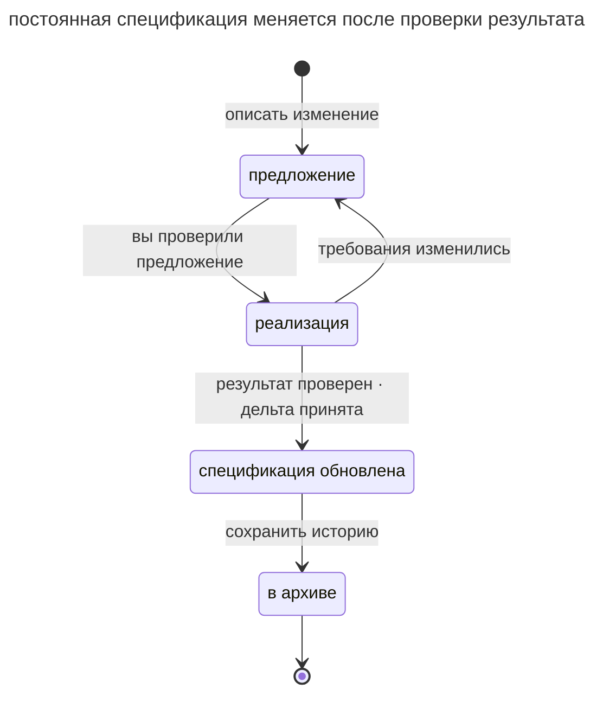

# OpenSpec

_Команды и возможности OpenSpec 2.1.1 проверены 21 ноября 2026 года._

[OpenSpec](https://github.com/Fission-AI/OpenSpec) от Fission-AI организует [SDD](spec-driven-development.md) вокруг **изменения** с этапами propose, review, apply и archive. Постоянные спецификации описывают систему, а дельты фиксируют предлагаемые изменения требований.

OpenSpec поддерживает разные кодинг-агенты и ассистенты, включая Claude Code, Codex, Cursor и GitHub Copilot.

## Рабочий процесс

OpenSpec сохраняет требования между задачами. Вы обсуждаете конкретное изменение, проверяете предложение и только затем переходите к реализации. Подключение инструмента описано в [официальном руководстве](https://openspec.dev/docs/installation).

Скилл `/openspec-explore` помогает исследовать код и сравнить подходы. Когда задача понятна, `/openspec-propose` готовит пакет: причину изменения, дельту требований, технический подход и задачи. Вы проверяете, правильно ли описано нужное поведение, включая ошибки и пограничные случаи.

После согласования `/openspec-apply-change` выполняет задачи. Если по ходу работы меняются требования, сначала обновите предложение и связанные артефакты. При завершении `/openspec-archive-change` предлагает перенести дельты в постоянные спецификации и сохраняет пакет в архиве. Подробности процедур — в [документации OpenSpec](https://openspec.dev/docs/quickstart).

Схема показывает, как предложение становится новым состоянием спецификации.



Пока дельта не принята, постоянная спецификация описывает прежнее поведение. Архив хранит основания изменения; порядок архивирования относительно мержа команда выбирает в своём процессе.

Например, вы хотите изменить политику отключения вебхука:

```text
/openspec-propose отключать вебхук после десяти неудач подряд
```

Агент готовит предложение, вы проверяете новый порог и сценарии, затем переходите к реализации. В Codex скиллы вызываются с `$`, например `$openspec-propose`; выбирайте доступный скилл в меню своего агента.

## Артефакты

Каталог _openspec/_ разделяет постоянные спецификации и пакеты изменений.

| Путь | Что лежит |
| ------ | ----------- |
| _openspec/specs/_ | Постоянные спецификации — актуальная модель того, что _уже построено_ |
| _openspec/changes/\<изменение\>/proposal.md_ | Зачем меняем |
| _openspec/changes/\<изменение\>/specs/_ | Дельты требований с конкретными сценариями |
| _openspec/changes/\<изменение\>/design.md_ | Технический подход |
| _openspec/changes/\<изменение\>/tasks.md_ | Чек-лист реализации |
| _openspec/changes/archive/_ | Завершённые изменения |

## Пример изменения требования

В сервисе доставки событий вебхук отключается после пяти неудач подряд. Постоянная спецификация в _openspec/specs/webhooks/spec.md_ содержит это правило.

```markdown
### Requirement: Delivery failure cutoff
Система SHALL отключать вебхук после пяти неудачных попыток подряд.

#### Scenario: Failed deliveries reach cutoff
- **WHEN** пятая подряд попытка доставки завершается неудачей
- **THEN** вебхук отключается
```

Команда согласовала другой порог для временно недоступных получателей. В пакете изменения агент создаёт дельту в _openspec/changes/raise-cutoff/specs/webhooks/spec.md_. Для изменяемого требования он сохраняет заголовок и приводит новое требование со сценарием целиком.

```markdown
## MODIFIED Requirements

### Requirement: Delivery failure cutoff
Система SHALL отключать вебхук после десяти неудачных попыток подряд.

#### Scenario: Failed deliveries reach cutoff
- **WHEN** десятая подряд попытка доставки завершается неудачей
- **THEN** вебхук отключается
```

В этом примере `MODIFIED Requirements` обозначает замену существующего требования. После реализации и проверки команда подтверждает sync при `/openspec-archive-change`. В постоянном _spec.md_ требование `Delivery failure cutoff` теперь содержит порог десять и соответствующий сценарий; маркер `MODIFIED Requirements` остаётся частью дельты в архиве. Если предложение отклонено, постоянное правило с порогом пять не меняется. Формат разделов и сценариев описан в [документации OpenSpec](https://github.com/Fission-AI/OpenSpec/blob/main/docs/concepts.md).

## Чем отличается

- Постоянные спецификации описывают текущее требуемое поведение системы.
- Дельта фиксирует разницу между текущими и предлагаемыми требованиями.
- Процесс рассчитан на последовательные изменения существующей кодовой базы.
- Общие спецификации помогают команде согласовать требования и историю их изменения.

## Когда выбирать

OpenSpec подходит для существующей системы, требования к которой нужно поддерживать вместе с кодом. Для процесса на основе скиллов с обязательными контрольными точками рассмотрите [Superpowers](superpowers.md), а для работы через трекер задач сравните [пак Мэтта Покока](matt-pocock-skills.md).
