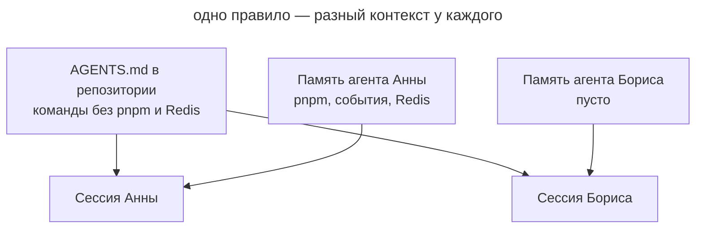

# Приватная память

## Также известен как

Private agent memory, auto memory, Memories, личная память агента.

## Контекст

Агент умеет сам вести заметки о проекте и подгружать их в следующих сессиях. Вы поправили его в чате или сказали «запомни», и он записал вывод в свою память. Эта память хранится вне репозитория: в домашнем каталоге на вашей машине или в аккаунте у вендора. В Claude Code такая память включена по умолчанию.

## Проблема

Знания о проекте оседают в личной памяти агента, а не в репозитории. Правило, которое агент вывел из ваших поправок, работает только на вашей машине. У коллеги, в CI и в другом агенте его нет. Каждый участник команды постепенно получает собственный контекст, и один и тот же запрос приводит к разному поведению агента у разных людей.

## Почему так делают

- Память включена по умолчанию, и о её существовании узнают только по сообщению «Saved 2 memories».
- Сказать «запомни» быстрее, чем открыть _AGENTS.md_ и сформулировать правило для всех.
- Поправка помогает сразу: на вашей машине агент перестаёт ошибаться, поэтому проблема не видна.
- Память кажется личной настройкой, вроде темы редактора, хотя в ней копятся факты о коде и командах проекта.

## Последствия

- ➖ Агент ведёт себя по-разному у разных людей, и баг «у меня агент так не делает» невозможно воспроизвести.
- ➖ Правила не проходят ревью: никто не видит, что агент вывел из поправок и не ошибся ли он.
- ➖ Записи устаревают незаметно. Проект переехал на другой пакетный менеджер, а память по-прежнему подсказывает старый.
- ➖ Знания уходят вместе с человеком или машиной: новый ноутбук или новый коллега начинают с нуля.
- ➖ Память и _AGENTS.md_ расходятся, и агент получает противоречивые инструкции из двух источников.

## Признаки

- В интерфейсе агента появляются сообщения о сохранённых или прочитанных воспоминаниях.
- Коллега жалуется на ошибку агента, которую вы давно «исправили».
- В _AGENTS.md_ нет правила, которое агент у вас соблюдает без напоминания.
- Вы говорите агенту «запомни», а не «добавь в AGENTS.md».
- В каталоге памяти агента лежат команды сборки, соглашения и границы модулей.

## Как лучше

Выключите память агента в командном проекте так, чтобы настройка лежала в репозитории и действовала у всех. Глобально память можно оставить для личных проектов: выключение в проекте её перекрывает. Всё, что агент должен знать о проекте, записывайте в [память проекта](agents-md-memory.md), [словарь домена](domain-context-file.md) и другие файлы, которые проходят ревью. Свои предпочтения, например язык ответов или стиль коммитов, вы пишете сами в пользовательский файл инструкций агента. Тогда у каждого правила есть автор и история изменений, а сессии разных людей начинают с одинакового контекста.

### Что не зависит от агента

#### Перенос накопленной памяти

Это обычный промпт, который вы запускаете один раз перед выключением. Агент читает свою память о проекте и раскладывает записи по местам: команды и соглашения в _AGENTS.md_, термины в глоссарий, ваши личные предпочтения в пользовательский файл инструкций. Устаревшие и ошибочные записи он не переносит. Вы проверяете дифф на ревью, после чего агент удаляет исходные записи.

##### Пример

```text
Перенеси свою память по этому проекту в репозиторий
```

#### Правило вместо «запомни»

Когда поправка касается проекта, просите агента дописать правило в _AGENTS.md_, а не запомнить его. Просьба «запомни» адресована агенту, и там, где память включена, запись оседает у него. Правка _AGENTS.md_ попадает в коммит, и команда видит её на ревью.

##### Пример

```text
Добавь в AGENTS.md: зависимости ставим только через pnpm
```

### Claude Code

Сверено с Claude Code 2.1.316 и [документацией памяти](https://code.claude.com/docs/en/memory) на 2026-10-31.

#### Автопамять

Auto memory — встроенная функция, и в локальных сессиях она включена по умолчанию. Claude сам решает, что сохранить, и пишет заметки в _~/.claude/projects/&lt;проект&gt;/memory/_; индекс этих заметок загружается в каждую сессию. Память привязана к репозиторию и машине и не передаётся коллегам, на другие машины и в облачные окружения. На просьбу «запомни» Claude пишет именно в автопамять, а в инструкции проекта — только если попросить об этом прямо.

Попросите Claude выключить автопамять в проекте. Он запишет это в настройки проекта, которые коммитятся вместе с кодом, и автопамять выключится у всей команды, а в остальных ваших проектах продолжит работать. Переключатель в `/memory` выключает её только у вас и сразу во всех проектах.

##### Пример

```text
Выключи автопамять в этом проекте для всей команды
```

### Codex

Сверено с Codex CLI 0.166.0 и [документацией Memories](https://learn.chatgpt.com/docs/customization/memories) на 2026-10-31.

#### Memories

Memories — встроенная функция, по умолчанию выключенная. Если вы её включили, Codex генерирует записи из прошлых сессий и хранит их в _~/.codex/memories/_ общим хранилищем для всей машины. Документация сама советует держать обязательные командные правила в _AGENTS.md_ и называет Memories вспомогательным слоем.

Если Memories у вас включены глобально, попросите Codex выключить их в командном проекте. Он запишет это в конфиг проекта; закоммитьте его, чтобы настройка действовала у коллег. Конфиг проекта Codex читает только в доверенных проектах, и там он перекрывает пользовательский. В Codex CLI 0.166.0 мы проверили это на практике.

##### Пример

```text
Выключи Memories в этом проекте, глобально оставь
```

## Пример

**Было**

> За две недели работы автопамять Анны накопила три записи: «пакетный менеджер — pnpm», «домены общаются через события», «API-тестам нужен локальный Redis». У Анны агент всё делает правильно. Борис берёт задачу в том же репозитории, и его агент запускает `npm install`, напрямую вызывает сервис уведомлений и падает на тестах без Redis.



На схеме обе сессии читают один и тот же _AGENTS.md_, но сессия Анны получает ещё и три правила из её личной памяти. Сессия Бориса их не видит, и тот же запрос приводит к другому результату.

**Стало**

> Анна просит агента перенести память в репозиторий. Три правила попадают в _AGENTS.md_ и проходят ревью, Борис на ревью добавляет к ним команду запуска Redis. В том же PR агент выключает автопамять в настройках проекта. Новая сессия Бориса ставит зависимости через pnpm и вызывает уведомления через событие.

## Связанные паттерны и антипаттерны

- [Память проекта](agents-md-memory.md) — место, куда переезжают правила из личной памяти агента.
- [Словарь домена](domain-context-file.md) принимает термины, которые агент иначе запомнил бы у себя.
- [Раздутая память](bloated-agents-md.md) описывает обратную беду: правила в общем файле есть, но их слишком много.
- [Плановое обслуживание](scheduled-maintenance.md) включает проход по памяти агента для тех, кто её пока не выключил.
