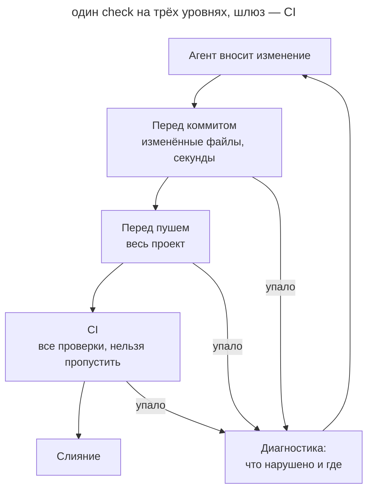

# Шлюзы качества

## Назначение

Закрепить стандарты кода проекта детерминированными проверками, которые запускаются на каждом изменении и валят сборку при нарушении. Агент получает сигнал сразу и исправляется сам, а правило одинаково действует для каждого автора, агента и машины.

## Также известен как

Quality gates, enforcement as code, обязательные проверки, линт-гейты.

## Проблема

Агент пишет много кода и быстро. Стандарты из _AGENTS.md_ вроде «домены общаются только через события» или «не оставляй неиспользуемые зависимости» он соблюдает вероятностно: в длинной сессии правило теряется среди остального контекста. Ревью тоже не справляется. Дифф большой, внимание уходит на стиль, а нарушение границы модуля проходит незамеченным. Каждое такое замечание на ревью машина могла бы сделать за секунду.

Линтеры в проекте часто уже есть, но не работают как шлюз. Одни выдают предупреждения и завершаются успешно, другие запускаются только в редакторе, третьи стоят в хуке, который легко пропустить. Агент такой сигнал не видит или не считает обязательным. У разных людей в команде разные агенты и настройки, и единственное, что видят все, — это репозиторий и CI.

## Решение

Превратите каждое однозначно проверяемое правило в инструмент, который при нарушении завершается с ненулевым кодом. Одна команда `check` запускает все проверки, и CI вызывает ту же команду, поэтому локальный запуск и CI не расходятся.

Проверки разложены по трём уровням. Перед коммитом за секунды проверяются изменённые файлы: форматирование, линтеры, секреты, формат сообщения. Перед пушем проверяется весь проект: типы, полный линт, зависимости. CI запускает всё, включая проверки, которым нужны сеть или база. Хук — это удобство, а шлюзом служит только CI, потому что его нельзя пропустить.

В _AGENTS.md_ записаны команда и правило: изменение не готово, пока `check` не прошёл. Агент запускает её сам, читает диагностику и правит код. Правила ради зелёной сборки не выключают: исключение узкое, на один путь и одно правило, с причиной и решением человека. На старом коде новая проверка падает, поэтому вводите её с baseline: новые нарушения валят сборку, а старые перечислены и разбираются постепенно. Каждую проверку один раз видят падающей, иначе неизвестно, работает ли она.

Инструкция без проверки остаётся советом. Если правило можно проверить, добавьте проверку и уберите строку из _AGENTS.md_.

## Структура

На схеме одно изменение проходит три уровня проверок. Все уровни запускают одну и ту же команду с разным охватом.



Агент получает ошибку на самом раннем уровне, который её ловит, и исправляет её до ревью. Если хук пропустили или он не стоит у коллеги, то же нарушение остановит CI.

## Участники / Компоненты

- **Инструмент проверки** — линтер, тайпчекер, правила архитектуры, сканер секретов — завершается с ненулевым кодом при нарушении.
- **Команда `check`** запускает все проверки одинаково на машине разработчика и в CI.
- **Хуки** запускают быструю часть проверок до коммита и пуша.
- **CI** запускает всё и защищает целевую ветку.
- **Baseline** фиксирует существующие нарушения, чтобы падали только новые.
- **Агент** запускает `check`, читает диагностику и исправляет код.
- **Разработчик** выбирает правила, утверждает исключения и превращает повторяющиеся замечания ревью в проверки.

## Когда применять

- Агент регулярно пишет код в репозитории.
- На ревью повторяются одни и те же замечания.
- В проекте работают несколько людей или несколько агентов.
- Стандарт можно сформулировать однозначно: граница модуля, запрещённый вызов, формат, неиспользуемый код.

## Последствия и компромиссы

- ➕ Агент исправляет нарушения сам, до ревью и без вашего участия.
- ➕ Ревью освобождается для смысла изменения: архитектуры, требований, рисков.
- ➕ Правило одинаково действует у каждого автора, в каждом агенте и на каждой машине.
- ➕ Правила, которые стали проверками, уходят из _AGENTS.md_, и память проекта становится короче.
- ➖ Внедрение на старом коде требует baseline и постепенной чистки.
- ➖ Медленные проверки тормозят цикл агента, поэтому их выносят на уровень пуша и CI.
- ➖ Агент может «чинить» проверку вместо кода: отключать правило или расширять игнор. Исключения нужно смотреть на ревью.
- ➖ Проверка покрывает только формализуемое. То, что требует суждения, остаётся ревью.

## Реализация

### Что не зависит от агента

#### Внедрение шлюзов

Это обычный промпт в режиме планирования. Агент изучает проект: языки, менеджеры пакетов, существующие линтеры, хуки и CI. По стеку он выбирает инструменты, сводит их в одну команду `check`, подключает её к хукам и CI, для старого кода заводит baseline и дописывает правило в _AGENTS.md_. В плане видно, что он добавит, что оставит как есть и почему. После реализации агент показывает, что каждая новая проверка умеет падать.

Выбирать инструменты помогает курируемый список. [Dev Quality Gates](https://github.com/mokevnin/dev-quality-gates) рекомендует по одному инструменту на задачу, с ограничениями, и содержит инструкцию для агента по внедрению ([инструкция](https://github.com/mokevnin/dev-quality-gates/blob/main/docs/adopt.md)). Список ведёт автор этой книги. Запускайте внедрение один раз на проект и повторно, когда меняется стек.

##### Пример

```text
Внедри https://github.com/mokevnin/dev-quality-gates в этот репозиторий
```

#### Проверка из замечания ревью

Это обычный промпт. Когда на ревью второй раз появляется одно и то же замечание, попросите агента превратить его в проверку. Агент подбирает подходящий инструмент или пишет правило для уже подключённого, проверяет его на текущем коде и добавляет в `check`. Сообщение об ошибке стоит написать так, чтобы оно говорило, как исправить нарушение: его читает агент.

##### Пример

```text
Сделай из этого замечания проверку, чтобы CI ловил такое сам
```

### Claude Code

Сверено с Claude Code 2.1.316 и [документацией хуков](https://code.claude.com/docs/en/hooks) на 2026-10-31.

#### Проверка перед завершением ответа

Stop-хук — встроенная функция Claude Code. Хук запускает команду, когда Claude собирается закончить ответ. Если проверка упала, Claude получает её вывод и продолжает работу, а не отчитывается о готовности. Хуки из настроек проекта коммитятся вместе с кодом и действуют у всей команды. Ставьте в такой хук быструю часть проверок, а полную оставьте CI.

##### Пример

```text
Сделай хук для всей команды: перед завершением ответа запускай быстрые проверки и продолжай работу, пока они не пройдут
```

### Codex

Сверено с Codex CLI 0.166.0 и [документацией хуков](https://learn.chatgpt.com/docs/hooks) на 2026-10-31.

#### Проверка перед завершением ответа

Stop-хук — встроенная функция Codex. Если проверка упала, хук возвращает Codex к работе, и причина становится новым запросом. Хуки проекта лежат в репозитории, но загружаются только в доверенном проекте, а новый или изменённый хук каждый участник один раз просматривает и подтверждает в `/hooks`. Поэтому после такого изменения предупредите коллег.

##### Пример

```text
Сделай хук для всей команды: перед завершением ответа запускай быстрые проверки и продолжай работу, пока они не пройдут
```

## Пример

Сервис биллинга живёт с правилом в _AGENTS.md_: домены общаются только через события. Агент добавляет уведомление о неудачном списании и импортирует клиент уведомлений напрямую из соседнего домена. Заодно он ставит пакет для форматирования дат и потом перестаёт его использовать. Ревьюер находит оба нарушения через день, и агент переделывает работу.

Вы запускаете внедрение шлюзов. Агент подключает правило границ между доменами и поиск неиспользуемых зависимостей, сводит их в `check` вместе с уже существующими линтером и тайпчекером, ставит быструю часть в хук перед коммитом, а всё — в CI. Для двух старых нарушений границ он заводит baseline. Строку про события в _AGENTS.md_ заменяет правило «изменение не готово, пока `mise run check` не прошёл».

Следующая похожая задача упирается в проверку до коммита:

```text
src/billing/notify.ts → src/notifications/client.ts
  нарушено: домены общаются только через события
  исправление: опубликуйте PaymentFailed, подписчик в src/notifications
```

Агент публикует событие, удаляет лишний пакет и повторяет `check`. На ревью приходит дифф, в котором уже нет ни того, ни другого, и ревьюер смотрит на саму логику уведомлений.

## Антипаттерны и частые ошибки

- **Проверка только в хуке.** Хук можно пропустить или не поставить. Без CI правило не обязательно.
- **Предупреждения вместо ошибок.** Инструмент, который завершается успешно при нарушении, агент не воспринимает как сигнал.
- **Зелёная сборка любой ценой.** Агент отключает правило или расширяет игнор. Исключения должны быть узкими и проходить ревью.
- **Новая проверка без baseline.** Тысячи старых ошибок заставляют агента либо править всё подряд, либо выключать правило.
- **Проверка, которую не видели падающей.** Неверный путь или конфиг дают вечно зелёный шлюз.
- **Всё и сразу.** Инструменты для категорий, которых в проекте нет, только замедляют цикл.

## Известные применения

- **Dev Quality Gates** собирает по одному инструменту на задачу, описывает уровни запуска, baseline и исключения и даёт агенту инструкцию по внедрению.
- **Репозиторий этой книги** запускает jactionlint, betterleaks, typos, rumdl, agnix и oxlint одной командой `mise run check` через hk, и CI вызывает ту же команду.
- **Борис Черни** рассказывает, что превращает повторяющиеся замечания на ревью в линт-правила, отмечая `@claude` прямо в PR ([подкаст](https://youtu.be/julbw1JuAz0?t=2715)).
- **Бригитта Бёкелер** описывает правила зависимостей и линтеры с советом по исправлению как датчики сопровождаемости для агента ([статья](https://martinfowler.com/articles/sensors-for-coding-agents.html)).

## Связанные паттерны

- [Петля обратной связи](give-agent-a-way-to-verify.md) задаёт проверку конкретной задачи, а шлюзы качества — стандарты всего проекта на каждом изменении.
- [Исполняемые ограничения](executable-guardrails.md) ограничивают действия агента в окружении, а шлюзы качества проверяют код, который он оставил.
- [Память проекта](agents-md-memory.md) хранит команду `check` и правило её запуска.
- [Раздутая память](bloated-agents-md.md) уменьшается, когда проверяемые правила переходят в проверки.
- [Писатель и рецензент](writer-reviewer.md) остаётся для того, что требует суждения.
