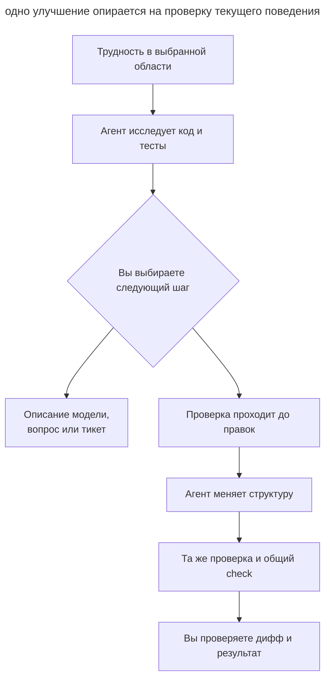
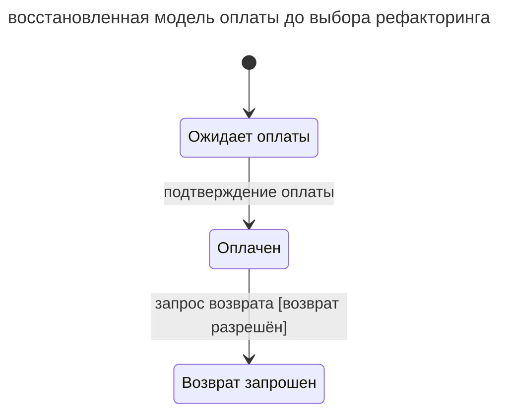
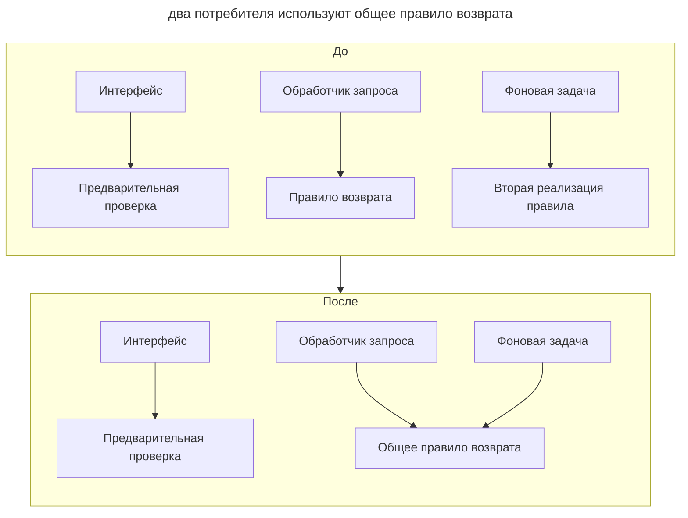

# Рефакторинг

## Назначение

Вместе с агентом упрощать устройство существующего кода небольшими проверяемыми изменениями, сохраняя наблюдаемое поведение. Вы выбираете трудность, которую стоит устранить, проверяете восстановленную агентом модель и принимаете изменение по результатам проверок.

## Также известен как

Agent-assisted refactoring, рефакторинг с агентом, структурное упрощение.

## Проблема

Чтобы добавить одно условие возврата, приходится менять обработчик запроса, фоновую задачу и проверку в интерфейсе. Агент легко находит похожие выражения и предлагает общий хелпер. Но одно выражение может определять предварительную доступность кнопки, другое — окончательное право на возврат. Объединение по сходству кода меняет правило незаметно для вас.

Запрос «улучши архитектуру» оставляет агенту слишком много свободы. Он может добавить слои, переименовать десятки сущностей и обновить зависимости в одном диффе. Даже проходящие тесты мало говорят о сохранении поведения, если агент одновременно переписал их ожидания под новую реализацию.

## Решение

Начните с конкретной трудности: одно правило приходится менять в нескольких местах, переход состояния невозможно проследить или проверка расчёта требует запуска внешних сервисов. В режиме планирования агент исследует выбранную область, связывает выводы с кодом и тестами и предлагает изменение. Вы проверяете, действительно ли оно делает следующую задачу проще.

Разделяйте восстановление модели и её изменение. Описание состояний может оказаться достаточным результатом исследования. Неясное сочетание полей становится вопросом к предметной области; найденная ошибка — отдельной задачей. Рефакторинг меняет структуру, сохраняя [наблюдаемое поведение](https://refactoring.com/).

Перед правками определите, чем проверяется текущий контракт. Если нужного сценария в тестах нет, сначала зафиксируйте его через существующий публичный интерфейс. После подтверждения плана агент выполняет выбранное преобразование и повторяет проверку. Несколько независимых улучшений проходите отдельно, чтобы у каждого была понятная причина и проверяемый результат.

## Структура

Проверка связывает исходное поведение с результатом изменения. Исследование может закончиться описанием модели, вопросом или тикетом без правок кода.



Если проверка после правок падает, агент разбирает расхождение с исходным контрактом. Замена ожидаемого результата требует отдельного обоснования: она может скрывать изменение поведения.

## Участники / Компоненты

- **Вы** выбираете область, проверяете смысл правил и утверждаете план изменения.
- **Агент** исследует код, предлагает преобразование, вносит правки и сообщает результаты проверок.
- **Контракт** задаёт поведение, которое должно сохраниться: результаты, ошибки, внешние вызовы и их порядок.
- **Проверки** наблюдают этот контракт до и после изменения.

## Когда применять

- Небольшая задача регулярно требует согласованных правок в нескольких местах.
- Смысл состояний или бизнес-правил приходится заново собирать из условий.
- Лишние прослойки мешают проследить вызов и понять ответственность модуля.
- Перед новой функцией нужно упростить участок, в котором предстоит работать.

## Последствия и компромиссы

- ➕ Вы оцениваете пользу по конкретной следующей задаче и видите причину каждого изменения.
- ➕ Проверки через публичную границу сохраняют ценность при перестройке внутреннего кода.
- ➕ Исследование выявляет неясные правила до того, как они превратятся в новую абстракцию.
- ➖ При слабом покрытии сначала приходится восстанавливать контракт и добавлять проверки.
- ➖ Агент может принять случайное сходство за общее правило; смысл подтверждаете вы.
- ➖ Широкое изменение общего интерфейса требует согласованной миграции потребителей.

## Реализация

### Подход, который не зависит от агента

#### Выбор изменения и проверка поведения

Начинайте там, где изменение уже даётся трудно. Агент показывает, какие места приходится читать или править вместе, и объясняет, как выбранное преобразование сократит эту работу. Меньше строк само по себе не означает более понятный код. Полезное улучшение может удалить прослойку, объединить подтверждённое правило или сделать расчёт проверяемым отдельно.

Стремясь к минимальному диффу, агент может повторить недостаток соседнего кода. Разрешайте ему предложить более широкое улучшение с объяснением пользы; вы выбираете его границы, учитывая причину трудности и текущие требования.

В плане должны быть видны существующий контракт и проверка, которая его наблюдает. Для расчёта это могут быть результаты и округление, для возврата — также повторный запрос, порядок записи и отправки сообщения, обработка ошибки. Если проверки уже падают, сначала установите причину: сравнивать нужно с понятным исходным состоянием. После правок агент запускает подходящие проверки и общий `check` проекта.

Сохраняйте границы задачи вместе со всеми необходимыми изменениями вызовов и тестов. Если команда контролирует всех потребителей внутреннего интерфейса, их можно обновить одной согласованной правкой. Для внешнего API учитывайте контракт совместимости. Широкую замену разбивайте по expand–contract: добавьте новую форму, перенесите потребителей и лишь затем удалите старую; этот порядок описан в [трассирующих тикетах](tracer-bullet-tickets.md).

Небольшое улучшение удобно сделать перед нужной функцией, отдельным проверяемым шагом. [Постоянный рефакторинг](https://martinfowler.com/bliki/OpportunisticRefactoring.html) дополняется регулярным поиском кандидатов из [планового обслуживания](scheduled-maintenance.md).

##### Пример

```text
Упрости проверку права на возврат в оплате
```

#### Неявные машины состояний

Это обычный промпт для поиска жизненных циклов, спрятанных в статусах, флагах, nullable-полях, датах и условиях. Агент предлагает имена состояний, события, условия и действия переходов и связывает их с кодом и тестами. Такое описание опирается на понятия [состояний и переходов](https://www.w3.org/TR/scxml/#Core); схема помогает увидеть переход, который иначе приходится собирать из нескольких обработчиков.

В описании отделяйте поведение, подтверждённое кодом, от предполагаемых правил. Сочетание «платёж ожидается, дата оплаты заполнена» может быть ошибкой, допустимым промежуточным состоянием или следом старой миграции. Независимые состояния оплаты и доставки уведомления описывайте отдельно: [параллельные состояния](https://stately.ai/docs/parallel-states) не обязаны превращаться в одно перечисление. Сначала вы проверяете модель, затем решаете, нужен ли рефакторинг и какая форма представления подходит.

Начинайте с одной предметной области, где часто добавляются флаги и ветвления. Вопросы о допустимых переходах разбирайте вместе с агентом.

##### Пример

```text
Найди неявные машины состояний в оплате и предложи их описание
```

#### Разрозненные бизнес-правила

Это обычный промпт. Агент ищет одно правило, повторённое в обработчиках, политиках и фоновых задачах, и показывает различия со ссылками на код. Например, право на возврат может по-разному вычисляться в интерфейсе и в задании обработки платежей. Вы выясняете, случайное ли это расхождение или разные правила с похожим условием. Такой проход дополняет [проверку терминов](domain-context-file.md): одинаковое имя ещё не гарантирует одинакового поведения.

Запускайте после серии изменений в одной области или когда одна правка регулярно требует менять несколько мест. Объединяйте реализации после подтверждения общего правила.

##### Пример

```text
Найди бизнес-правила оплаты, которые реализованы в нескольких местах
```

#### Лишние абстракции

Это обычный промпт для поиска прослоек, которые заставляют читать больше файлов, но почти не скрывают сложность. Агент показывает вызывающий код до и после удаления прослойки и объясняет, где окажется её ответственность. В каталоге Фаулера [Inline Class](https://refactoring.com/catalog/inlineClass.html) — обратное преобразование к выделению класса: улучшение может состоять в удалении абстракции.

Проверяйте и точки расширения под будущие требования. Если проект экспортирует один формат, универсальная система плагинов может усложнять единственный сценарий. Перед упрощением агент проверяет реальные вызовы и обязательства расширения: удаление слоя должно сохранять весь текущий сценарий, включая обработку ошибок.

Запускайте по области, где даже небольшая задача требует переходов между множеством файлов. Для разбора выбранного изменения используйте скил из раздела «Архитектура» ниже.

##### Пример

```text
Найди в app/services абстракции, которые можно удалить
```

#### Понятия в примитивах

Это обычный промпт для поиска доменных значений, представленных строками и числами, вокруг которых повторяются проверки, преобразования и сравнения. Агент предлагает имя понятия и его инварианты. Например, деньги могут требовать совместного хранения суммы и валюты, а длительность — явной единицы измерения. [Replace Primitive with Object](https://refactoring.com/catalog/replacePrimitiveWithObject.html) показывает такое направление изменения; польза определяется общим правилом, которое удаётся выразить.

Запускайте по области, где одинаковые значения проверяют в нескольких местах или путают единицы. Согласуйте термин с глоссарием, затем выбирайте представление.

##### Пример

```text
Найди доменные понятия в оплате, спрятанные в строках и числах
```

#### Вычисления и эффекты

Это обычный промпт. Агент показывает, где вычисление цены или решение о возврате смешано с записью в базу, сетевым запросом или отправкой сообщения. Затем предлагает границу, на которой решение можно проверить отдельно. У Фаулера [Separate Query from Modifier](https://refactoring.com/catalog/separateQueryFromModifier.html) отделяет расчёт суммы от отправки счёта.

Запускайте там, где для проверки бизнес-правила приходится поднимать внешние сервисы. При выбранном рефакторинге проверяйте также порядок эффектов, обработку ошибок и транзакционные границы: один и тот же итоговый результат ещё не доказывает сохранения поведения.

##### Пример

```text
Найди в оплате места, где вычисления смешаны с побочными эффектами
```

#### Мёртвый код и обходные пути

Это обычный промпт для поиска неиспользуемых веток, завершённых фиче-флагов и совместимости, которая больше не нужна. Начните с доступных в проекте [проверок неиспользуемого кода](quality-gates.md), затем агент исследует оставшиеся кандидаты. Для удаления нужны сведения о вызывающем коде, точках входа и поддерживаемых версиях. Отсутствие статической ссылки не исключает вызов через конфигурацию, рефлексию или внешнего потребителя.

Запускайте после завершения миграции или удаления старой функции. Если срок поддержки неизвестен, результатом будет вопрос владельцу совместимости, а не удалённая ветка.

##### Пример

```text
Найди в оплате мёртвый код и устаревшие обходные пути
```

#### Архитектура

Это скил `improve-codebase-architecture` из [пака Мэтта Покока](matt-pocock-skills.md) ([исходник](https://github.com/mattpocock/skills/tree/4ae2317ddb22b046e26455e4f9c9b3aaaf62212d/skills/engineering/improve-codebase-architecture)). Он сам подгружает `codebase-design` и `grilling`. План превращается в тикеты скилом `to-tickets` ([исходник](https://github.com/mattpocock/skills/tree/4ae2317ddb22b046e26455e4f9c9b3aaaf62212d/skills/engineering/to-tickets)).

Скил берёт из `codebase-design` словарь: модуль, интерфейс, глубина, шов, адаптер. Затем читает _GLOSSARY.md_ и ADR выбранной области, и сабагент обходит код в поисках трения: чтобы понять одно понятие, приходится прыгать по многим мелким модулям; интерфейс почти так же сложен, как реализация; модули протекают друг в друга через швы. Подозрительные модули проверяются тестом удаления: если удалить модуль, сложность соберётся в одном месте или просто переедет? Кандидатов скил показывает HTML-отчётом во временной папке. По выбранному проводит `grilling` и при желании сравнивает варианты интерфейса через [«Спроектируй дважды»](design-it-twice.md). `to-tickets` превращает согласованный план в проверяемые тикеты с блокирующими связями и публикует их в трекер.

Используйте скил вместе с агентом, когда несколько связанных модулей затрудняют изменения. Сравнивайте варианты интерфейса после выбора конкретной трудности; широкую механическую замену планируйте по expand–contract.

##### Пример

```text
/improve-codebase-architecture app/services
```

После разбора выбранного места запустите `/to-tickets`.

### Claude Code

Сведения об упрощении сверены с Claude Code 2.1.319 и [справочником команд](https://code.claude.com/docs/en/commands) на 2026-11-07.

#### Упрощение: `/simplify`

`/simplify` — встроенный скил. Четыре сабагента параллельно проверяют переиспользование, упрощение, эффективность и уровень абстракции, затем найденное исправляется. Можно передать путь или ссылку на PR. Скил не ищет ошибки корректности ([документация](https://code.claude.com/docs/en/commands)).

Запускайте для упрощения выбранного участка после разбора его поведения. До запуска убедитесь, что проверка текущего контракта проходит. После правок повторите её: оценка читаемости не доказывает, что результаты, ошибки и эффекты остались прежними.

##### Пример

```text
/simplify app/services
```

### Codex

Блок сверен с Codex CLI 0.167.0 и [руководством по рефакторингу](https://learn.chatgpt.com/use-cases/refactor-your-codebase) на 2026-11-07.

[Руководство OpenAI по рефакторингу](https://learn.chatgpt.com/use-cases/refactor-your-codebase) описывает небольшие проходы с проверкой поведения. Общие запросы выше подходят и для Codex.

#### Повторяемый проход как скил

Когда несколько реальных проходов показали, какие входные данные и результаты полезны вашей команде, используйте встроенный скил `$skill-creator` ([документация](https://learn.chatgpt.com/docs/build-skills)). В текущей сессии у него уже есть контекст выполненного прохода. Проверьте созданный скил на другой области, затем включайте его в расписание.

##### Пример

```text
$skill-creator
```

## Пример

В этом учебном примере вы добавляете условие возврата и замечаете, что приходится читать три похожие проверки: в интерфейсе, обработчике запроса и фоновой задаче. В режиме планирования начинаете с модели оплаты:

> Найди неявные машины состояний в оплате и предложи их описание

Агент связывает `status`, `settled_at` и `refund_pending` с состояниями и обработчиками переходов. Упрощённая схема показывает найденный жизненный цикл:



К каждому переходу приложены ссылки на обработчик и тест. Сочетание `status=pending` с заполненным `settled_at` агент отмечает как вопрос: это временное состояние между записями или нарушение? Доставку уведомлений он описывает отдельно, поскольку её повторы не меняют состояние оплаты.

Вы подтверждаете известные переходы и заводите отдельный тикет на спорное сочетание полей. Теперь исследуете повторяющееся правило:

> Найди бизнес-правила оплаты, которые реализованы в нескольких местах

Агент сравнивает все три проверки. Интерфейс лишь предварительно показывает доступность возврата, а обработчик и фоновая задача принимают окончательное решение. Условия двух окончательных проверок совпадают; предварительная проверка имеет другой контракт. Её вы оставляете отдельной.

Для рефакторинга выбираете объединение двух реализаций окончательного решения. До правок тесты через публичные точки входа фиксируют разрешённый возврат, отказ и повторный запрос; там, где покрытия не хватает, агент сначала добавляет проверку. После подтверждения плана он переносит общее правило и обновляет оба вызова, сохраняя условия и порядок эффектов. Те же тесты и общий `check` проходят после изменения.

В диффе видно одно преобразование: общее правило теперь меняется в одном месте. Библиотеку машин состояний вы из этого исследования не выводите; описание модели остаётся полезным само по себе.

Новое условие возврата вы добавляете следующим, отдельным изменением — теперь в одном месте.

На схеме показано, как меняются вызовы: окончательное правило получает одно место реализации, а предварительная проверка остаётся у интерфейса.



## Антипаттерны и частые ошибки

- **Архитектура без трудности.** Агент добавляет слои ради общих принципов; следующую задачу выполнять сложнее. Требуйте объяснения пользы на выбранном участке.
- **Объединение по сходству.** Похожие условия оказываются разными правилами. Подтвердите общий смысл до извлечения хелпера.
- **Сразу библиотека состояний.** Найденные флаги превращаются в зависимость до проверки модели и независимости состояний.
- **Изменение поведения под видом чистки.** Новое условие возврата или новый порядок эффектов требует отдельного решения и проверки.
- **Зелёный тест за счёт новых ожиданий.** Агент подгоняет тест под правку и теряет свидетельство сохранения контракта.
- **Удаление без свидетельств.** Отсутствие статических ссылок не исключает динамические вызовы и внешних потребителей.
- **Попутная переделка.** Переименования и обновление зависимостей скрывают основное преобразование в большом диффе.

## Известные применения

- [Руководство OpenAI по рефакторингу](https://learn.chatgpt.com/use-cases/refactor-your-codebase) описывает работу с существующей кодовой базой небольшими проверяемыми проходами.
- [Встроенный скил Claude Code `/simplify`](https://code.claude.com/docs/en/commands) выполняет проход по возможностям упрощения выбранного кода.
- [Скил `improve-codebase-architecture` Мэтта Покока](https://github.com/mattpocock/skills/blob/4ae2317ddb22b046e26455e4f9c9b3aaaf62212d/skills/engineering/improve-codebase-architecture/SKILL.md) связывает исследование кодовой базы с выбором улучшения вместе с вами.

## Связанные паттерны

- [Плановое обслуживание](scheduled-maintenance.md) организует регулярный поиск кандидатов и разбор результатов.
- [Петля обратной связи](give-agent-a-way-to-verify.md) помогает выбрать проверку поведения.
- [Спроектируй дважды](design-it-twice.md) помогает сравнить варианты выбранного интерфейса.
- [Словарь домена](domain-context-file.md) закрепляет смысл понятий до объединения правил.
- [Трассирующие тикеты](tracer-bullet-tickets.md) задают порядок шагов широкой миграции интерфейса.
- [Фразы для AGENTS.md](agents-md-phrases.md) задают постоянные предпочтения при выборе реализации и границ правки.
