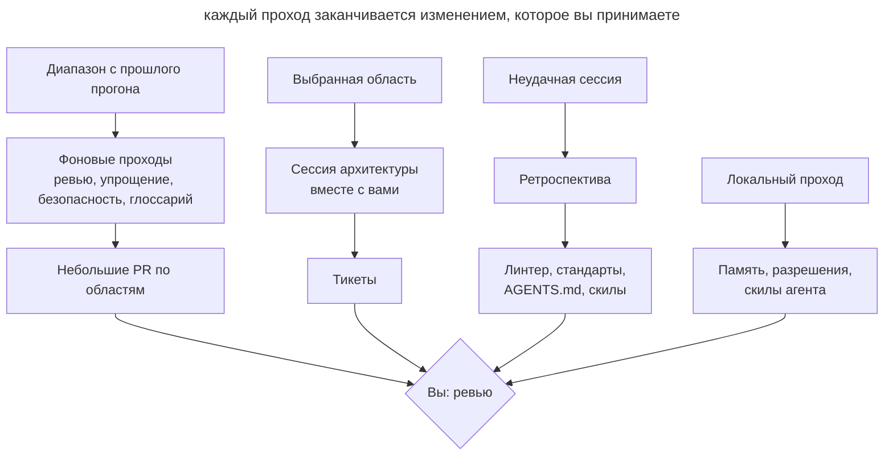

# Плановое обслуживание

## Назначение

Регулярно запускать агента на проходы, которые ищут дрейф кода, документации и агентского окружения, и возвращать результат небольшими PR или тикетами. Каждый проход имеет свою частоту, свою область и свой способ запуска: в облаке, локально или вместе с вами.

## Также известен как

Garbage collection, doc gardening, maintenance routines, регулярные задачи, санитарные проходы.

## Проблема

Агенты пишут десятки тысяч строк в неделю. Ревью каждого PR проверяет только его diff. Если три PR по отдельности нарушают стандарт чуть-чуть и в разных местах, ни одно ревью этого не заметит, а через месяц отклонение станет новой нормой, которую агент копирует дальше.

Вместе с кодом устаревает всё, что помогает агенту работать. Глоссарий не знает о новых моделях, в _AGENTS.md_ копятся правила, которые уже ничего не меняют, скил запуска приложения ссылается на удалённый скрипт, allowlist разрешений разрастается, а в личной памяти агента оседают факты о проекте, которых нет в репозитории. Каждая такая мелочь стоит агенту лишних вызовов и ошибок в каждой следующей сессии.

Разовая чистка «когда станет совсем плохо» не работает: к этому моменту дрейф уже разошёлся по кодовой базе, и исправление превращается в большой рискованный рефакторинг. Ручная еженедельная уборка тоже не масштабируется: команда тратит на неё день и всё равно не успевает за объёмом.

## Решение

Когда кода от агентов много, дрейфует всё сразу: архитектура, границы слоёв, глоссарий, соблюдение стандартов, инструкции для самих агентов. Поэтому проверки не ждут повода, а выполняются регулярно. Всё, что идёт следом за кодом, смотрится раз в неделю: ревью стандартов, упрощение, безопасность, глоссарий, архитектура. Инструкции, скилы, ADR и настройки агента меняются медленнее, их достаточно проверять раз в месяц.

Каждый проход смотрит на конкретный участок: изменения за неделю, каталог, слой или доменное понятие. Проход по всему репозиторию сразу даёт поверхностный отчёт.

Результат каждого прохода должен быть действием, а не отчётом: PR с правками по одной области или тикеты. Отчёт, который никто не превратил в изменение, только добавляет шум.

Отдельно от плановых проходов держите разбор по событию. Ретроспектива сессии полезна сразу после неудачной работы, пока вы помните, что пошло не так. Через неделю разбирать уже нечего.

## Структура

Схема показывает три способа запуска и то, куда приходит результат каждого.



Фоновые проходы работают без вас. При настройке задайте ожидаемый результат: PR с правками или тикеты с подтверждёнными находками. После запуска проверьте, что задача его создала. Находки недельного ревью подсказывают область для сессии архитектуры. Ретроспектива запускается после неудачной сессии; локальные проходы обслуживают сам инструмент.

## Участники / Компоненты

- **Расписание** запускает проходы с заданной частотой и хранит их промпты.
- **Точка отсчёта** задаёт диапазон: тег прошлого прогона или дата.
- **Проход** проверяет одну область на один вид дрейфа.
- **Эталон** описывает норму: стандарты кодирования, глоссарий, ADR, _AGENTS.md_.
- **Результат** оформляет находки как PR или тикеты.
- **Вы** принимаете изменения, выбираете область для архитектуры и отвечаете на вопросы ретроспективы.

## Когда применять

- Агенты пишут больше кода, чем команда успевает внимательно прочитать.
- В проекте есть эталон, с которым можно сверяться: стандарты, глоссарий, ADR.
- Над репозиторием работают несколько людей или несколько параллельных сессий.
- В проекте уже накопилось агентское окружение: инструкции, скилы, хуки, разрешения.

В маленьком проекте с одним разработчиком и редкими изменениями достаточно ретроспективы после неудачных сессий и ежемесячного прохода по инструкциям.

## Последствия и компромиссы

- ➕ Дрейф исправляется мелкими шагами, пока он ещё локален.
- ➕ Инструкции и скилы остаются короткими и соответствуют реальной работе.
- ➕ Фоновые проходы не требуют вашего времени до момента ревью.
- ➖ Недельные PR тоже нужно читать; если они копятся, проходы теряют смысл.
- ➖ Фоновый агент ошибается так же, как любой другой, поэтому его PR проходят обычное ревью.
- ➖ Проходы стоят токенов и лимитов, особенно на больших диапазонах.
- ➖ Расписание устаревает вместе с проектом и само требует пересмотра.

## Реализация

Недельные проходы по коду удобно поставить облачными задачами и задать создание PR как ожидаемый результат. Архитектуру, ретроспективу и обслуживание агента запускайте вручную. Указывайте период явно, например «за последнюю неделю», чтобы диапазон не зависел от сохранённого состояния прошлых запусков. Если изменений много, запускайте проход по каталогам. Раз в месяц проверяйте полезность находок и то, что PR действительно рассматривают.

### Проходы, которые не зависят от агента

Большая часть этих проходов — [скиллы Мэтта Покока](matt-pocock-skills.md). Установите пак одним из описанных в обзоре способов, затем один раз запустите `/setup-matt-pocock-skills`. В примерах ниже указаны имена процедур; способ их вызова зависит от выбранного агента. Встроенные команды разобраны в отдельных блоках после общего подхода.

#### Ретроспектива

Это скил `retro` из инженерной части пака ([исходник](https://github.com/mattpocock/skills/tree/main/skills/engineering/retro)). Модель не вызывает его сама, запускаете только вы.

Скил подгружает `writing-for-agents` как руководство по стилю и читает транскрипт сессии, по умолчанию текущей. Улучшения он ищет в семи категориях: навигация по проекту, автоматические проверки, стандарты для ревью, _AGENTS.md_, экономия вызовов, правила, которые ничего не меняют, и доступ к информации. Механическое нарушение он предлагает ловить линтером, хуком или CI, а в стандарты записывать только то, что требует суждения. Кандидатов показывает по убыванию важности и сам ничего не меняет.

Запускайте сразу после сессии, где агент буксовал: много исправлений, откат, долгий поиск, повторная ошибка. Принятые предложения реализуйте в этой же сессии.

##### Пример

```text
/retro
```

#### Ревью стандартов

Это скил `code-review` из пака ([исходник](https://github.com/mattpocock/skills/tree/main/skills/engineering/code-review)).

Скил берёт diff от точки отсчёта (`git diff <точка>...HEAD`) и находит документы со стандартами, например _CODING_STANDARDS.md_ и _CONTRIBUTING.md_. Затем запускает два сабагента параллельно: один сверяет diff со стандартами проекта и с базовым списком запахов кода из «Рефакторинга» Фаулера, другой сверяет diff с исходной задачей. Для планового прохода нужна только первая часть. Нарушения делятся на жёсткие и спорные, у каждого есть ссылка на правило.

Запускайте раз в неделю облачной задачей, по отдельной задаче на каждую крупную область.

##### Пример

```text
/code-review за последнюю неделю
```

#### Упрощение

Отдельного скила в паке нет, проход задаётся обычным промптом. Агент ищет в недавно изменённом коде повторы, лишние слои и мёртвый код и сразу их убирает.

Запускайте раз в неделю по 3–5 каталогам с наибольшим числом изменений. Каталоги облачная задача находит сама по `git log --since="7 days ago" --stat`.

##### Пример

```text
Упрости код, который поменялся за последнюю неделю
```

#### Ревью безопасности

Обычный промпт. Агент читает изменения за период и проверяет места, где ошибка стоит дороже всего: авторизацию, платежи, загрузку файлов и вызовы внешних API.

Запускайте раз в неделю облачной задачей по основной ветке.

##### Пример

```text
Проверь на уязвимости изменения за последнюю неделю
```

#### Проверка глоссария

Это скил `domain-modeling` из пака ([исходник](https://github.com/mattpocock/skills/tree/main/skills/engineering/domain-modeling)).

Скил сверяет термины в коде и разговоре с _GLOSSARY.md_ и указывает на противоречия: глоссарий называет понятие одним словом, а код другим, или код ведёт себя не так, как описано. Разрешённый термин он записывает в глоссарий сразу. _GLOSSARY.md_ остаётся только словарём, без деталей реализации. Скил рассчитан на разговор с вами; в облачной задаче спросить некого, поэтому спорные термины уходят в описание PR.

Запускайте раз в неделю облачной задачей.

##### Пример

```text
/domain-modeling за последнюю неделю
```

#### Архитектура

Это скил `improve-codebase-architecture` из пака ([исходник](https://github.com/mattpocock/skills/tree/main/skills/engineering/improve-codebase-architecture)). Он сам подгружает `codebase-design` и `grilling`. План превращается в тикеты скилом `to-tickets` ([исходник](https://github.com/mattpocock/skills/tree/main/skills/engineering/to-tickets)).

Скил берёт из `codebase-design` словарь: модуль, интерфейс, глубина, шов, адаптер. Затем читает _GLOSSARY.md_ и ADR выбранной области, и сабагент обходит код в поисках трения: чтобы понять одно понятие, приходится прыгать по многим мелким модулям; интерфейс почти так же сложен, как реализация; модули протекают друг в друга через швы. Подозрительные модули проверяются тестом удаления: если удалить модуль, сложность соберётся в одном месте или просто переедет? Кандидатов скил показывает HTML-отчётом во временной папке. По выбранному проводит `grilling` и при желании сравнивает варианты интерфейса через design-it-twice. `to-tickets` режет план на вертикальные срезы с блокирующими связями и публикует их в трекер.

Запускайте раз в неделю вместе с вами. Область по очереди: слой или доменное понятие. Выбирайте её там, где недельные ревью и упрощение нашли больше всего.

##### Пример

```text
/improve-codebase-architecture app/services
```

После разбора выбранного места запустите `/to-tickets`.

#### Инструкции для агентов

Это скил `writing-for-agents` из пака ([исходник](https://github.com/mattpocock/skills/tree/main/skills/productivity/writing-for-agents)).

Это справочник о том, как писать документы для агента. Он разбирает указатели на контекст, две нагрузки (на контекст агента и на внимание человека), порядок шагов и справки, критерии завершения и единый источник правды. С ним видны дубли между файлами, разросшиеся документы и запреты, которые тянут внимание к запрещённому сильнее, чем отводят от него.

Запускайте раз в месяц.

##### Пример

```text
/writing-for-agents проверь доки
```

#### Свои скилы

Свои скилы проверяет тот же `writing-for-agents`, для скилов он дополнительно разбирает frontmatter и способ вызова. Описание скила должно называть случаи, в которых он нужен, а шаги должны заканчиваться проверяемым критерием.

Запускайте раз в месяц.

##### Пример

```text
/writing-for-agents проверь скилы
```

#### ADR

ADR проверяет тот же `domain-modeling`. Скил читает _docs/adr_, сверяет решения с кодом и более поздними ADR и проставляет статусы и ссылки.

Запускайте раз в месяц.

##### Пример

```text
/domain-modeling проверь ADR
```

#### Память агента

Отдельной команды нет, нужен обычный промпт. Агент читает свою память о проекте, переносит в репозиторий факты о коде и командах и оставляет в памяти только то, как работать с вами. Где лежит память и как она чистится сама, зависит от агента и описано в его блоке.

Запускайте раз в месяц, локально.

##### Пример

```text
Почисти свою память по этому проекту
```

### Claude Code

Сверено с Claude Code 2.1.316 и [справочником команд](https://code.claude.com/docs/en/commands) на 2026-10-31. Обслуживание установки и памяти выполняется локально. `/schedule` запускает облачные задачи; у ревью также есть облачный режим `/code-review ultra`.

#### Расписание: `/schedule`

`/schedule` — встроенная команда, она же `/routines` ([документация](https://code.claude.com/docs/en/routines)).

Команда создаёт облачную задачу в разговоре: уточняет расписание, репозиторий и запрос. Обычно запуск начинает работу от ветки по умолчанию; события PR и явные настройки могут менять исходную ветку. Результатом может быть отчёт, комментарий или PR. Если нужен PR, задайте это при настройке задачи и проверьте результат запуска. Для новых веток обычно используется префикс `claude/`; ход работы доступен в транскрипте на claude.ai.

##### Пример

```text
/schedule каждый понедельник /code-review за последнюю неделю
```

#### Ревью: `/code-review` и `/review`

В Claude Code есть встроенный скил `/code-review`, который ищет ошибки корректности. Скил проекта с тем же именем, например `code-review` из пака Мэтта Покока, его заменяет, а встроенный остаётся доступен как `/review` ([документация](https://code.claude.com/docs/en/skills)).

##### Пример

```text
/review
```

#### Упрощение: `/simplify`

`/simplify` — встроенный скил ([документация](https://code.claude.com/docs/en/commands)).

Четыре сабагента параллельно смотрят изменённый код: переиспользование существующих хелперов, упрощение, эффективность и уровень абстракции. Найденное сразу исправляется. Ошибки корректности `/simplify` не ищет. Аргументом можно передать путь или PR, поэтому в недельной задаче его запускают по каждому каталогу.

##### Пример

```text
/simplify app/services
```

#### Безопасность: `/security-review`

`/security-review` — встроенная команда ([справочник команд](https://code.claude.com/docs/en/commands), [исходник](https://github.com/anthropics/claude-code-security-review)). Проверки устанавливаемого плагина Security Guidance — отдельный механизм.

Команда берёт diff текущей ветки с веткой по умолчанию в `origin` и ищет инъекции, ошибки авторизации и утечки данных. Диапазон коммитов она не принимает, поэтому её запускают на ветке перед слиянием, а недельный проход по основной ветке остаётся обычным промптом из общего блока.

##### Пример

```text
/security-review
```

#### Память

Автопамять лежит в _~/.claude/projects/&lt;проект&gt;/memory_, а `/memory` показывает записи и управляет её включением ([документация](https://code.claude.com/docs/en/memory)). Это личные заметки инструмента. При ежемесячном проходе переносите подтверждённые командные правила в _AGENTS.md_ через обычное ревью; не рассчитывайте, что фоновая обработка памяти сама обновит репозиторий.

#### Разрешения: `/fewer-permission-prompts`

`/fewer-permission-prompts` — встроенный скил.

Скил читает транскрипты сессий, собирает частые вызовы Bash и MCP только для чтения и предлагает список по приоритету. После вашего согласия дописывает правила в `permissions.allow` общего _.claude/settings.json_.

Запускайте раз в месяц.

##### Пример

```text
/fewer-permission-prompts
```

#### Здоровье установки: `/doctor`

`/doctor` — встроенный скил.

Скил проверяет установку, версию, настройки, плагины, MCP-серверы и хуки. Предлагаемые изменения разрешений оценивайте отдельно от диагностики. Для проверки _AGENTS.md_ используйте проход `writing-for-agents`: сверьте команды с текущим проектом, удалите дубли и подтвердите результат на реальных задачах.

Запускайте раз в месяц, после `/fewer-permission-prompts`.

##### Пример

```text
/doctor
```

#### Скилы: `/skill-doctor`

`/skill-doctor` — встроенная команда, доступная с версии 2.1.252 ([документация](https://code.claude.com/docs/en/skills#find-unused-skills)). Для отчёта требуется доступ к загрузке feature flags; через Remote Control команда недоступна.

Отчёт показывает стоимость в контексте и использование поддерживаемых скиллов; встроенные и корпоративные скиллы в него не входят. Claude Code загружает скиллы проекта, пользователя, плагинов и других поддерживаемых источников. При установке редактируемых файлов проверьте каталог _.claude/skills/_ или ссылки на общие файлы; при установке плагина проверяйте сам плагин.

Запускайте раз в месяц.

##### Пример

```text
/skill-doctor
```

#### Запуск приложения: `/run-skill-generator`

`/run-skill-generator` — встроенный скил.

Скил пишет проектный скил, который учит `/run` и `/verify` собирать, запускать и проверять ваше приложение с чистого окружения. Если записанный скил перестал работать, `/run` сам предлагает его обновить. Claude правит файл, только когда запуск пошёл не так.

Запускайте раз в месяц и каждый раз, когда `/run` сообщает, что скил устарел.

##### Пример

```text
/run-skill-generator
```

### Codex

Сверено с Codex CLI 0.166.0 и документацией на learn.chatgpt.com на 2026-10-31.

#### Расписание: Scheduled tasks и `codex-action`

Scheduled tasks создают повторяемые задания в приложении и в веб-среде ChatGPT/Work, когда функция доступна ([документация](https://learn.chatgpt.com/docs/automations)). `openai/codex-action` запускает Codex в GitHub Actions ([документация](https://learn.chatgpt.com/docs/github-action), [исходник](https://github.com/openai/codex-action)).

Локальная задача работает в проекте или отдельном worktree; для неё компьютер и приложение должны быть включены. Веб-задача использует доступные ей файлы, скиллы, плагины и подключённые инструменты, но не получает прямого доступа к локальной папке. Задачи выполняются без вашего участия, поэтому заранее проверьте разрешения и песочницу. Action запускает `codex exec` по событиям GitHub, включая cron, и не зависит от вашей машины. Для создания PR нужен отдельный шаг.

##### Пример в приложении

В разделе Scheduled создайте задачу с расписанием и промптом:

```text
$code-review за последнюю неделю
```

##### Пример в GitHub Actions

```yaml
on:
  schedule:
    - cron: "0 6 * * 1"
jobs:
  standards:
    runs-on: ubuntu-latest
    permissions:
      contents: write
      pull-requests: write
    steps:
      - uses: actions/checkout@v5
        with:
          fetch-depth: 0
      - uses: openai/codex-action@v1
        with:
          openai-api-key: ${{ secrets.OPENAI_API_KEY }}
          prompt-file: .github/prompts/weekly-standards.md
      - uses: peter-evans/create-pull-request@v7
        with:
          branch: maintenance/weekly-standards
          title: "refactor: weekly standards pass"
```

#### Ревью: `codex review` и `@codex review`

`codex review` — встроенная команда CLI, `/review` делает то же в TUI ([документация](https://learn.chatgpt.com/docs/code-review)). Правила для ревью Codex берёт из раздела `## Code Review Rules` в _AGENTS.md_, поэтому ссылку на стандарты проекта стоит держать там. Автоматическое ревью PR на GitHub (`@codex review`) смотрит один PR и сообщает только о серьёзных проблемах, поэтому недельный проход оно не заменяет.

##### Пример

```text
codex review --base main
```

#### Безопасность: `@codex security review`

Security Review требует доступа к функции, настроенного рабочего пространства и подключённого облачного репозитория ([настройка](https://learn.chatgpt.com/docs/security/security-review)). На дату проверки поддерживаются Enterprise, Business, Edu и Pro; на Plus функция недоступна. В настроенном репозитории комментарий `@codex security review` запускает проверку PR, полный отчёт появляется во вкладке Security Report задачи. Для более широких проверок есть [Codex Security](https://learn.chatgpt.com/docs/security).

##### Пример

```text
@codex security review
```

#### Память: Memories

Memories по умолчанию выключены ([документация](https://learn.chatgpt.com/docs/customization/memories)). Если вы их включили, записи лежат в _~/.codex/memories/_ и генерируются из прошлых сессий. Документация не рекомендует править их руками, поэтому при ежемесячном проходе факты о проекте переносятся в _AGENTS.md_, а генерацию при необходимости отключают через `memories.generate_memories`.

#### Разрешения: правила `.rules`

Песочница (`sandbox_mode`) ограничивает файловую систему и сеть, а политика подтверждений (`approval_policy`) определяет, когда требуется согласование. Экспериментальные правила _.rules_ управляют выполнением команд за пределами песочницы; они дополняют эти границы ([правила](https://learn.chatgpt.com/docs/agent-configuration/rules), [песочница](https://learn.chatgpt.com/docs/sandboxing)).

Правила пишутся как `prefix_rule(pattern=[...], decision="allow" | "prompt" | "forbidden")` в файлах _.rules_: _~/.codex/rules/_ и _.codex/rules/_ в доверенном проекте. Из подходящих правил побеждает самое строгое. Согласие сохранить постоянное разрешение для префикса команды добавляет правило в _~/.codex/rules/default.rules_. Разовое разрешение вызова не означает сохранение такого правила.

Раз в месяц просматривайте файл руками, общие правила переносите в _.codex/rules/_ репозитория, лишние удаляйте.

##### Пример

Проверить, как правила решат конкретную команду:

```text
codex execpolicy check --pretty --rules ~/.codex/rules/default.rules -- git push origin main
```

#### Здоровье установки: `codex doctor`

`codex doctor` — встроенная команда CLI ([документация](https://learn.chatgpt.com/docs/cli/reference)).

Команда проверяет установку, конфигурацию, авторизацию, окружение, Git и терминал. В TUI `/debug-config` показывает слои конфигурации, а `/hooks` показывает хуки и позволяет доверить или отключить их ([документация](https://learn.chatgpt.com/docs/hooks)).

Запускайте раз в месяц.

##### Пример

```text
codex doctor
```

#### Размер _AGENTS.md_

Размер инструкций ограничивает настройка `project_doc_max_bytes`, по умолчанию 32 KiB ([документация](https://learn.chatgpt.com/docs/agent-configuration/agents-md)).

Проверьте инструкции, применимые к рабочему каталогу, и их размер относительно `project_doc_max_bytes`. При большом наборе файлов явно убедитесь, что нужные правила попали в контекст; не считайте наличие файла на диске доказательством загрузки. Совмещайте эту проверку с проходом `writing-for-agents`.

##### Пример

```text
Посчитай, сколько весят все AGENTS.md вместе
```

#### Скилы

Скиллами в Codex управляет настройка `[[skills.config]]` в _config.toml_ ([документация](https://learn.chatgpt.com/docs/build-skills)). Она позволяет отключать выбранные скиллы.

Codex читает _.agents/skills/_ напрямую. Для отключения используется `[[skills.config]]` с `enabled = false`. Использование можно оценивать по сохранённым сессиям, но отсутствие записи в _~/.codex/sessions/_ не доказывает, что скилл не запускался: учитывайте срок хранения и источник истории.

Запускайте раз в месяц.

##### Пример

```text
Какими скилами я не пользовался за последний месяц?
```

#### Запуск приложения

Скрипты подготовки и действия для запуска приложения настраивают в Local environments ([документация](https://learn.chatgpt.com/docs/environments/local-environment)). Раз в месяц запускайте подготовку в чистом worktree и проверяйте, что приложение поднимается с нуля.

## Пример

В проекте за неделю приходит около двадцати тысяч строк, стандарты лежат в _CODING_STANDARDS.md_, код разложен по слоям в _app/_. Каждый понедельник облачная задача запускается с промптом:

> /code-review за последнюю неделю

В понедельник приходят три PR: в _app/services_ два сервиса снова ходят в базу мимо репозиториев, в _app/policies_ появилась проверка роли через строку вместо перечисления, в _app/javascript/pages_ дублируется форматирование дат. Первые два PR вы принимаете после короткого ревью. Третий показывает, что правило про форматирование дат можно проверить линтером, и вы заводите тикет на правило вместо строчки в стандартах.

На сессию архитектуры в эту неделю вы берёте _app/services_: там больше всего находок второй месяц подряд. Отчёт показывает, что сервисы тонкие и почти целиком пересказывают репозитории; выбранное место прорабатывается до плана и уходит тикетами.

## Антипаттерны и частые ошибки

- **Проход по всему репозиторию.** Агент понемногу смотрит всё и находит только очевидное. Задавайте область.
- **Один большой PR.** Правки по всем областям в одном PR невозможно ревьюить, его откладывают, и следующий проход находит то же самое.
- **Отчёт вместо изменения.** HTML-отчёты копятся во временной папке, и ничего не меняется.
- **Ретроспектива по памяти.** Разбор сессий недельной давности опирается на то, что никто уже не помнит.
- **Надежда на ревью каждого PR.** Автоматическое ревью PR ловит ошибки в diff, но не отклонение, которое складывается из многих PR.
- **Обслуживание инструмента вперемешку с проектом.** Правки личных разрешений и памяти попадают в командный PR или, наоборот, командные правила остаются в личных настройках.
- **Расписание без пересмотра.** Проходы, которые давно ничего не находят, продолжают тратить лимиты, а PR от них перестают читать.

## Известные применения

- **OpenAI** описывает в статье [Harness engineering](https://openai.com/index/harness-engineering/) фоновые задачи Codex, которые с регулярной частотой ищут отклонения от «золотых принципов», обновляют оценки качества по доменам и слоям и открывают целевые PR с рефакторингом. Отдельный агент doc-gardening ищет устаревшую документацию. Раньше команда тратила на уборку каждую пятницу, и это не масштабировалось.
- **Скиллы Мэтта Покока** дают готовые проходы для регулярного запуска: `retro`, `code-review`, `domain-modeling`, `writing-for-agents`, `improve-codebase-architecture`.
- **Claude Code** содержит встроенные проверки окружения `/doctor`, `/skill-doctor` и `/fewer-permission-prompts`, а `/schedule` запускает облачные задачи по расписанию.
- **Codex** в документации к Scheduled tasks приводит пример задачи, которая просматривает прошлые сессии и улучшает скилы.

## Связанные паттерны

- [Память проекта](agents-md-memory.md) описывает файл инструкций, который ежемесячный проход держит коротким.
- [Раздутая память](bloated-agents-md.md) показывает, во что превращаются инструкции без регулярной чистки.
- [Словарь домена](domain-context-file.md) задаёт эталон для недельной проверки глоссария.
- [Скиллы](skills-as-packaged-workflows.md) упаковывают проходы так, чтобы их можно было запускать по расписанию.
- [Писатель и рецензент](writer-reviewer.md) разделяет написание и ревью; плановое ревью стандартов работает на уровне недели, а не одного PR.
- [Исполняемые ограничения](executable-guardrails.md) получают новые проверки из ретроспектив и ограничивают фоновые задачи песочницей.
