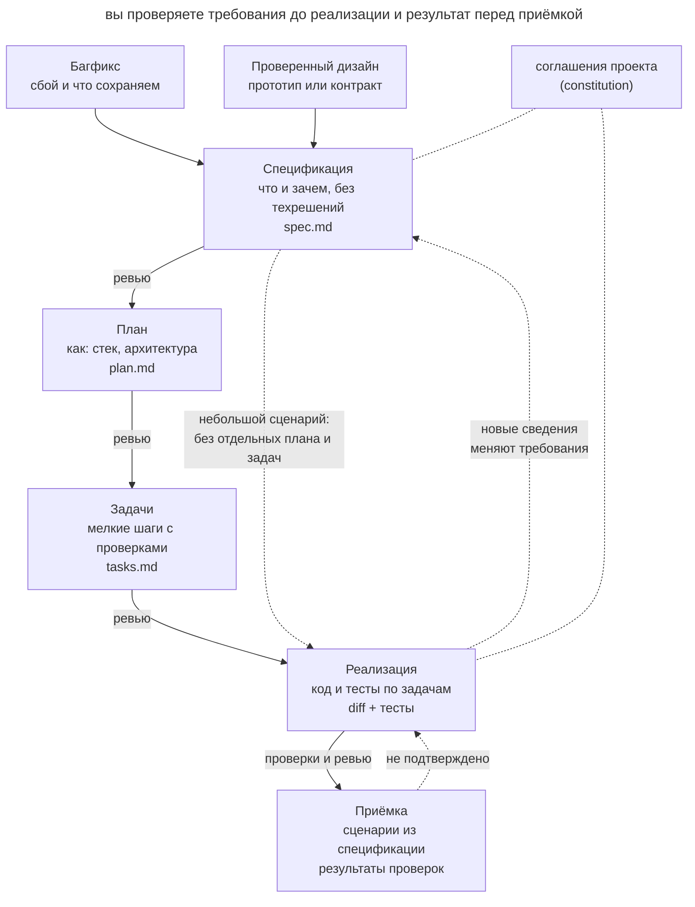

# Спеко-ориентированная разработка

## Назначение

Сохранить цель и требования в согласованной спецификации, которая направляет реализацию и проверку результата. Документы позволяют продолжить работу в другой сессии и оценить соответствие исходному замыслу.

## Также известен как

Spec-Driven Development (SDD), spec-first, «спецификация как источник истины».

## Проблема

При большой фиче требования могут остаться среди сообщений длинного разговора. Новая сессия видит код, но не знает всех договорённостей.

Например, в чате решили отправлять большие отчёты ссылкой. В реализации осталась отправка вложений, и новый агент не может определить, было ли это осознанным ограничением или недоработкой. Без записи требования приходится восстанавливать по памяти автора. Последующие правки могут ещё дальше увести поведение от цели, поскольку сравнивать его не с чем.

Принятие сгенерированного кода без такого сравнения описано в антипаттерне [вайб-кодинга](vibe-coding.md).

## Решение

Перед реализацией согласуйте ожидаемое поведение, ограничения и критерии приёмки в спецификации. Используйте её при выборе подхода, реализации и проверке результата. Один из распространённых процессов состоит из четырёх этапов.

1. **Спецификация** описывает сценарии, требования, ограничения и критерии приёмки.
2. **План** выбирает технический подход после согласования требований.
3. **Задачи** делят план на небольшие шаги с проверяемым результатом.
4. **Реализация и приёмка.** Агент выполняет задачи, сверяясь со спецификацией и планом, а вы принимаете результат по проверкам согласованных сценариев.

На переходе вы проверяете полученный документ. Это позволяет исправить требование до его реализации. Если новые сведения меняют задачу, согласуйте спецификацию и затем приведите код в соответствие с ней.

Приёмка сопоставляет результат с согласованными сценариями. Отдельный план и список задач полезны для большой работы; небольшой сценарий можно реализовать прямо по спецификации. Состав документов и точка входа зависят от задачи.

## Структура

Схема показывает процесс со спецификацией, планом и задачами, который завершается приёмкой.

Постоянные соглашения проекта ограничивают выбор на каждой фазе. Для багфикса исходным материалом служат воспроизведение и поведение, которое нужно сохранить; для проверенного дизайна — его ограничения. Пунктирный путь позволяет небольшому сценарию обойти отдельные план и задачи. Приёмка сопоставляет сценарии с проверками; упавшие или непроверенные случаи возвращают работу к реализации и проверкам. Стрелка к спецификации означает пересмотр требований, когда новые сведения меняют задачу; нарушение действующего требования исправляют в реализации.

## Участники / Компоненты

- **Разработчик** задаёт цель и проверяет документы и результат.
- **Агент** готовит документы и реализует согласованные задачи.
- **Спецификация** хранит требования и критерии приёмки.
- **План и задачи** задают технический подход и порядок реализации.
- **Соглашения проекта** сохраняют общие стандарты и ограничения.

## Когда применять

- Работа занимает несколько сессий.
- Нескольким участникам нужны общие требования.
- Корректность системы нужно сверять с явно заданными сценариями.
- Команда ещё уточняет поведение новой системы.

Для небольшой правки достаточно [четырёх фаз](explore-plan-code-commit.md) или прямой постановки.

## Последствия и компромиссы

- ➕ Требования доступны следующей сессии и другим участникам.
- ➕ Расхождения реализации с замыслом можно проверить по документу.
- ➕ Ошибки требований и подхода могут обнаружиться до написания кода.
- ➕ Актуальная спецификация объясняет ожидаемое поведение после завершения разработки.
- ➖ Подготовка документов увеличивает стоимость коротких задач.
- ➖ Документы нужно обновлять при изменении требований.
- ➖ Чрезмерная детализация реализации в спецификации приводит к [преждевременной спецификации](premature-specification.md).

## Реализация

### Что не зависит от агента

#### Ревью требований

До выбора реализации проверьте, одинаково ли вы и агент понимаете сценарии. Слова «удалить», «доставить» или «по местному времени» допускают разные результаты. Разберите и совместимость требований: например, требование сохранять файл сутки для повторного скачивания противоречит требованию удалять его сразу после отправки. Согласуйте поведение до технического плана; [интервью](let-claude-interview-you.md) помогает собрать недостающие требования.

Для сценариев с доступом к данным запишите, кто вправе выполнить действие и что должно произойти при отказе. Например, пересланная ссылка на отчёт не должна давать доступ другому пользователю. Такие требования влияют на дизайн; их реализацию затем проверяют тестами и ревью. Kiro описывает этот проход как [усиление спецификации требованиями безопасности](https://kiro.dev/blog/spec-it-safe/). Ревью требований дополняет проверки кода и [шлюзы качества](quality-gates.md).

#### Вход в процесс

Для новой фичи начните с требуемого поведения, затем выберите подход и при необходимости разбейте работу на [трассирующие тикеты](tracer-bullet-tickets.md). Если технический подход уже проверен прототипом или задан обязательным контрактом, используйте его как исходное ограничение и согласуйте поведение системы в этих границах. Это отличается от [преждевременного выбора реализации](premature-specification.md), когда цель ещё не выяснена.

Для багфикса сохраните воспроизводящий сценарий, ожидаемый результат и соседнее поведение, которое должно остаться прежним. При исправлении часового пояса расписания меняется время срабатывания, а правила отмены и повторной отправки сохраняются.

Варианты входа описаны в [Kiro](https://kiro.dev/blog/specs-bugfix-and-design-first/): отдельные процессы для багфиксов и работы от технического дизайна. В [варианте Саймона Мартинелли](https://tessl.io/blog/spec-driven-development-works-when-specs-are-system-use-cases) сценарии использования и доменная модель направляют реализацию без отдельной стадии плана и задач.

#### Реализация и приёмка

Агент реализует согласованный объём и запускает проверки для критериев приёмки. При завершении сопоставьте каждый существенный сценарий с тестом, сквозным прогоном или другим наблюдаемым результатом. По [записям окружения](give-agent-a-way-to-verify.md) должно быть видно, что проверено, что упало и что ещё не запускалось. Закрытый список задач и успешная сборка сами по себе не подтверждают все требования.

Если код нарушает действующие требования, исправьте реализацию. Если изменились сами требования, согласуйте спецификацию и обновите проверки вместе с кодом. [Независимый рецензент](writer-reviewer.md) сверяет результат с замыслом и ищет пропущенные случаи. Свидетельства выполнения критериев помогают этому ревью, но не делают проверку реализации ненужной.

#### Готовые процессы

Рабочий процесс можно собрать вручную или использовать готовый тулкит. [OpenSpec](openspec.md) хранит постоянные спецификации и дельты изменений. [Superpowers](superpowers.md) связывает фазы через скиллы и обязательные контрольные точки. [Скиллы Мэтта Покока](matt-pocock-skills.md) сохраняют спецификации и трассирующие тикеты в трекере. Другие инструменты собраны в [полезных ссылках](resources.md) и сравнении [spec-compare](https://cameronsjo.github.io/spec-compare/).

## Пример

Вы добавляете экспорт отчётов по расписанию.

> Добавь экспорт отчётов по расписанию

Агент готовит **спецификацию** для вашего ревью.

> Пользователь выбирает отчёт, расписание и получателей. Система отправляет отчёт не позже пяти минут после назначенного времени. При ошибке сборки она уведомляет получателей о сбое. Удаление отчёта отключает его расписания.

На ревью вы замечаете, что не определён часовой пояс расписания, и уточняете его до реализации. Вы также добавляете требование: получатель должен иметь доступ к отчёту в момент отправки. При отозванном доступе отправка запрещена.

В **плане** агент предлагает cron-воркер и `report_schedules`. Вы указываете уже используемый планировщик, и агент уточняет подход.

**Задачи** последовательно добавляют проверяемые сценарии создания расписания, отправки отчёта, отказа при отсутствии доступа, обработки сбоя и отключения расписаний после удаления отчёта.

При **реализации** выясняется ограничение почтового шлюза в 10 МБ на вложение. Вы фиксируете в спецификации границу: отчёты до 10 МБ включительно отправляются вложением, более крупные — ссылкой. Для нового способа доставки добавляете требование и задачи: при каждом скачивании проверять действующий доступ к отчёту. Отозванный доступ или пересылка ссылки пользователю без прав должны приводить к отказу. Требование о доступе перед отправкой сохраняется при обоих способах доставки.

На **приёмке** вы сопоставляете сценарии с результатами проверок: соблюдение срока отправки в выбранном часовом поясе — с прогоном планировщика, порог размера — с тестами отчётов на 10 и 11 МБ, отзыв доступа — с отказом отправки и скачивания, пересылку ссылки постороннему — с отказом скачивания, уведомление о сбое — с тестом ошибки сборки. В журнале видны успешные проверки этих случаев и отключения расписаний после удаления отчёта. Доставка через реальный почтовый шлюз ещё не проверена: агент помечает этот сценарий как непроверенный, и вы выполняете сквозной прогон до приёмки экспорта.

## Антипаттерны и частые ошибки

- **Документы без ревью.** Непроверенные требования могут перенести ошибку в реализацию.
- **Только успешный сценарий.** Доставка отчёта разрешённому получателю не проверяет отказ пользователю без доступа. Включайте существенные запреты в требования и проверки.
- **Задачи закрыты — требования выполнены.** Сопоставляйте согласованные сценарии с результатами проверок; явно оставляйте статус непроверенных случаев.
- **Устаревшая спецификация.** При изменении поведения обновляйте согласованные требования вместе с кодом.
- **Спецификация-псевдокод.** Детальный порядок вызовов до исследования задачи создаёт [преждевременную спецификацию](premature-specification.md).
- **Избыточный процесс.** Для небольшой обратимой правки полный набор документов может стоить дороже самой работы.
- **Спецификация вместо прототипа.** Дни на исчерпывающие документы до первой рабочей версии разобраны в антипаттерне [«Спецификация наперёд»](big-spec-up-front.md).

## Известные применения

- [OpenSpec](openspec.md), [Superpowers](superpowers.md) и [скиллы Мэтта Покока](matt-pocock-skills.md) разобраны в этом разделе. Общий подход также описан в [анонсе Spec Kit](https://github.blog/ai-and-ml/generative-ai/spec-driven-development-with-ai-get-started-with-a-new-open-source-toolkit/).
- [Microsoft](https://developer.microsoft.com/blog/spec-driven-development-ai-native-engineering/) включает уточнение требований и итоговую валидацию в цикл SDD и рекомендует начинать с лёгкого процесса, расширяя его по необходимости.
- Сравнение других инструментов доступно в [spec-compare](https://cameronsjo.github.io/spec-compare/) и [подборке ссылок](resources.md).

## Связанные паттерны

- [Четыре фазы](explore-plan-code-commit.md) организует согласование и реализацию в масштабе одной задачи.
- [Преждевременная спецификация](premature-specification.md) описывает риск выбора реализации до уточнения требований.
- [Петля обратной связи](give-agent-a-way-to-verify.md) связывает критерии приёмки с проверками и доказательствами из окружения.
- [Писатель и рецензент](writer-reviewer.md) проверяет соответствие реализации согласованным требованиям в отдельном контексте.
