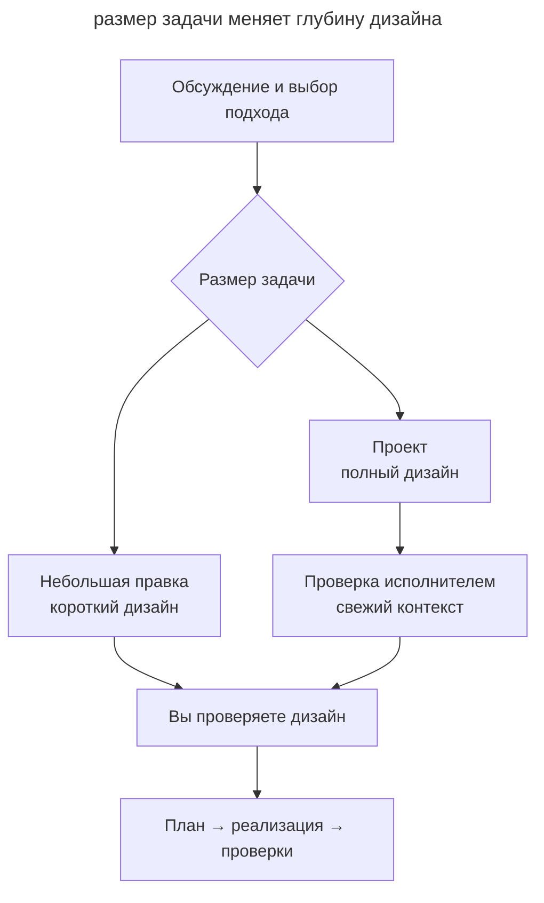

# Superpowers

_Команды и возможности Superpowers 7.0.1 проверены 31 октября 2026 года._

[Superpowers](https://github.com/obra/superpowers) Джесси Винсента (obra) реализует [SDD](spec-driven-development.md) набором [скиллов](skills-as-packaged-workflows.md). Между дизайном и реализацией инструкции задают обязательные контрольные точки с названием HARD-GATE.

## Установка

Основной способ установки использует маркетплейс Claude Code.

```text
/plugin install superpowers@claude-plugins-official
```

Пак также содержит инструкции и манифесты для Codex, Cursor, Antigravity, GitHub Copilot CLI и OpenCode.

## Рабочий процесс

При старте сессии хук загружает `using-superpowers`, который требует проверять применимость скиллов перед ответом. Новую фичу агент обсуждает через `brainstorming`, а баг исследует через `systematic-debugging`.

В `brainstorming` вы уточняете цель и выбираете подход. Для небольшой правки агент записывает короткий дизайн, для проекта — полный. В обоих документах остаются рассмотренные варианты и причины выбора. Перед реализацией вы проверяете документ.



Для проекта `builder check` ищет вопросы, которые помешают исполнителю составить план. Обычно его выполняет свежий сабагент; без такого инструмента агент проводит проверку сам. Небольшая правка проходит сразу к вашему ревью. Однозначную мелкую задачу можно выполнить сразу; согласованный одноразовый spike и явный отказ от интервью также имеют отдельные исключения. См. [brainstorming](https://github.com/obra/superpowers/blob/main/skills/brainstorming/SKILL.md).

После согласования дизайна `writing-plans` готовит задачи с действиями и проверками. Изоляция через `using-git-worktrees` относится к подготовке исполнения. `subagent-driven-development` или `executing-plans` выполняет план; `test-driven-development` задаёт цикл TDD. `requesting-code-review` и `receiving-code-review` поддерживают ревью, а `finishing-a-development-branch` завершает проверенную ветку через выбранный вами merge или PR. `verification-before-completion` требует запускать проверки перед объявлением готовности.

## Артефакты

| Артефакт | Где живёт |
| ---------- | ----------- |
| Дизайн-документ | _docs/superpowers/specs/ГГГГ-ММ-ДД-\<тема\>-design.md_ |
| План реализации | _docs/superpowers/plans/ГГГГ-ММ-ДД-\<фича\>.md_ |

Короткий и полный дизайн хранятся в Markdown. Для проекта проверка исполнителем предшествует вашему ревью. План появляется после согласования дизайна; его расположение можно переопределить. Одноразовый spike заканчивается ответом на вопрос, а сохранение его кода требует нового решения.

## Чем отличается

- Небольшая правка получает короткий письменный дизайн, проект — полный дизайн с дополнительной проверкой.
- Хук помогает агенту выбирать нужную процедуру автоматически.
- Отдельный контекст исполнителя и рецензента разделяет реализацию и оценку.
- План включает шаги red–green–refactor.

## Когда выбирать

Superpowers подходит команде, которой нужен единый порядок с обязательными контрольными точками. Для быстрых правок этот процесс может быть избыточен. Если удобнее хранить результат обсуждений в трекере, сравните [скиллы Мэтта Покока](matt-pocock-skills.md).
